
# 同济大学 RoboMaster 招新培训笔记 · 电控组
> 来源：同济大学（SuperPower）RoboMaster 战队招新培训课件视频笔记，视频见 B 站空间：https://space.bilibili.com/651837546
> 整理：东南大学成贤学院 Solaris（天钺）战队 ｜ 2026-10-17 ｜ 配图均截取自原课件
> 用途：入队新生复习笔记，供战队学习交流使用

## 培训大纲

| 讲次 | 课件 | 核心主题 |
|---|---|---|
| 第一讲 电控导论 | 电控组第一讲：电控导论.pptx | 电控职责定位、C 型板与电机等硬件、软件开发工作流与工具链、学习方法与提问、安全规范、C++ 面向对象铺垫 |
| 第二讲 STM32CubeMX基础 | 电控组第二讲：STM32CubeMX基础.pptx | 单片机/MCU 概念、CubeMX 工程生成、时钟与时钟树、GPIO 八种模式、定时器 PSC/CNT/ARR、PWM 输出与呼吸灯 |
| 第四讲 电机控制（1） | 电控组第四讲：电机控制（1）.pptx | 通信三层模型、UART 串口接线与 DMA、比特率/波特率、CAN 接线与终端电阻、CAN ID 仲裁、收发代码流程 |
| 第五讲 PID控制电机 | 电控组第五讲：PID控制电机.pptx | 开环/闭环控制、P/I/D 各自作用、梯形积分/动态积分/微分先行、双环串级 PID、现场调试经验 |
| 附：电控组大作业 | SP_26赛季招新——电控组大作业.pdf | 蜂鸣器、LED 流水灯、舵机、麦轮底盘运动与功率控制、GitHub commit 规范、入队流程 |

> 说明：第四讲课件文件名为「电机控制（1）」，实际授课内容为电机与开发板之间的 **UART 与 CAN 通信**，电机 PID 控制放在第五讲。

---



## 第一讲 电控导论

本讲是入门第一课，回答五个问题：电控是谁、要和哪些硬件打交道、工作流程是什么、用什么工具、怎样成为合格电控，外加实验室安全规范和 C++ 面向对象的思想铺垫。

### 1.1 电控职责：我们是谁

RoboMaster 比赛中，一台战车要完成**移动、射击、识别**三类动作。队伍分工可以类比人体：

- **机械 = 骨骼**，负责结构与外形；
- **电控 = 大脑和神经系统**，又分为**软件**与**硬件**两部分；
- 电控的目标一句话：**听指令 → 正确行动 → 稳定可靠**，最终「赋予一辆战车生命」。

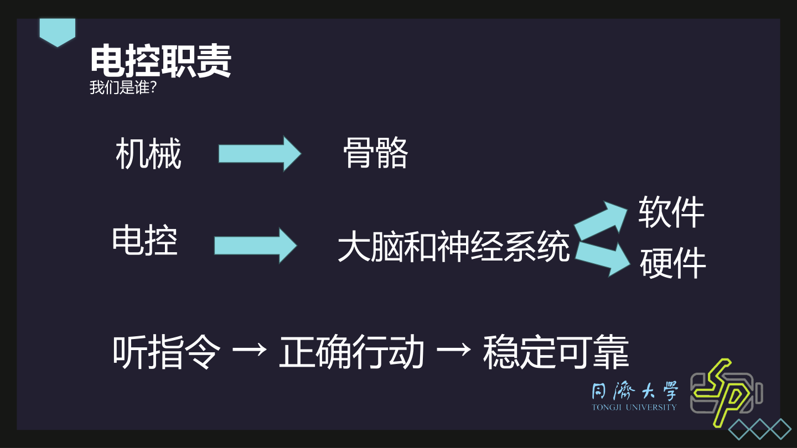

### 1.2 硬件介绍：我们要和哪些物品打交道

队内最核心的控制板是 **RoboMaster C 型板**，本质是一块 **STM32 单片机 + 常用外设**，用来完成四件事：**驱动电机、读传感器、通信功能、烧录代码**。另一件常客是 **M3508 电机**，需要重点了解它的性能参数、通信方式和接线方法。查资料的固定渠道是厂商 Gitee 仓库（如达妙科技 `https://gitee.com/kit-miao`）、RoboMaster 官网 `https://www.robomaster.com/` 与官方社区。

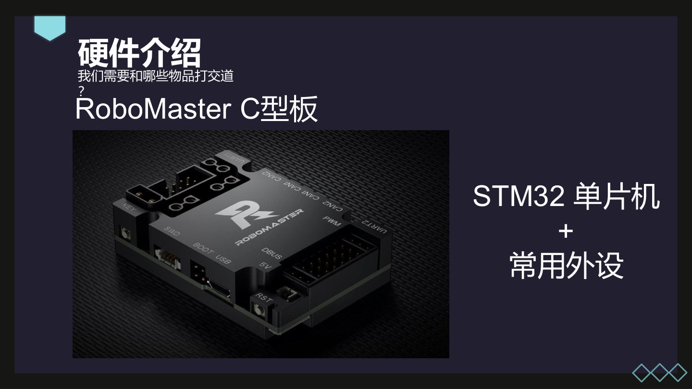

### 1.3 软件开发工作流

软件相关工作可以拆成一条流水线。以「完成麦轮移动」这个功能为例：遥控器输入 → C 板解算 → 电机按解算速度转动。拆成环节就是：

1. **明确功能**（要做什么，如麦轮移动）；
2. **配置芯片**：单片机基本配置，例如遥控器通信配置、CAN 总线配置；
3. **敲代码**：收发数据、解算；
4. **编译**：把代码编译成二进制文件；
5. **烧录**：把二进制文件下载到 C 板中；
6. **调试**：让移动性能更好，发现问题、解决问题，再回到前面的环节迭代；最后**交付**并做代码版本管理。

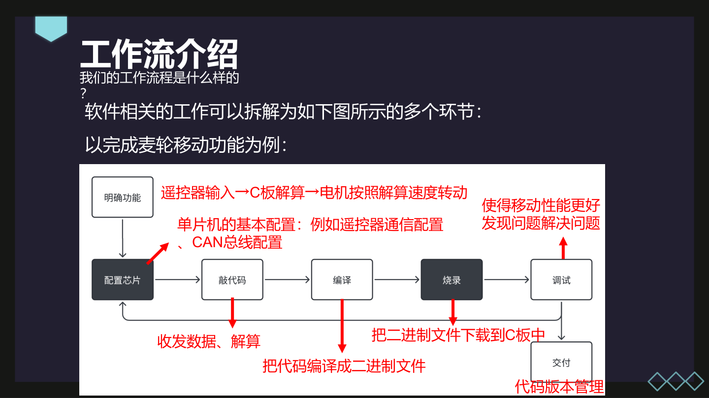

### 1.4 工具链：用什么工具完成工作

队内新工具链的各软件正好落在工作流的对应位置：

| 工作流环节 | 工具 |
|---|---|
| 配置芯片 | STM32CubeMX |
| 敲代码 | VSCode + C/C++ 扩展 |
| 编译 | VSCode 的 CMakeTools 扩展 |
| 烧录 / 调试 | Cortex-Debug 扩展 |
| 看数据曲线（调试） | SerialPlot |
| 交付 / 版本管理 | Git + GitHub |

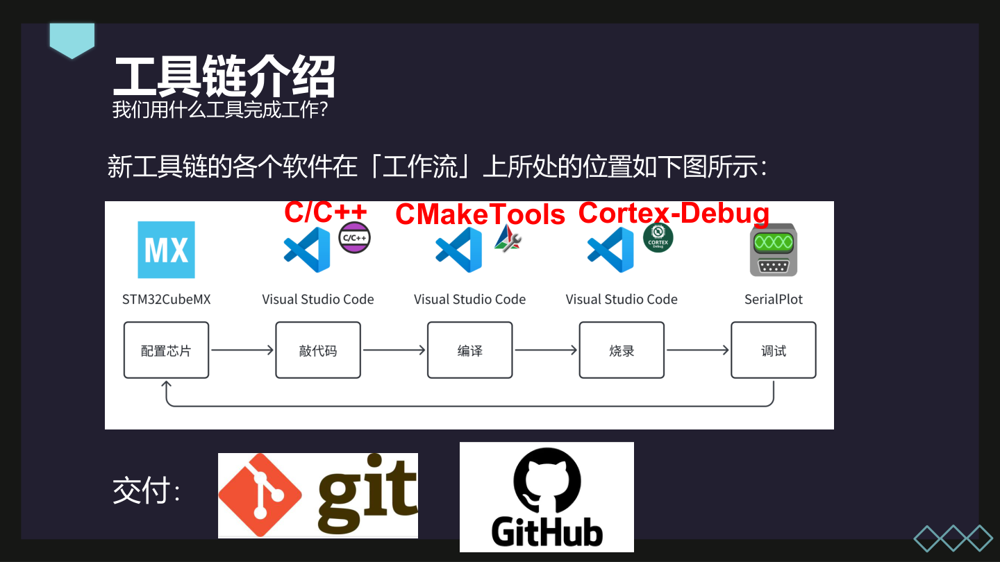

### 1.5 学习方法：搜集信息与学会提问

三种能力并行培养：**搜集信息**（B 站其他战队培训视频、各技术官方第一手文档、RoboMaster 官网及论坛、问学长、实践出真知）、**工程能力**、**提问能力**。

重点是**学会提问**：

- **提问前**：先想清楚疑问点和提问目标；
- **提问时**核心是**提供足够多的信息**：描述问题背景、自己试过的方法、报错信息截图、一切存在有效信息的资料。

反面教材就是「有大佬在吗，我想问个问题」「我的代码出错了，有人能帮帮我吗」——没有背景、没有报错，别人无法回答。

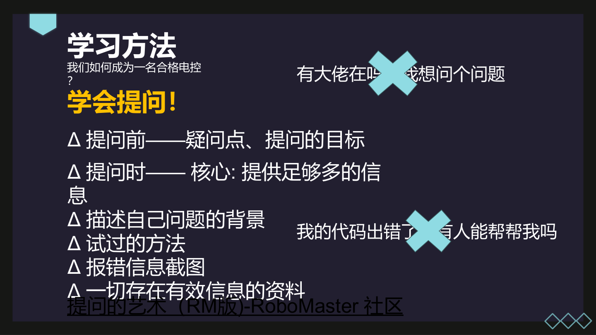

### 1.6 安全规范

- **电池**：离开实验室前确保机器人（或板子）电源关闭；电池放入防爆柜充电；电池若有破损不要再使用。
- **接线**：尽量不要热插拔（带电插拔线材）；使用别人物品前先检查是否存在缺陷。
- **调试**：调试机器人之前先确保遥控器可以正常使电机失能；注意周围人员安全；调 PID 时注意电机可能震荡。

### 1.7 C++ 面向对象铺垫

为什么要用面向对象？以「养一只哈基米（猫）」为例：饲养者只关心如何喂养、外观、性格，不关心它的生理结构——这就是**封装带来的使用方便**。

对应到电机的**使用者**视角，也只需要关心两类信息：**性能参数**（工作电压、扭矩、码盘值……）和**通信相关**（传感器得到什么数据……），内部实现由战队电控中间件 `TongjiSuperPower/sp_middleware` 封装好，调用者不必钻到底层。

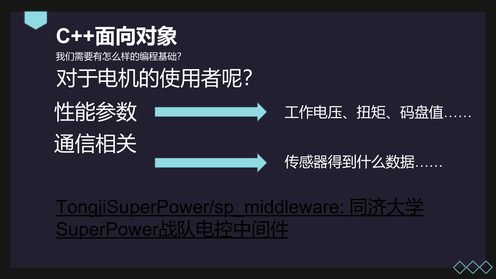

## 第二讲 STM32CubeMX基础

本讲内容：单片机与 STM32 是什么、CubeMX 怎么生成工程、时钟与时钟树、GPIO 八种模式，最后以「点亮 LED → 呼吸灯」实操串起定时器与 PWM。

### 2.1 什么是单片机和 STM32

先区分几个处理器名词：

- **CPU**（Central Processing Unit，中央处理器）：解释指令、处理软件数据；
- **GPU**（Graphics Processing Unit，图形处理器）：专做绘图运算；
- **NPU**（Neural Processing Unit，神经处理器）：专用于 AI 硬件加速；
- **MCU**（Microcontroller Unit，微控制器）：本讲主角。

**单片机（Single-chip Microcomputer）**把中央处理器、存储器、定时/计数器、各种输入输出接口都集成在一块芯片上。优点：便宜、电路简单、体积小、耗电低；缺点（特性）：功能专一、运行频率低。按寄存器位数，4 位用于简单家电，8/16 位用于一般控制领域，32 位用于网络、多媒体等复杂场合。

队内主要使用两种开发板：

| 开发板 | MCU 型号 |
|---|---|
| RoboMaster 开发板 C 型 | STM32F407IGH6 |
| 达妙科技 DM-MC02 | STM32F723VGT6 |

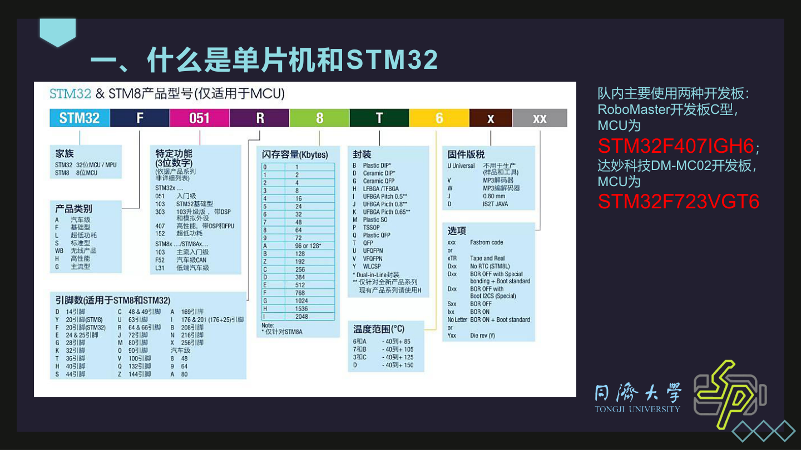

**拿到开发板第一件事：找开发板原理图或 PCB（Printed Circuit Board）图。** 硬件上 PCB 把芯片引脚与各种外设（Peripheral）连接；软件上要根据硬件引脚配置来设置芯片引脚功能，才能写程序。

### 2.2 编译、烧录与开发流程

Python、C、C++ 等高级语言不能直接在单片机执行，需要**编译**成机器语言可执行文件——C 语言执行效率高、代码精简，是最适合单片机开发的高级语言。编译得到的可执行文件存在电脑上，再**烧录**到单片机；烧录分有线和无线，队内一般用正点原子烧录器无线烧录。

电控开发循环六步：

1. 提出某项功能或改进；
2. 根据原理图进行引脚配置；
3. 使用 C 或 C++ 编写代码；
4. 编译，把代码转换为二进制可执行文件；
5. 烧录，将二进制文件传输到单片机上；
6. 调试，观察预期功能是否实现，寻找改进空间（回到第 1 步迭代）。

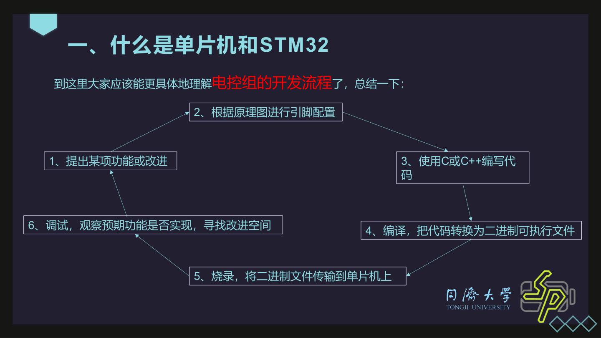

原理图上常见简写（接线时用，有印象即可）：

| 简写 | 含义 | 说明 |
|---|---|---|
| GND | ground | 地线，默认 0V |
| RST | reset | 复位电平，拉高/拉低使设备复位 |
| CLK | clock | 时钟信号，像人的心跳脉搏，频率越高工作越快 |
| Peripheral | 外部设备 | 除 MCU 外基本都叫外设，如各种传感器 |
| VCC | 电路工作高电压 | c = circuit / collector |
| VDD | 器件工作高电压 | d = device / drain |
| VEE | 器件工作低/负电压 | e = electronic / emitter |
| VSS | 公共低电压（一般 0V） | s = series / source |

### 2.3 STM32CubeMX：图形化配置并生成工程

引脚配置重复性强，**STM32CubeMX** 专门用于 STM32 芯片的引脚配置，可以帮我们生成基本的 C 代码项目工程，之后只在这个工程上开发。流程：初始界面 → 选择芯片 → 工程配置界面 → 配置时钟树 → 项目生成（Toolchain 选 CMake）。

### 2.4 理论一：时钟与时序

- **时钟是什么**：固定时间周期的信号，程序运行需要先后顺序（时序），时钟用来提供时序，相当于人的心脏和脉搏；单片机每收到一个时钟信号就运算一次，**时钟频率决定运行性能**。
- **时钟从哪里来**：石英晶体做成的**晶振（Crystal/ceramic resonator）**受激励产生周期电信号；内部 RC 振荡电路也能提供时钟（时序不稳定、容易出错）；还有 Bypass clock source（旁路，由外部设备主动给出，不经内部驱动）。
- **分类**：按源在芯片内/外分内部 I / 外部 E；按频率分高速 HS（给定时器、UART、ADC 等外设）与低速 LS（给实时时钟 RTC 等）。
- **时钟树**：基本时钟信号经 MCU 内部倍频、分频得到不同频率的子时钟，分别供给不同设备；按需配置，一般性能拉满。

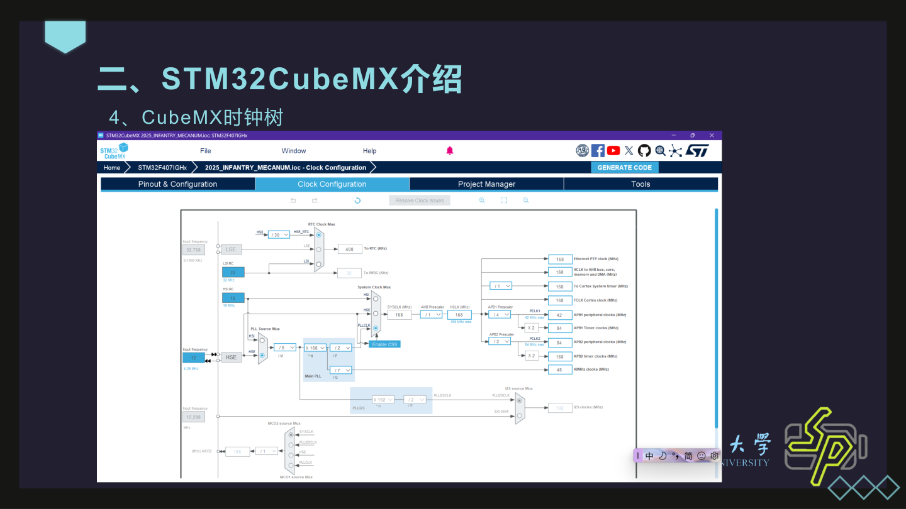

### 2.5 理论二：GPIO 八种模式

**GPIO**（General Purpose Input Output，通用输入输出端口）是 MCU 与外部元件沟通的接触点，一般沟通电压信息；芯片上大部分引脚都是 GPIO，工作模式和电压高低都可编程控制。共 8 种模式：

**四种输入模式**：

| 模式 | 特点 | 无输入时读到的电平 |
|---|---|---|
| 上拉输入 | 内部等效接一个大电阻到高电平 | 高电平 |
| 下拉输入 | 内部等效接一个大电阻到低电平 | 低电平 |
| 浮空输入 | 不接上拉/下拉电阻，电平悬而不定 | 0~3.3V 之间任意值 |
| 模拟输入 | 读取连续时间连续值的模拟信号（经 ADC 转成离散数字量） | — |

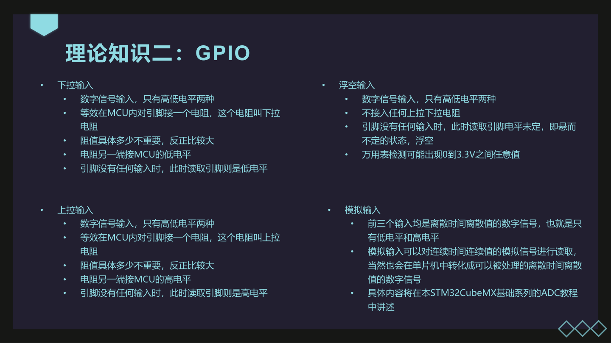

**四种输出模式**：

| 模式 | 驱动能力 | 要点 |
|---|---|---|
| 推挽输出 | 高低电平驱动能力都强 | 「宁折不弯」，推挽高低电平相遇会烧坏 |
| 开漏输出 | 低电平强、高电平弱 | 高电平靠外接上拉电阻实现；跳变速度取决于上拉电阻，电阻越小越快；「墙头草」，开漏高低相遇会变低 |
| 复用推挽输出 | — | 把引脚绑定到 MCU 内某特定外设功能输出 |
| 复用开漏输出 | — | 同上，开漏形式 |

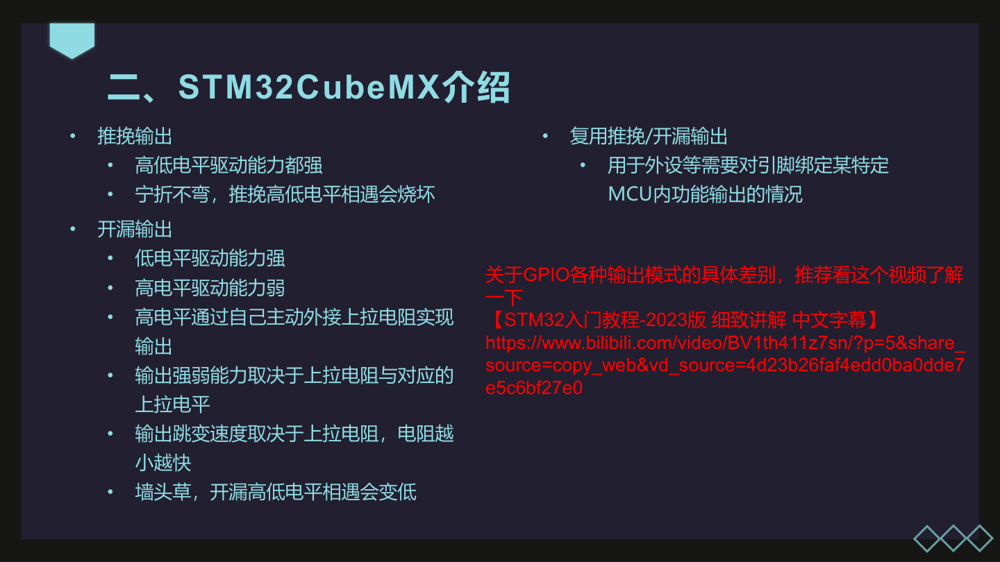

### 2.6 实操一：点亮 LED（GPIO 输出）

CubeMX 操作步骤：

1. 新建工程，按开发板说明书/原理图选 MCU 型号；
2. 配置时钟树：高速时钟选外部晶振作为时钟源，低速时钟可以不管；
3. 进行引脚配置：查看开发板原理图，搜索引脚并配置；
4. 生成项目文件，Toolchain 选 CMake；
5. 添加必要文件，用 VSCode 打开项目；
6. 在 `main.c` 中编写代码；
7. F7 编译，`Ctrl+Shift+B` 烧录。

```c
HAL_GPIO_TogglePin(GPIOH, GPIO_PIN_10);                 // 引脚电平翻转
HAL_GPIO_WritePin(GPIOH, GPIO_PIN_10, GPIO_PIN_RESET);  // 引脚电平设为低电平
HAL_GPIO_WritePin(GPIOH, GPIO_PIN_10, GPIO_PIN_SET);     // 引脚电平设为高电平
HAL_Delay(1000);                                        // 延时函数
```

> 注意：自己的代码必须写在 CubeMX 标记的 `USER CODE BEGIN` 和 `USER CODE END` 之间，否则之后用 CubeMX 修改项目时代码会被删除。

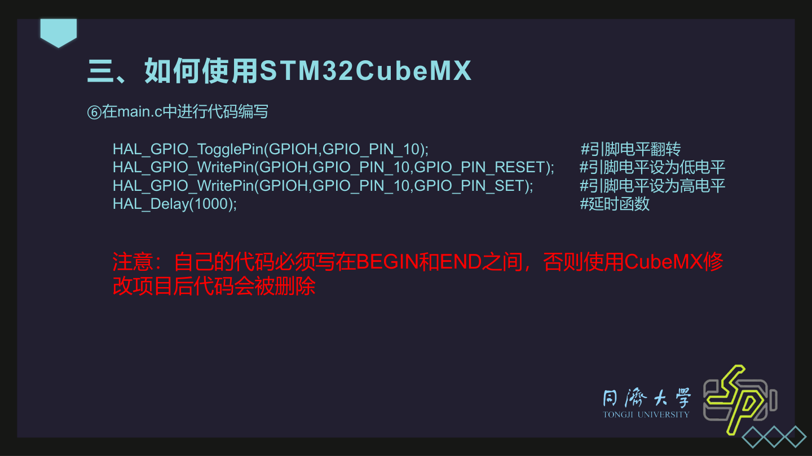

### 2.7 理论三：定时器与 PWM

**定时器（Timer）**对时钟信号的脉冲计数，计到一定数字就触发动作（改变 GPIO 电平、读取电压等）。用途：定时中断、输入捕获、输出比较、编码器接口、主从触发；本课用**输出比较**功能输出 PWM，定时中断下节课讲。

三个关键寄存器：

1. **预分频器 PSC（Prescaler）**：对输入时钟分频，把频率降低；
2. **计数器 CNT（Counter）**：开启后自动对 PSC 输出计数，计到最大值自动清零；
3. **自动重装器 ARR（Auto-Reload Register）**：存一个阈值，CNT 数到它就清零，不必非数到最大值。

> C 板 MCU 中 PSC 是 16 位，CNT 和 ARR 是 32 位，CubeMX 会提醒最大值。

由于寄存器从 0 开始计数：

$$
\text{计数频率}=\frac{\text{输入频率}}{PSC+1},\qquad
\text{溢出频率}=\frac{\text{计数频率}}{ARR+1}=\frac{\text{输入频率}}{(PSC+1)(ARR+1)}
$$

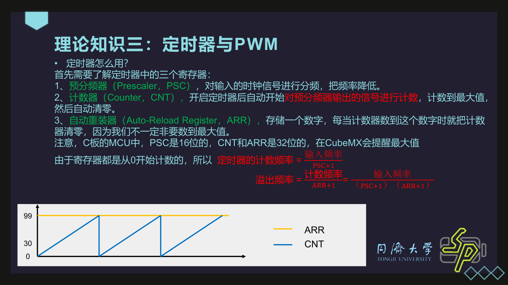

**PWM（Pulse Width Modulation，脉冲宽度调制）**：用数字信号输出「代替」模拟信号输出（不是转换）。数字信号只有 0/1 离散值，自然界光照、声音、电流多为连续模拟信号；读模拟信号靠 ADC（模数转换器），输出模拟信号靠 DAC（数模转换器），而 PWM 走的是另一条路。

呼吸灯思路：LED 亮度取决于功率（电压、电流），但 LED 只有通电 5V / 不通电 0V 两种状态；利用人眼**视觉暂留**，通断电足够快时，亮的时间越久看起来越亮——控制时断时续信号的接通时间比例即可调节亮度，这就是 PWM。

输出 PWM 的方法：CNT 计数时，在 ARR 和 0 之间选一个数字比较，低于它 GPIO 输出高电平、高于它输出低电平，调整这个数字就改变高电平占比。

- **CCR（Capture/Compare Register，捕获/比较寄存器）**：存这个比较数字；输出用比较功能，读取信号用捕获功能。
- **占空比**：高电平占一个周期的时间比例，**占空比 = CCR / ARR**。
- **分辨率**：占空比变化的最小间隔，CCR 最小变化为 1，ARR 越大每步占空比变化越小、调节越精细。

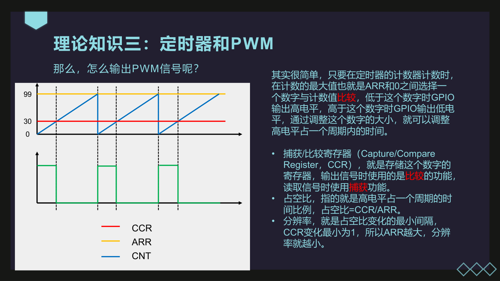

### 2.8 实操二：呼吸灯（定时器输出 PWM）

CubeMX 配置：查找原理图确定 LED 对应哪个定时器哪个通道 → Timers 中找到 TIM5 → 选 Internal Clock → 开启三个 Channel 的 PWM 输出 → Parameter Settings 中设置 PSC 和 ARR。计数模式有向上计数（0 加到最大值，实际最常用）、向下计数（最大值减到 0）、中心计数（加到最大再减到 0 循环）。

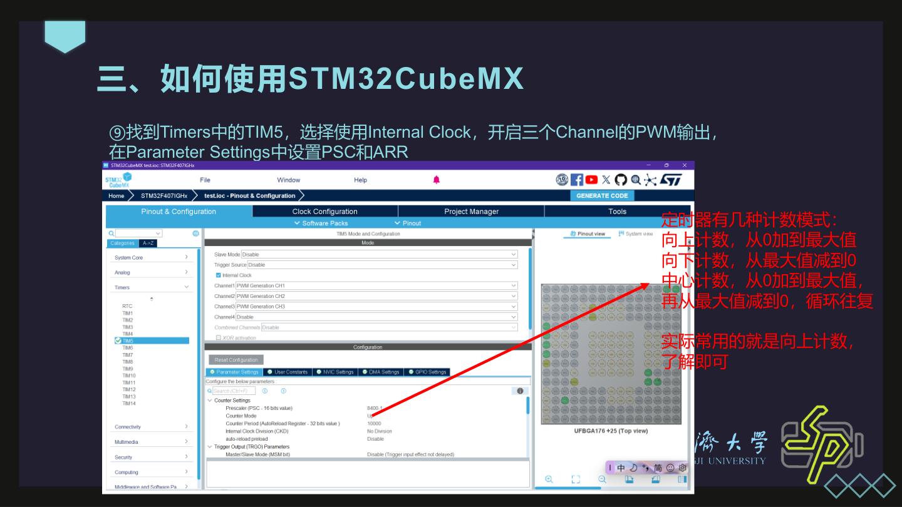

生成项目用 VSCode 打开后，先启动 PWM 再不断刷新比较值：

```c
HAL_TIM_PWM_Start(&htim5, TIM_CHANNEL_1);
__HAL_TIM_SetCompare(&htim5, TIM_CHANNEL_1, TIM3_pwmVal);
```

呼吸灯代码思路：维护 `TIM3_pwmVal` 与方向 `TIM3_direction`，每隔约 50ms 让占空比增减，到边界翻转方向，持续调用 `__HAL_TIM_SetCompare` 修改通道占空比。

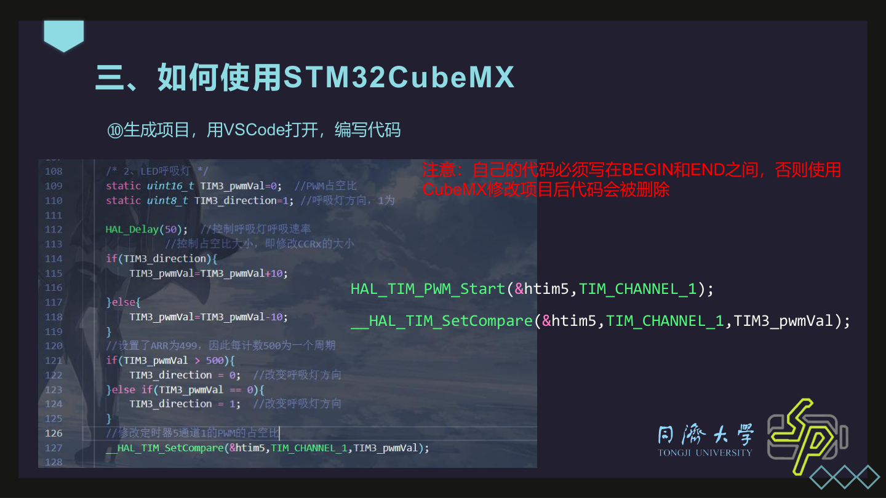

**知识拓展**：PWM 调光利用系统惯性让离散信号 Cosplay 模拟信号；若有人眼能识别高速闪烁，则改用 MOS 管——G 极给连续可调电压控制 D/S 间电流大小来调亮度（DC 调光），需要 MCU 的 DAC 功能，可避免频闪（对比 PWM 调光与 DC 调光）。

### 2.9 Git 与课后作业

用 Git 新建仓库上传 GitHub 远程仓库：

```bash
git config --global user.name "xxxxxxxx"
git config --global user.email xxxxxxxx@xxxxx.com
git config --list          # 查看配置
git init                   # 本地仓库初始化
git clone <远程Git仓库地址> # 克隆远程仓库
```

其余命令可用 VSCode 图形化插件完成，或下载 GitHub Desktop 方便管理。

**课后作业**：课堂只做了 GPIO 点 LED；思考如何让红黄蓝三色 LED 组合出多种颜色循环（涉及定时器与 PWM）；查清 C 板无源蜂鸣器的引脚并让它响起来。课外推荐：江协科技【STM32入门教程-2023版】、中科大【RM 电控合集·电控入门导论】。

## 第四讲 电机控制（1）：UART 通信与 CAN 通信

> 本讲课件标题为「电机控制（1）」，实际内容是开发板与电机/外设之间的两种通信：UART 串口与 CAN 总线。参考 RoboWalker 电控教学资料。

### 4.1 通信方式简介：三层模型

拿「打电话」类比通信，任何通信都分三层：

| 层次 | 对应打电话 | 工程含义 |
|---|---|---|
| 物理信号层 | 电话线 | 硬件电路 |
| 链路传输层 | 声到电、电到声 | 通信协议 |
| 应用数据层 | 聊天内容 | 传输数据主体 |

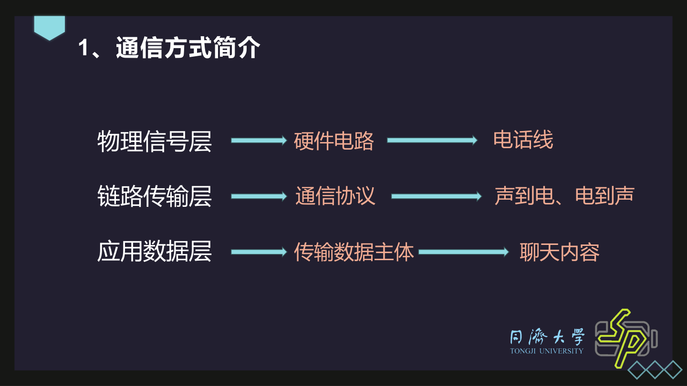

### 4.2 UART 通信

UART（串口）接线要点：

- **GND**：提供参考电平，消除噪声；
- **RX ↔ TX 交叉连接**：设备1 的 RXD 接设备2 的 TXD，反之亦然；
- **5V**：给外设供电。

以 C 板排针为例，UART1 引脚线序：1=RXD、2=TXD、3=GND、4=5V；UART6：1=GND、2=TXD、3=RXD（以原理图为准）。

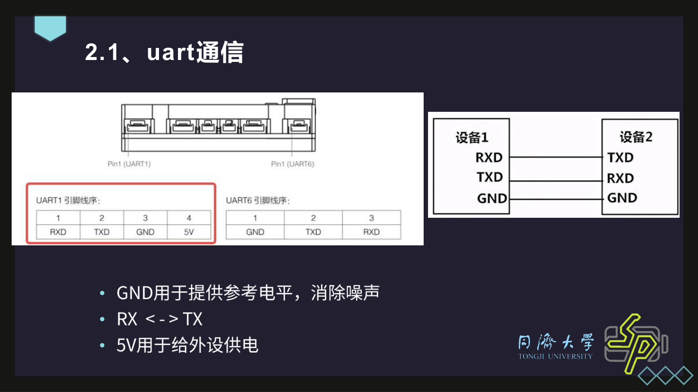

### 4.3 DMA（Direct Memory Access，直接内存访问）

- **普通串口通信**：外设寄存器收到字节后，由 CPU 中断取出再写入内存，CPU 被搬运动作占用。
- **DMA 串口通信**：数据搬运完全交由 DMA 硬件控制器完成，CPU 可以专注于内存数据的存取。

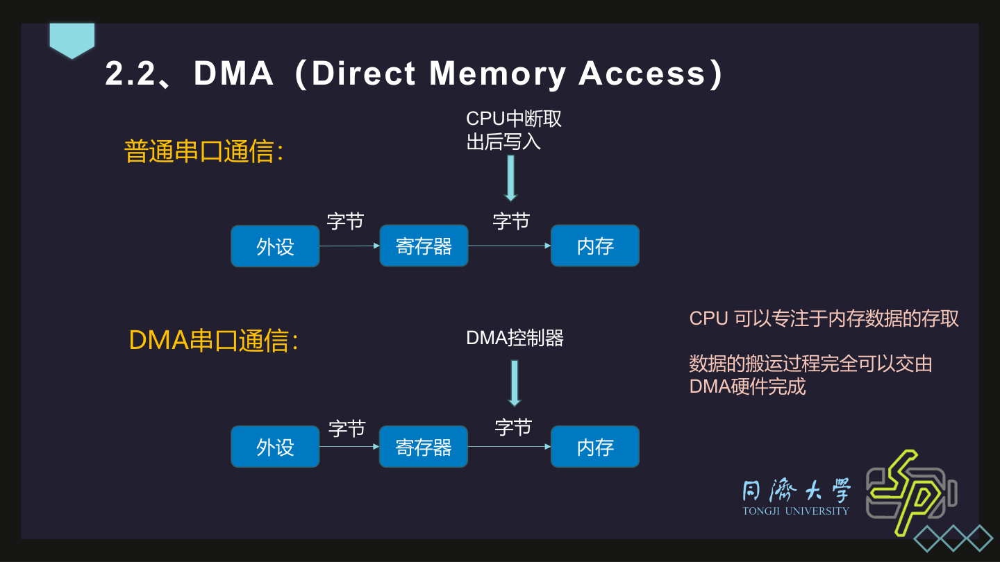

**传输速率两个定义**：

- **比特率**（bit/s，bps）：每秒钟传输的二进制码元数量；
- **波特率**（symbol/s）：每秒钟传输的有效信息码元数量。

举例：CAN 通信中比特率 = 波特率（有效信息码元 = 对应二进制码元）；十六进制字符编码中，一秒传输 1000 个字符，则比特率 = 4000 bps，波特率 = 1000 symbol/s。

### 4.4 CAN 通信引入与硬件接线

先认识车上的角色：**电机**（动力装置，部分电机需搭配电调）、**电调（电子调速器）**（根据控制信号调节电动机转速）、**单片机**（经 CAN、PWM 等与电机通信驱动转动）、**电源**（给单片机、电机供能）。

实车接线关系：电池 → 分电板 → C 板（开发板）与电机，电机与 C 板之间用 CAN 线连接。

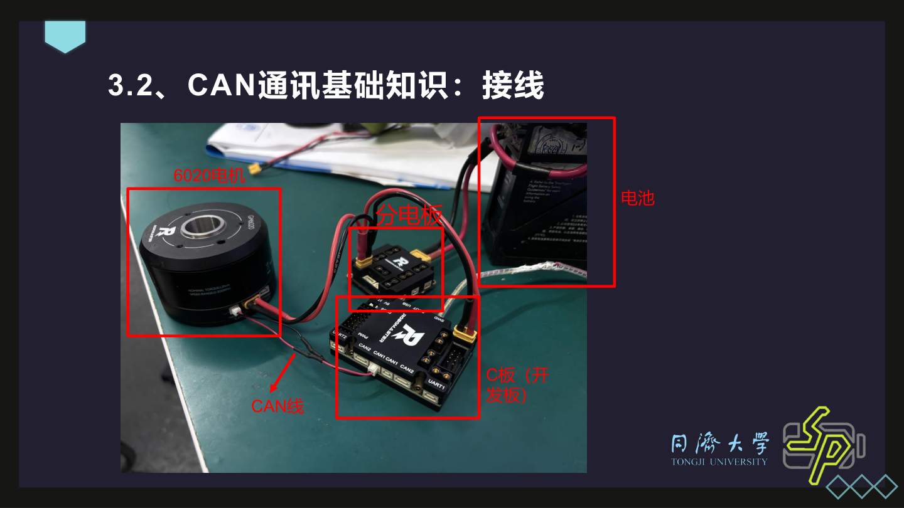

接线方式：

- **电源**：VCC 接电池正极，GND 接电池负极；
- **CAN 线**：CAN_H（电机/电调）——CAN_H（单片机），CAN_L（电机/电调）——CAN_L（单片机）。以 GM6020 为例，背面有 CAN、24V、PWM 三组接口。

### 4.5 CAN 接线注意事项

1. **总线接法**：CAN_H——CAN_H，CAN_L——CAN_L，不能交叉；
2. **终端电阻**：CAN_H 与 CAN_L 通过 60 欧终端电阻（2 个 120 欧并联）连接在一起，防止信号不稳定；
3. **总线负载健康**：经典 CAN 协议最高只有 1 Mbps 波特率，一条总线上单位时间要传的信息过多就容易丢包（可用社区 CAN 负载计算器评估）。

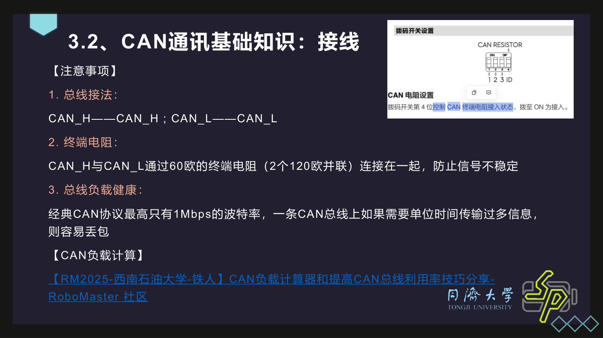

### 4.6 CAN 软件流程与代码

发送侧闭环：CAN 初始化（配置滤波器 + 调用 HAL 库启动 CAN 模块）→ 将目标扭矩转换为发给电机的报文 → 把数据打包成 CAN 帧 → 发送 CAN 帧；接收侧在 CAN 中断回调函数中接收 CAN 帧，把反馈报文转换为电机温度、码盘值、转速等信息。

```c
extern "C" void can_task() {
    can1.config();          // CAN 初始化：配置滤波器
    can1.start();           // 调用 HAL 库启动 CAN 模块
    while (true) {
        motor6020.cmd(0.1f);            // 目标扭矩转换为发给电机的报文
        motor6020.write(can1.tx_data);  // 将数据打包成 CAN 帧
        can1.send(motor6020.tx_id);     // 发送 CAN 帧
        osDelay(1);
    }
}

extern "C" void HAL_CAN_RxFifo0MsgPendingCallback(CAN_HandleTypeDef *hcan) {
    auto stamp_ms = osKernelSysTick();
    while (HAL_CAN_GetRxFifoFillLevel(hcan, CAN_RX_FIFO0) > 0) {
        if (hcan == &hcan1) {
            can1.recv();                                   // 接收 CAN 帧
            if (can1.rx_id == motor6020.rx_id)
                motor6020.read(can1.rx_data, stamp_ms);    // 解包温度/码盘值/转速
        }
    }
}
```

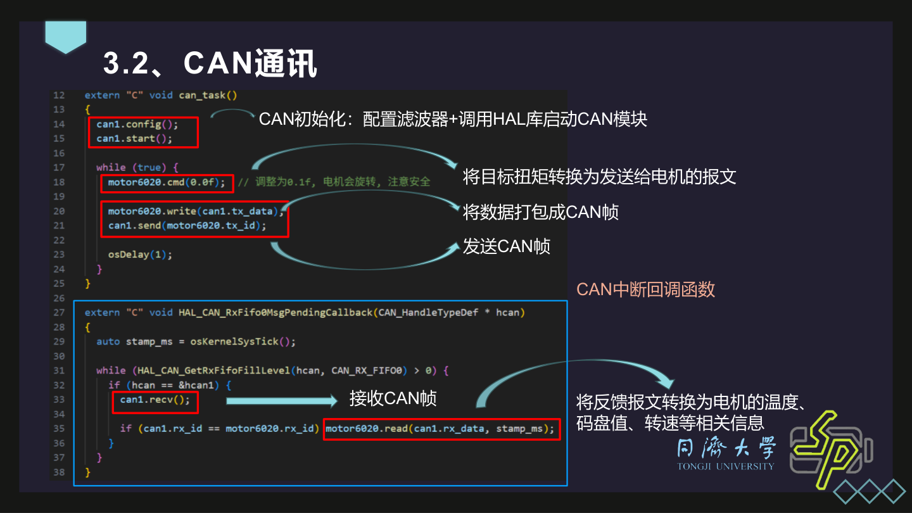

### 4.7 CAN 链路传输层与 ID 仲裁

单片机与电机之间：单片机用 **tx_id** 把数据写进数据帧、打包发送；电机用 **rx_id** 把数据帧解包成电机信息。**CAN ID 承担地址功能**，是一帧的标识符，一般指明「谁发的」；`sp_middleware` 中内置了控制标识符（tx_id）与反馈标识符（rx_id）的映射，设备 id 直接查表即可。

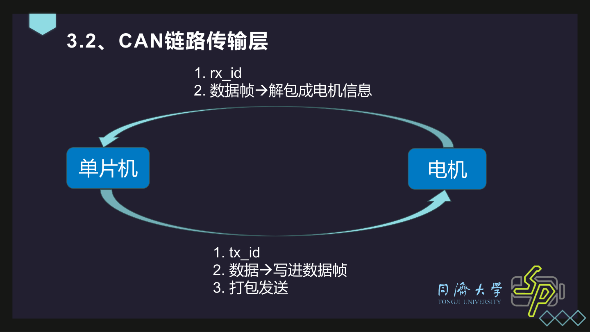

**多个设备同时发送怎么办**：靠冲突检测与避免（仲裁）解决——**ID 越小优先级越高**；当一条 CAN 总线上同时传输的信息过多，就可能出现收不到大 ID 设备报文的情况，这也是要控制总线负载的原因。

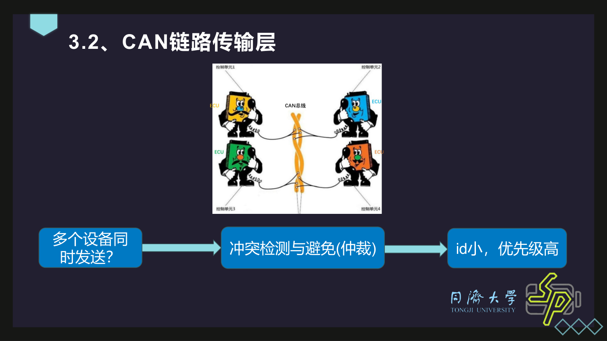

> 以上硬件细节无需强行记忆，有大致印象即可，重点是理解「查看说明书的重要性」；课堂实验按具体操作指南文档完成。

## 第五讲 PID控制电机

本讲在上节课「开发板与电机通讯」的基础上，讲如何让电机按期望速度/位置转动：先区分开环与闭环，再拆解 P/I/D，最后讲双环串级 PID 与现场调试纪律。

### 5.1 开环控制 vs 闭环控制

**开环控制**：输入 → 控制装置 → 控制量 → 执行机构 → 输出 → 被控对象，单向流动、没有反馈。落到车上：C 板给出电压、电流、扭矩 → 电机 → 输出速度，速度是多少并不回传给 C 板。

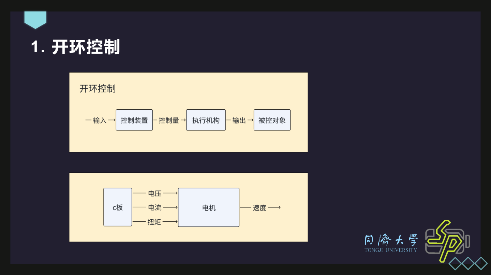

**闭环控制**：增加测量元件，把被控对象的输出（如电机速度）反馈回控制装置，与输入比较后再调整。车上即把速度反馈回 C 板，形成闭环。

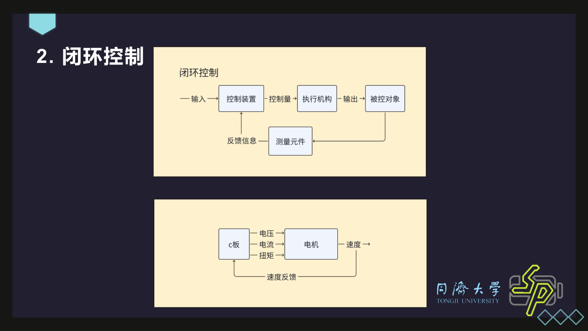

### 5.2 离散 PID 公式与 P / I / D

位置式离散 PID 控制量：

$$
u(k)=K_P\cdot e(k)+K_I\cdot\sum_{i=0}e(i)+K_D\cdot[e(k)-e(k-1)]
$$

其中 $e(k)$ 是当前误差，$K_P$、$K_I$、$K_D$ 分别为比例、积分、微分增益；$dt$ 是循环周期，要分清离散与连续。

| 环节 | 英文 | 功能 | 效果 |
|---|---|---|---|
| **P 比例** | Proportion | 基于**当前误差**计算控制输入，误差越大控制输入越大 | 快速减小误差，但通常留下一个稳态误差 |
| **I 积分/累加** | Integrate | 基于**误差累积值**计算控制输入 | 消除长期稳态误差，但可能响应变慢、超调 |
| **D 微分/差分** | Differential | 基于**误差变化率**计算输入，预测误差趋势提前调整 | 减小超调和振荡，但可能响应变慢 |

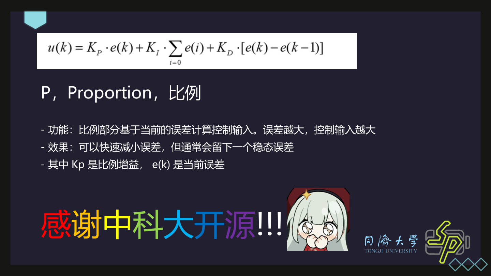

### 5.3 改进积分：梯形积分与动态积分

积分环节的累积误差可能导致**积分饱和**，课件给出两种缓解办法。

**梯形积分（Trapezoid）**：用梯形面积代替矩形积分，减小饱和风险。$t_{now}$、$t_{last}$ 为当前/上一时刻，$e(t)$、$e(t-1)$ 为当前/上一时刻误差：

$$
I_{out}=\frac{1}{2}K_i(t_{now}-t_{last})\times(e(t)-e(t-1))
$$

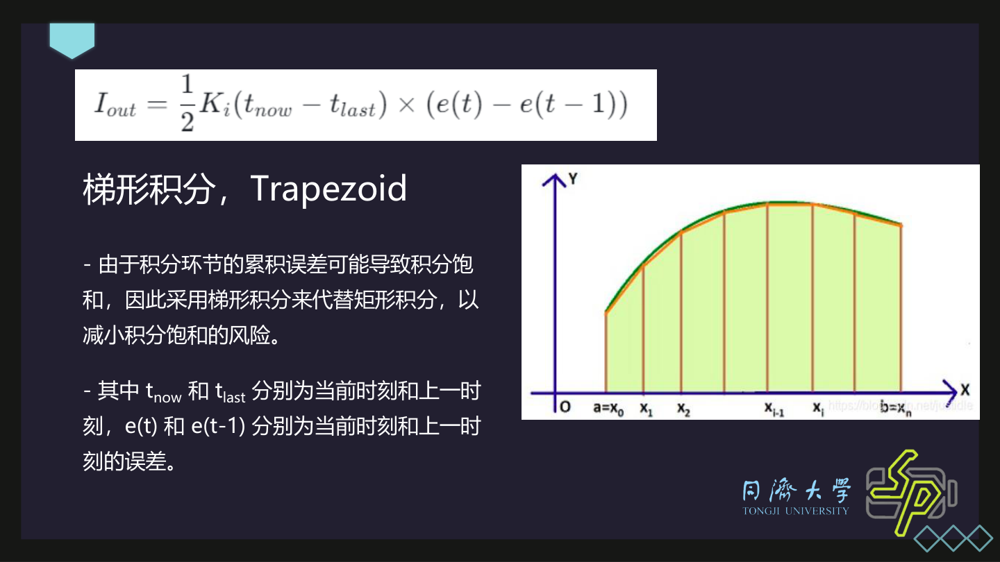

**动态积分（Dynamic）**：动态调节积分增益本身来减小饱和风险：

$$
K_i(t)=K_i\frac{1}{1+e(t)}
$$

### 5.4 微分先行

指令频繁升降的场合，直接对给定指令微分对结果影响很大。**微分先行 PID** 中只对输出量（测量值 $ref$）微分，不对给定指令 $set$ 微分。误差定义 $e(t)=set-ref$，微分输出：

$$
D_{out}=K_d\frac{de(t)}{dt}=K_d\frac{d(set)}{dt}+K_d\frac{d(ref)}{dt}
$$

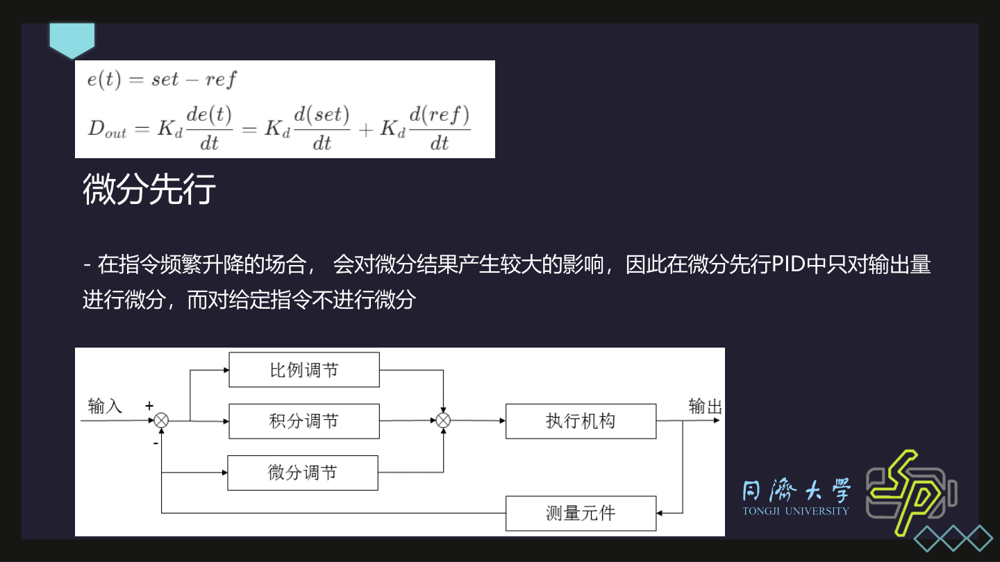

### 5.5 双环串级 PID

- **单速度环（单环位置环）**：期望位置与当前位置比较得位置误差 → PID → 控制器输出 → 驱动器（电调）→ 电流 → 电机 → 转速 → 速度 → 位置，位置反馈回输入端。
- **双环（串级）**：期望位置先进「合适的速度变化曲线」（结合当前位置）得到目标速度，再由速度环与当前速度比较 → PID → 电调；即**外环位置环、内环速度环**，实现从目标速度到目标位置的控制。

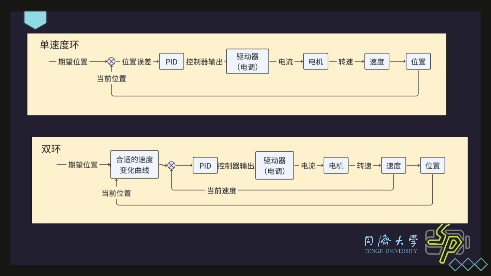

### 5.6 现场调试经验

1. 写代码先写 down（失能），确保任何时刻都能断电；
2. 固定好电机，不然会起飞；
3. 关注报错信息，学会用百度和 AI；
4. 使用 plot（SerialPlot）观察自己的代码曲线；
5. debug 的时候不要烧录，并且要 down 之后再退出调试；
6. 注意注释、代码规范、commit 规范。

## 附：电控组大作业

### 任务总览与实验室安排

- 地点：同济大学嘉定校区机械与能源学院（开物馆），找不到可私信 QQ 群内任意电控带路；国庆期间每天有值班电控，前一天 QQ 群接龙统计人数；**10 月 3 日麦轮步兵另有活动暂不可用**。
- 纪律：实验后关闭遥控器和电池，每天试验结束、临时离开都要关电源，违规酌情扣分。

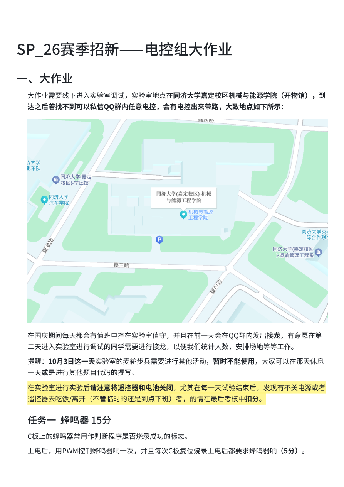

### 五个任务与分值

| 任务 | 分值 | 要求要点 |
|---|---|---|
| 任务一 蜂鸣器 | 15 分 | 上电后用 PWM 控制蜂鸣器响一次，每次复位/烧录/上电都响（5 分）；设计两种不同报错音调（如不同歌曲），按音调质量给分（最高 10 分） |
| 任务二 LED 流水灯 | 5 分 | 上电后 LED 以流水灯方式持续闪烁（顺序不限），用 PWM 驱动，LED 作为一个 FreeRTOS 任务 |
| 任务三 舵机 | 10 分 | PWM 驱动舵机，上电后 1 秒转动 45°、从 0° 转到 180°（FreeRTOS 任务） |
| 任务四 麦轮底盘 | 50 分 | 遥控器操控 + PID 走直线 + 功率控制 + 自定义电容策略（详见下） |
| 任务五 GitHub 存储 | 5 分 | 代码存入自己 GitHub 仓库，按 commit 规范、按时间规律提交 |
| 代码规范 | 5 分 | 简洁高效、命名规范、无报错可运行、架构清晰、缩进正确 |

任务四遥控器挡位表（右拨杆下档 = 全部电机失能，安全位）：

| 操作 | 右拨杆下档 | 右拨杆中档 |
|---|---|---|
| 左摇杆前后 | 全部电机失能 | 底盘前后移动 |
| 左摇杆左右 | 全部电机失能 | 底盘左右移动 |
| 右摇杆前后 | 全部电机失能 | 底盘向左转（2 rad/s） |
| 右摇杆左右 | 全部电机失能 | 底盘向右转（2 rad/s） |

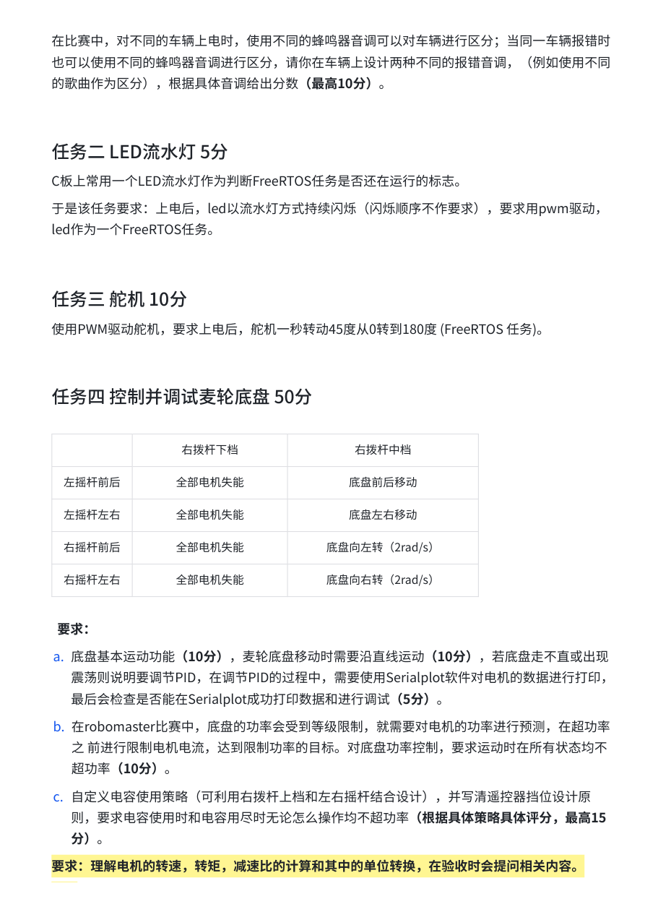

任务四评分细项：

- **a. 基本运动 + 走直线（25 分）**：底盘基本运动功能 10 分；移动需沿直线 10 分，走不直或震荡说明要调 PID；调 PID 时用 SerialPlot 打印电机数据，检查能否成功打印并调试（5 分）。
- **b. 功率控制（10 分）**：比赛底盘功率受等级限制，需预测功率，在超功率之前限制电机电流，运动时所有状态均不超功率。
- **c. 自定义电容策略（最高 15 分）**：可利用右拨杆上档与左右摇杆结合设计，写清遥控器挡位设计原则；电容使用时和用尽时无论怎么操作均不超功率。
- 验收会提问：理解电机的**转速、转矩、减速比的计算和单位转换**。

### 底盘数据与注意事项

- 麦轮直径 154mm，麦轮横向间距 370mm，纵向间距 330mm；
- 四个电机均为减速比 14.9 的 RM3508，电机 id 自行查看电调绿灯灯效，结合 C620 电调说明书与电机说明书查询；
- 预测功率由自己编写公式得出，实际功率通过 `sp_middleware` 的超级电容模块类（`supercap`）获取，自行阅读类思考计算方式；
- 电容作用：底盘功率高于裁判系统限制功率时补充额外功率，模式只用 AUTOMODE；
- 调 PID 时给总输出和各项输出**限幅**，否则可能损坏机械结构；功率上限在 `pm02` 类中自行查询；
- 控制电机前先确保遥控器下档能正常使电机失能，确保安全。

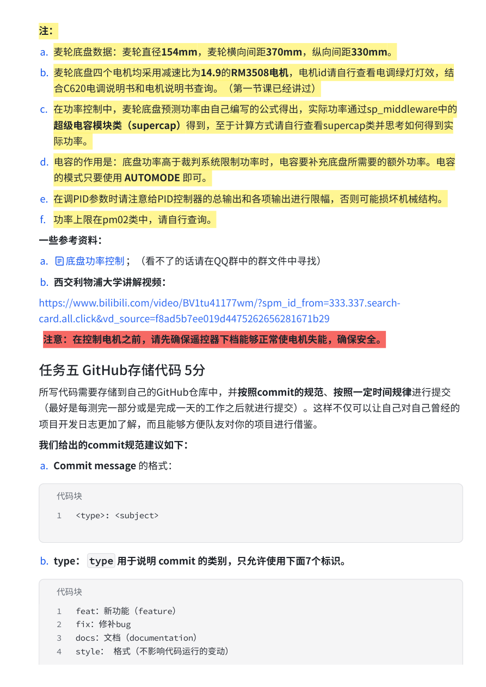

### GitHub commit 规范

格式：

```text
<type>: <subject>
```

`type` 只允许 7 个标识：`feat` 新功能、`fix` 修补 bug、`docs` 文档、`style` 格式（不影响运行）、`refactor` 重构、`test` 增加测试、`chore` 构建/辅助工具变动。`subject` 是简短描述，不超过 50 个字符，第一个字母小写，结尾不加句号。

### 提交要求与入队流程

- 大作业最迟 **2025 年 10 月 12 日 24:00** 前完成；
- GitHub 仓库设为 public，网址发送到 `1835651172@qq.com`；
- 需要在线下进行调试效果验收。

入队流程：9.27 公布大作业题目 → 自行至实验室完成各项要求 → 10.12 24:00 程序提交 + 线下程序测试验收 → 淘汰判断（淘汰则遗憾出局）→ 进入面试环节（暂定 10.14 日下午，时间待通知）→ 再次判断 → 成功入队。

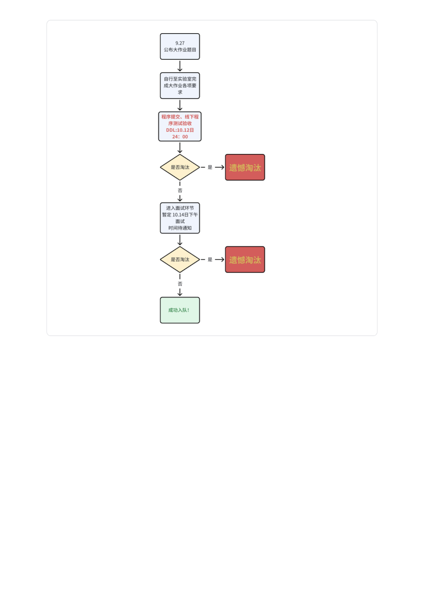
