
# 同济大学 RoboMaster 招新培训笔记 · 硬件组
> 来源：同济大学（SuperPower）RoboMaster 战队招新培训课件视频笔记，视频见 B 站空间：https://space.bilibili.com/651837546
> 整理：东南大学成贤学院 Solaris（天钺）战队 ｜ 2026-10-17 ｜ 配图均截取自原课件
> 用途：入队新生复习笔记，供战队学习交流使用

## 培训大纲

| 讲次 | 课件 | 核心主题 |
|---|---|---|
| 第1讲 硬件组导论 | 26硬件组培训01.pptx | 硬件组职能与必备工具（嘉立创EDA/半导小芯/立创商城）、R/C/L 基础公式与串并联、二极管/MOS 速览、MCU 与最小系统概念 |
| 第2讲 基本电子元器件介绍 | 26硬件组培训02.pptx | 电阻（E系列/选型/作用）、电容（分类/隔直通交/去耦）、电感（电流不能突变）、二极管、nMOS/pMOS、三极管、继电器、LDO |
| 第3讲 有线通信协议介绍 | 26硬件组培训03.pptx | 通信基础概念、UART 串口、I2C、SPI、CAN 总线（差分电平/五类帧/位填充/非破坏性仲裁）、3508 电机报文 |
| 第4讲 成为"焊武帝" | 26硬件组培训04.pptx | 焊接四步原理（热传导/润湿/扩散/凝固）、焊接七要点、线材线规与 XT 系列接头规格 |
| 第5讲 必备的硬件知识 | 26硬件组培训05.pptx | GPIO 推挽/开漏/高阻、上拉下拉电阻、防反接/过压保护/缓启动、BUCK/BOOST/BUCK-BOOST、伏秒积平衡、高低端电流检测 |
| 第6讲 最小系统板绘制 | 26硬件组培训06.pdf | STM32F103C8T6 系统板大作业、外围电路模块（电源/晶振/复位/SWD/CAN/USB转串口/INA226）、布局与布线要点 |

> 课程大纲依据官方教案 `25-26赛季硬件组招新课程教案（总版）.mm` 的六次课组织；课件实际讲授顺序与深浅以 PPTX/PDF 为准。

---

## 第1讲 硬件组导论

本讲先回答"硬件组到底做什么、需要什么基本功"，再快速过一遍电阻/电容/电感的基本公式与串并联，最后引出 MCU 与"最小系统"这个贯穿后面所有课程的概念。

### 1.1 硬件组的工作内容

硬件组负责设计、构建和维护整台机器人的电子系统与供电网络。课件引用香港科技大学 ENTERPRIZE 战队 26 赛季硬件部招新推文的比喻：**机械部门造出"骨架"和"肉体"，硬件组为其构建输送能量的"血管"（供电）与传递信号的"神经"（通信）**——通过设计 PCB 电路板与机器人电路拓扑、焊接元件、规范线缆布局，保证机器人在高强度对抗中稳定高效运行，并对硬件模块持续迭代维护。

具体职能分四块：

1. **车辆电气线路连接与维护**：和其他技术组一起做整车线路的连接、检修；
2. **设计特定功能的电路板**：如分电板（把一路电源分给多个负载）、降压驱动板、缓冲电容控制板；
3. **维护和迭代超级电容、能量机关**：包括超级电容控制板与赛场能量机关道具；
4. **研发前沿装置**：无线充电，以及新赛季可能新增的"电子战"（规则展望中提到硬件将获得某种解析对方队伍信息的方式）。

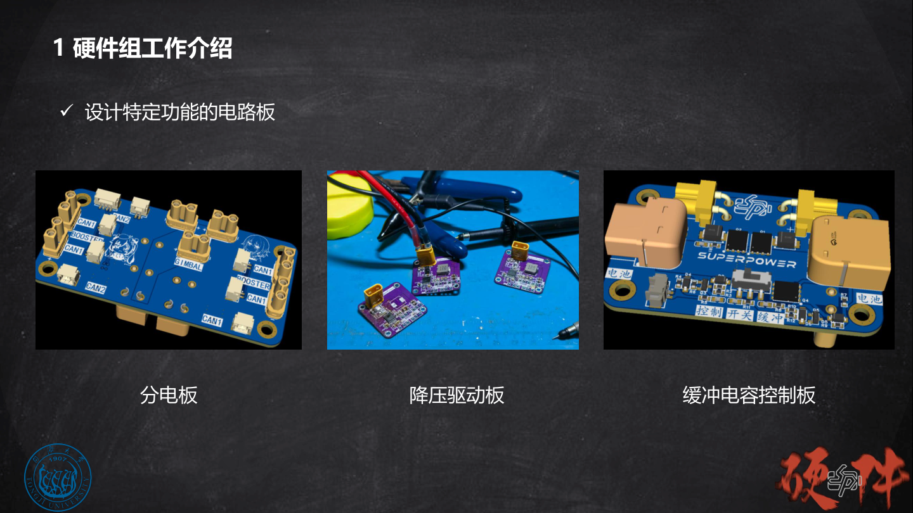

### 1.2 硬件组必备技能与工具

- **嘉立创 EDA**：简单高效、免费的国产 PCB（Printed Circuit Board，印制电路板）设计软件，从设计 → 下单打样 PCB → 采购元器件"一条龙"解决；官网搜索"嘉立创 EDA"即可下载，本讲最后会带着大家画一份最小系统原理图。
- **芯片手册查询**：搜索"半导小芯"查 datasheet（数据手册），学会读手册是硬件工程师的核心能力。
- **元器件购买**：立创商城（搜索"立创商城"），与嘉立创 EDA 库直接对应，选型下单方便。
- **最重要的心态**：一丝不苟、不抱任何侥幸——硬件上一个虚焊、一处接反，赛场里就是直接掉线。课件通过对比两场比赛视频让大家直观看到硬件可靠性对胜负的影响。

### 1.3 三大被动元件基础（第2讲深入）

课件在导论里先给出电阻、电容、电感的定义式和"不能突变"这条主线。

**电阻**：表示导体对电流阻碍作用大小的物理量。

$$R=\frac{U}{I}\quad\text{（欧姆定律）},\qquad R=\rho\frac{l}{S}\quad\text{（电阻定律，}\rho\text{ 电阻率、}l\text{ 长度、}S\text{ 截面积）}$$

主要参数：功率（电阻能消耗的最大功率 $P=I^2R$）、精度（常见 0.1%、1%、5%）、温度系数（单位 ppm/℃，即每摄氏度百万分之几的阻值漂移）。单位换算：mΩ → Ω → kΩ → MΩ。

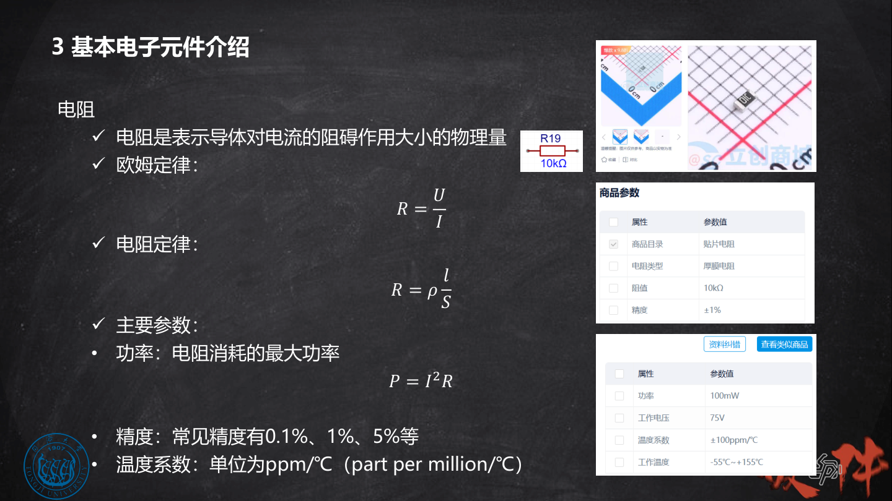

**电容**：表示储存电荷能力的物理量，定义式 $C=Q/U$，平行板电容 $C=\epsilon S/d$（$\epsilon$ 介电常数、$S$ 极板面积、$d$ 极板间距）。**电容两端电压不能突变**，由 $C=Q/U$ 微分得 $I=C\,dU/dt$：若上电瞬间电压允许突变，电流理论上会从 0 跳到无穷大。

**电感**：表示导体抵抗电流变化的物理量，定义式 $L=\psi/I$（$\psi$ 磁链），长直螺线管 $L=\mu N^2S/l$。**电感中的电流不能突变**，$\epsilon_L=L\,dI/dt$：若电流允许突变，感应电动势理论上会从 0 跳到无穷大。这条性质正是后面 BOOST 升压电路的理论基础。

**串并联规律（不考虑互感）**：

| 元件 | 串联 | 并联 |
|---|---|---|
| 电阻 | $R=R_1+R_2+R_3$ | $\dfrac{1}{R}=\dfrac{1}{R_1}+\dfrac{1}{R_2}+\dfrac{1}{R_3}$ |
| 电容 | $\dfrac{1}{C}=\dfrac{1}{C_1}+\dfrac{1}{C_2}+\dfrac{1}{C_3}$ | $C=C_1+C_2+C_3$ |
| 电感 | $L=L_1+L_2$ | $\dfrac{1}{L}=\dfrac{1}{L_1}+\dfrac{1}{L_2}$ |

注意**电阻串联越串越大、电容并联越并越大**，两者结论相反，不要记混。

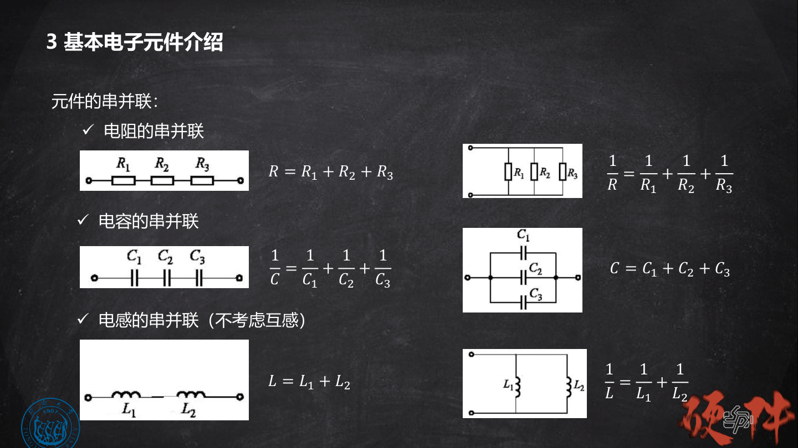

**二极管速览**：正向导通、反向截止（详细特性曲线在第2讲）。常见类型：肖特基二极管（低压降、快恢复，用于整流/防反接）、普通二极管（1N4148W/1N4007W）、稳压二极管（反向击穿区稳压）、TVS 瞬态抑制二极管（吸收浪涌过压）。

**MOS 管速览**：金属-氧化物半导体场效应晶体管（MOSFET），导论先建立"作开关管用"的印象：$V_{gs}$ 超过开启电压 $V_{gsth}$ 后漏源导通电阻 $R_{ds}$ 从无穷大跌到很小。详细参数 $V_{gsth}$、$R_{dson}$、$C_{gs}$ 与 n/pMOS 区别在第2讲。

### 1.4 MCU 与最小系统

- **MCU（Microcontroller，单片机）**：一颗集成了处理器、内存和输入输出接口的微型计算机芯片，专门用于嵌入式系统中执行特定控制任务。
- **最小系统**：使 MCU 能够正常工作、执行程序所必需的**最基本电路配置**。超出最小系统之外的采样电路、串口电路等都属于"非最小系统"。

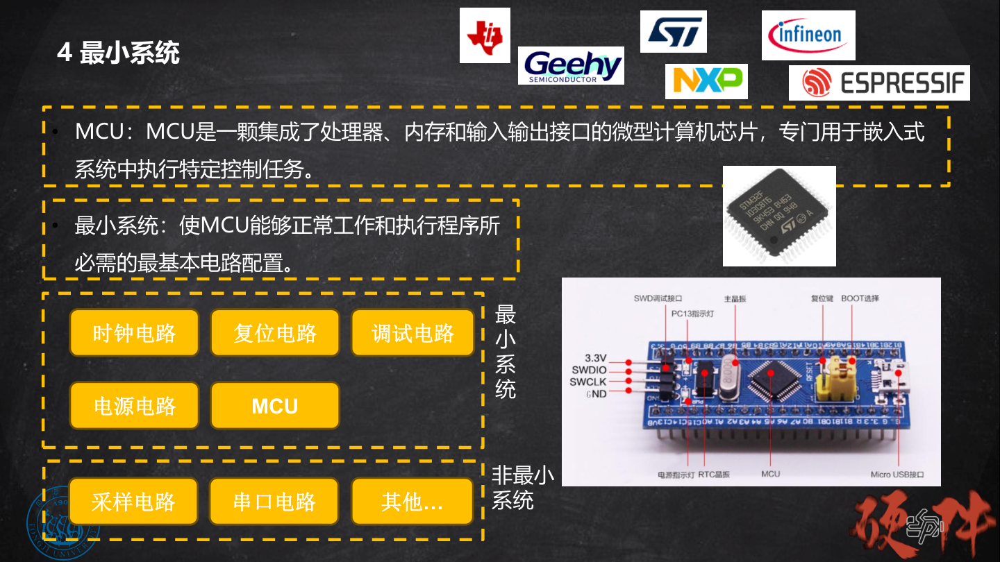

一个最小系统通常包含：**电源电路、时钟电路（晶振）、复位电路、调试电路（SWD）以及 MCU 本身**。下面两张图分别是课程大作业中最小系统部分的原理图分区，以及需要额外扩展的非最小外围电路，第6讲会逐块讲解。

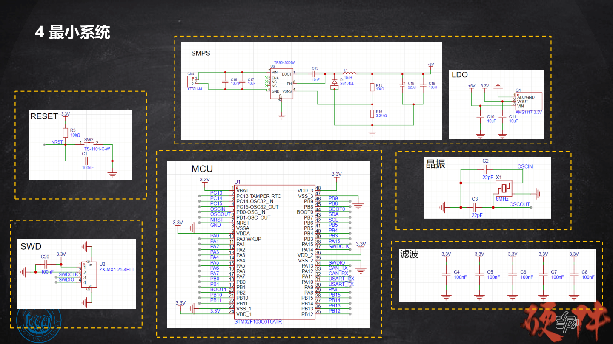

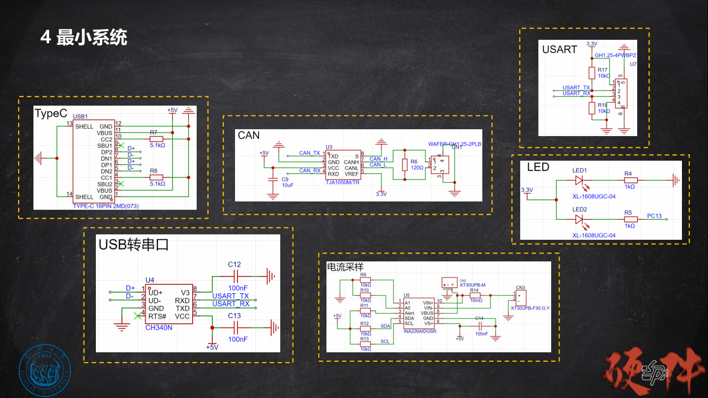

## 第2讲 基本电子元器件介绍

本讲按"电阻 → 电容 → 电感 → 二极管 → MOS 管 → 三极管 → 继电器 → LDO"顺序，讲清每个元件的参数、分类、选型与典型用法，面向会画原理图的实战需要。

### 2.1 电阻

**主要参数**：电阻值、功率额定值、温度系数、容差（精度）。**分类**：普通型（通用型）、精密型、功率型；**封装**：贴片式（如 0603）与插件式（色环电阻、水泥电阻等）。

**标称值（E 系列）**：国标规定一系列标准阻值作为产品，我国电阻/电容值采用"E 系列"（Exponential Spacing，指数间距），由几何级数构成：$a_n=(\sqrt[E]{10})^{n-1}$。分为 E6、E12、E24、E48、E96、E192 六大系列，其中 **E24 为常用数系**，E48/E96/E192 为高精密数系。

**队里常用选型**：

- 普通信号电阻统一选 **0603 封装、1% 精度、阻值符合 E24 系列**的贴片电阻；E24 标准值：1.0, 1.1, 1.2, 1.3, 1.5, 1.6, 1.8, 2.0, 2.2, 2.4, 2.7, 3.0, 3.3, 3.6, 3.9, 4.3, 4.7, 5.1, 5.6, 6.2, 6.8, 7.5, 8.2, 9.1；
- 泄放电阻、电流采样电阻等大功率电阻统一采用 **2512 封装**。

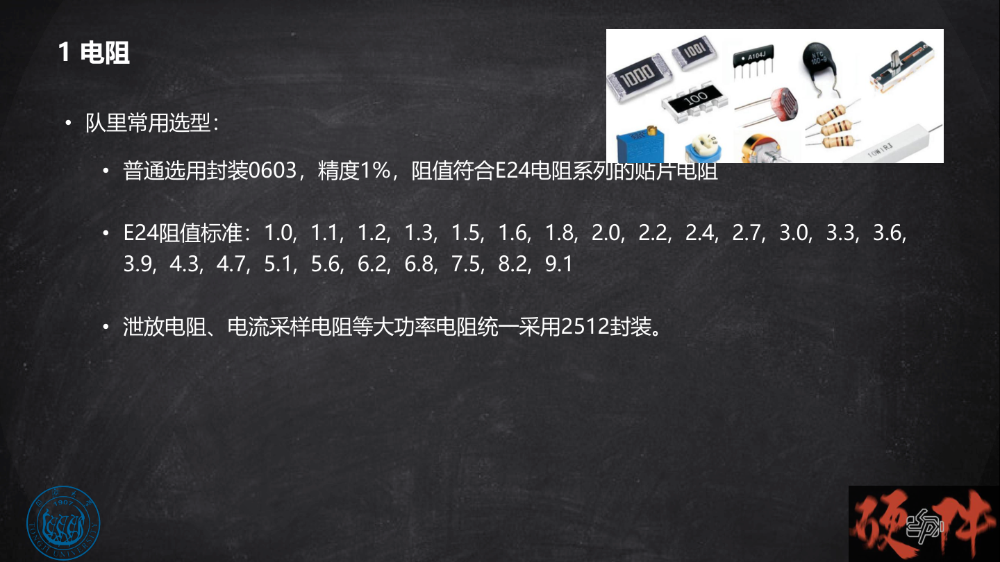

**电阻的作用**不止限流：

- **分压限流**：最典型的是发光二极管限流电阻——LED 有固定正向压降，串联电阻把电流限制在额定范围；
- **阻抗匹配**：用于高速 PCB 通信，与传输线理论相关（课件用 10 米电缆+示波器展示不同匹配电阻下的信号反射，R=50Ω 时波形最干净）；
- **传感器作用**：压敏、热敏、光敏电阻把物理量变成电阻变化；
- **调节时间常数**：R 与 C 组成 RC 电路，改变 R 即可控制电容充放电速度；
- **热效应**：电烙铁、热风枪；
- **0Ω 电阻**：用于电路调试测试、跳线、兼容设计、单点接地。

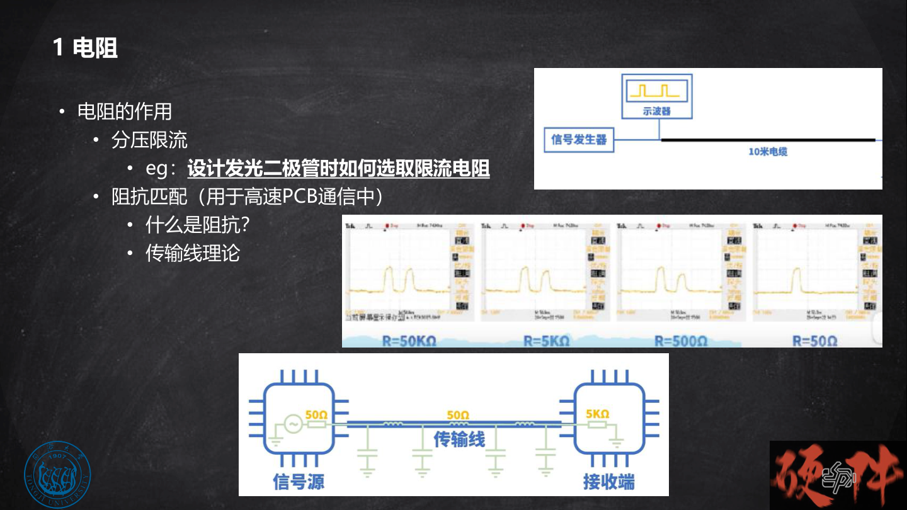

### 2.2 电容

**主要参数**：标称容量、精度、额定电压、绝缘电阻、温度系数、等效串联电阻（ESR）、漏电流等。单位：pF → nF → μF → mF → F。

**分类与选择**：

- **陶瓷电容**：电极板夹着电介质（瓷片），发展出多层陶瓷电容 **MLCC**——体积小巧、价格便宜、ESR 小，是板上去耦主力；
- **薄膜电容**：用于 220V 交流场景和 450V 以上高压场景；
- **电解电容 / 固态电容 / 钽电容**：大容量场合使用。

队里容值 1μF 以内的电容统一采用 **0603 封装、50V 耐压、10% 精度**，常用容值覆盖 100pF~1.0μF（100/150/220/330/470/680 pF，1.0~68nF，100nF~1.0μF 各档）。

**电容作用——隔直通交**：

- 构成高通/低通滤波器；
- **延时**：时间常数定义为电容电压从初始值衰减到原来 $1/e$ 倍所用的时间，可用 RC 给高电平加一点小延时；
- **去耦（本质还是滤波）**：每个 IC 电源脚旁放一颗 0.1μF（100nF）电容就近吸收电源线上的高频噪声。"为什么是 0.1μF""滤波的波从哪来""大小电容搭配与摆放顺序"都是实战要点。

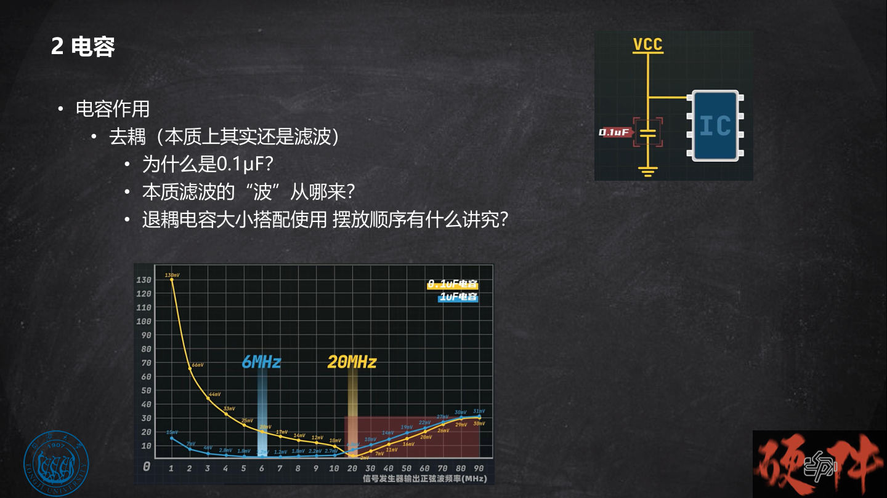

### 2.3 电感

核心一句话：**流经电感的电流不能突变**。当电路试图让电流突变时，电感会"竭力阻止"这种突变（产生反向感应电动势）；阻止不了就很危险（所以要续流）。两大作用：

- **储存能量**：这是升降压 DC-DC 电路的理论基础（第5讲展开）；
- **选择特定频率信号（滤波）**；
- 电磁效应——无线充电（略讲）。

### 2.4 二极管

**特性曲线**：正向有导通压降（硅管约 0.6~0.8V、锗管约 0.2~0.3V），低于导通电压的区间叫"死区电压"；反向基本截止，直到反向击穿电压 $U_{BR}$。

**主要应用**：

- 正向：续流作用（给电感感应电流提供回路）、整流作用；突然施加反向电压时存在**反向恢复时间**，由此分出肖特基二极管、快恢复二极管；
- 反向工作状态：TVS 瞬态电压抑制二极管、稳压二极管；
- 其他：发光二极管（LED）、变容二极管；
- 电路分析：正向导通时要计入导通压降，利用正向压降可做**钳位**。

### 2.5 MOS 管（增强型 nMOS 为主）

MOSFET = Metal-Oxide-Semiconductor Field-Effect Transistor。本讲主要介绍**增强型 nMOS**。G（栅极）和 S（源极）之间存在寄生电容。

- **参数选择**：$V_{gsth}$（开启阈值电压）、$R_{dson}$（导通电阻，越小越省电、发热越小）、$C_{gs}$（栅源电容，影响开关速度）；
- **主要用途**：作开关管用、防反接用、作电平转换用；
- 米勒平台、设计注意事项感兴趣可自行查阅手册。

**nMOS 和 pMOS 的区别**：两者沟道类型相反，导通条件与载流子方向不同；一个关键工程问题是"**nMOS 能放在上面（高边）吗？灯泡放在上面和放在下面有何区别？**"——nMOS 做低边开关（负载在上方、MOS 管接地）最自然，做高边需要自举或电荷泵，而 pMOS 更适合高边。

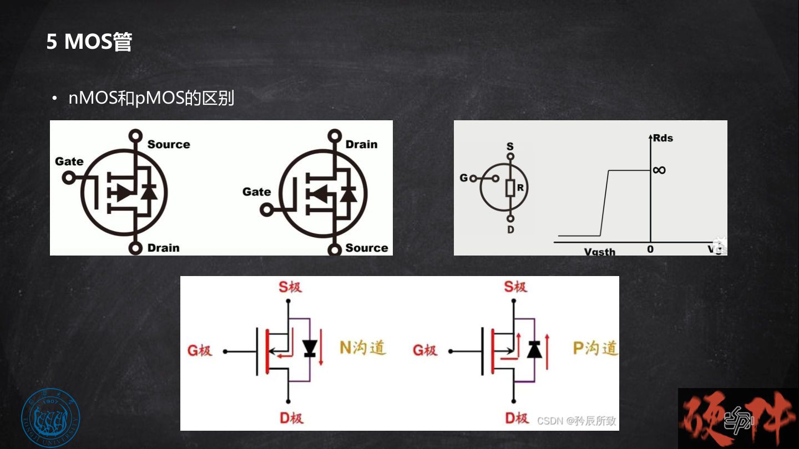

### 2.6 三极管

与 MOS 管"很类似"但本质不同：**三极管是电流控制元件**，等效模型里只有 b-e 结存在持续的基极电流，三极管才会被打开（MOS 管是电压控制栅极、几乎不取电流）。

MOS 管优势：省电、导通阻抗小（还是省电）。三极管应用场景：小功率场景便宜（小于 100mA 的 LED 灯、小功率直流电机），耐高压比 MOS 管容易。

### 2.7 继电器

**工作原理**：控制端通断电，驱动内部线圈产生磁场吸合/释放触点，从而用小电流控制大电流回路。

**继电器和 MOS 管的区别**（选型对照表）：

| 对比项 | 继电器 | MOS 管 |
|---|---|---|
| 开关速度 | 慢（机械吸合有毫秒级动作与声音） | 快（无机械动作） |
| 声音 | 有"咔哒"声 | 无声 |
| 电流方向 | 触点无方向 | 注意体二极管方向 |
| 隔离 | 控制端与被控制端**不共地**（电气隔离） | 控制端与被控制端共地 |
| 控制端电流 | 线圈需要持续电流维持 | 栅极几乎不取电流 |
| 价格 | 较贵、体积大 | 便宜、体积小 |

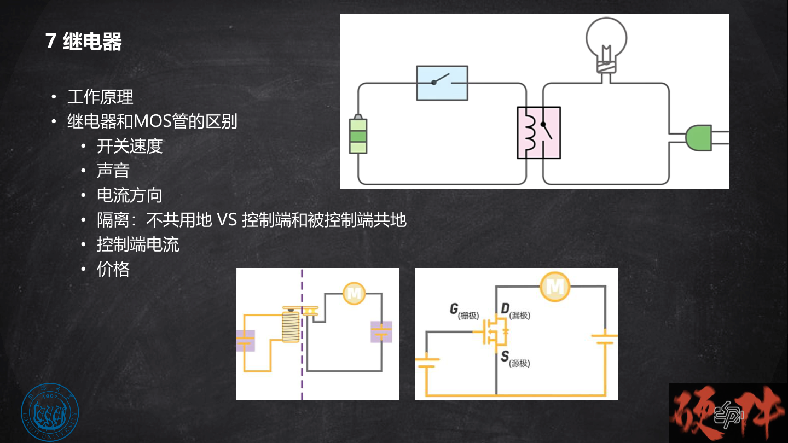

### 2.8 LDO 线性稳压电源

问题：12V 怎么得到 5V？如果负载是 5Ω，串联一个 7Ω 电阻分压行不行？——负载一变分压就变，不可能靠人工时刻调 R1，于是把这整块调整电路做成芯片，就是**线性稳压电源（LDO）**：内部用运放比较输出采样与基准、驱动调整管，把多余电压"吃掉"维持稳定输出。

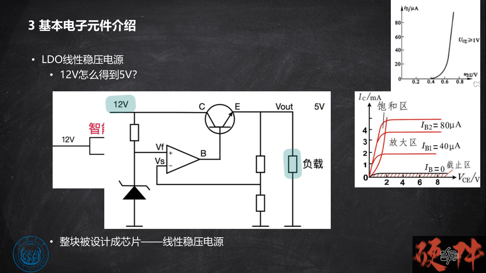

> 注意：LDO 只能降压、且自身会把压差以热量形式耗散（大电流大压差时发热严重）；需要高效率、大压差变换时用第5讲的 BUCK 开关电源。

## 第3讲 有线通信协议介绍

机器人上 MCU 与电机电调、传感器、C 板之间都靠有线协议对话。学每个协议都从**物理层**（线怎么接、电平多少）和**数据链路层**（帧怎么组织、怎么校验）两层入手。

### 3.1 通信基础概念

- **物理层规范**：连接器类型、电缆规格、针脚分配、信号电压水平，规定如何通过物理介质（光缆/双绞线/同轴电缆）传输数据；
- **数据链路层协议**：帧同步、帧结构、地址字段、控制字段、数据载荷、帧校验序列，规定如何组帧、错误检测与流量控制；
- **如何用电路传递信息**：文字用数字表示（ASCII 码），数字由一串二进制表示，二进制再用高低电平表示；8 根线并行传 8 位，只有一根线就只能**串行**一位一位传；
- **同步 / 异步传输**：按约定节奏 x 秒发一位（异步，双方约好波特率），或额外加一根标准时钟信号线（同步传输）；
- **起始位、停止位**：解决"一帧数据从哪开始、到哪结束"；
- **单工 / 半双工 / 全双工**：单向 / 双方不能同时发 / 可同时收发；
- **物理电平与逻辑电平**：高电平不一定是"1"，低电平不一定是"0"（如 RS232 是负逻辑）；
- **点对点 / 总线连接**：总线上主机先发从机地址呼叫对应设备，得到应答后双方通信，其他设备保持沉默；
- **波特率 vs 比特率**：波特率是载波调制状态改变次数（Baud），比特率是每秒有效位数（bit/s）；大多数场景数值相等，即每秒发送的位数。

### 3.2 串口通信 UART

UART（Universal Synchronous/Asynchronous Receiver/Transmitter），超简单的一种通信。

**物理层**：

- 针脚 RX、TX，**TX 与 RX 要交叉连接**（我的发接你的收），共地 GND；
- **全双工**；
- 信号电压水平有三种：
  - **TTL 逻辑**（Transistor-Transistor Logic）：常见 3.3V/5V，高电平 ≥2.4V、低电平 ≤0.4V；
  - **RS232 电平——"负逻辑"**：−3~−15V 表示 1，+3~+15V 表示 0；
  - **RS485 电平——差分信号**：两线压差 (A−B) +2~+6V 表示 1，−2~−6V 表示 0，**半双工**。

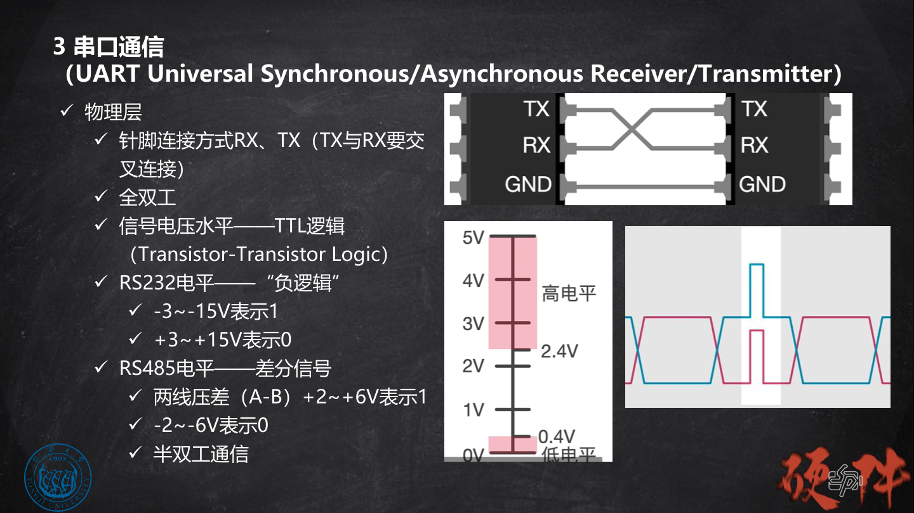

**数据链路层**：一帧数据 10 位或 11 位。

- **波特率**：串口通信速率；
- **起始位**：标志一帧开始，固定为低电平；
- **数据位**：有效载荷，1 为高电平、0 为低电平，**低位先行（LSB）**；
- **奇偶校验位**：按数据位计算得来，用于数据验证；
- **停止位**：帧间隔，固定为高电平。

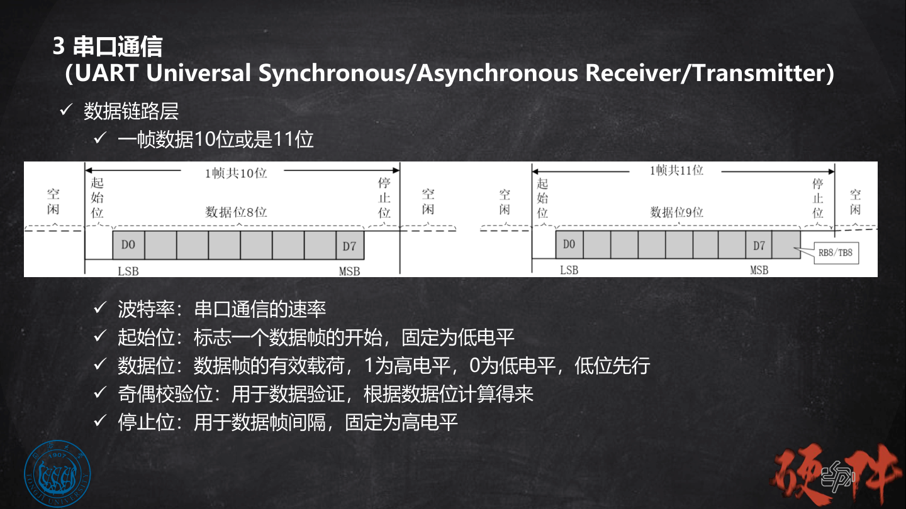

### 3.3 I2C 通信

I2C（Inter-Integrated Circuit），芯片与芯片之间的通信，两根线搞定。

**物理层**：

- 两根通信线：**SCL（Serial Clock，时钟线）、SDA（Serial Data，数据线）**；
- **半双工、同步、总线通信**，TTL 电平；显性电平为 0，隐性电平为 1；
- 所有设备的 SCL 连在一起、SDA 连在一起；靠**开漏输出 + 上拉电阻**（一般 4.7kΩ 左右）实现"**线或逻辑**"：任意一个设备输出 0，总线就呈现低电平（所以 I2C 不会发生两个设备强推相反电平的短路）。

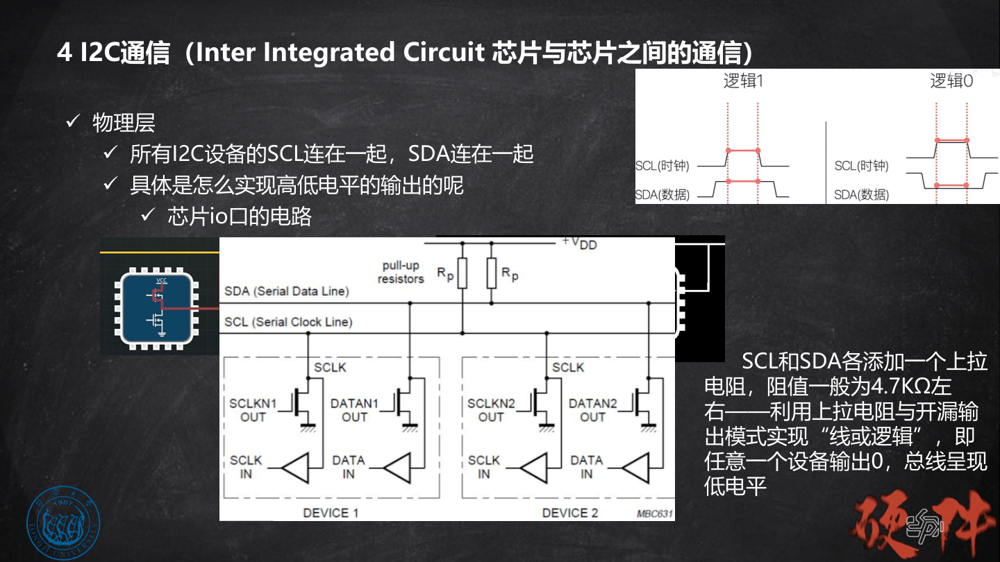

**数据链路层**：

- 空闲状态：数据线和时钟线都处于高电平；
- **起始信号**：SCL 高电平期间，SDA 从高电平切换到低电平；
- **7 位从机地址码（高位先行）**：先确定和哪一个设备通信，后跟读 1 / 写 0 数据位；
- **应答信号 ACK**（Acknowledge）：接收方拉低应答；
- 常见速率：标准模式 100 kbit/s、快速模式 400 kbit/s、快速模式增强 1 Mbit/s（再快硬件成本很高），**速率由主机控制**。

### 3.4 SPI 通信

SPI（Serial Peripheral Interface，串行外设接口），以高速度著称。

**物理层**，四线工作：

| 线名 | 全称 | 方向 |
|---|---|---|
| MISO | Master Input Slave Output | 主入从出 |
| MOSI | Master Output Slave Input | 主出从入 |
| SCK | Serial Clock | 串行时钟（主机提供） |
| SS / CS | Chip Select / Slave Select | 从机片选 |

**全双工、同步、总线通信、TTL**。

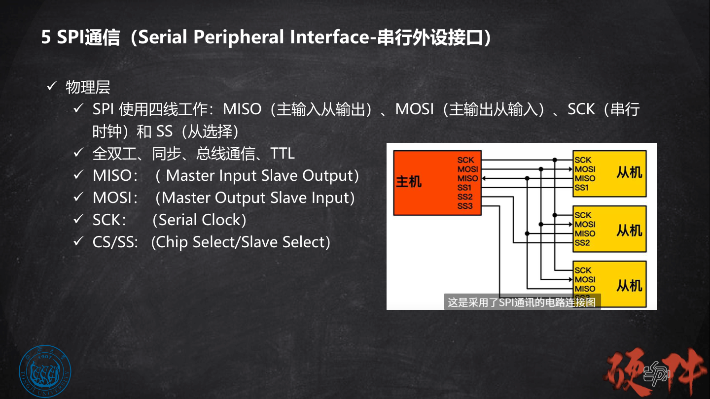

**数据链路层**：

- 开始发送：主机拉低 CS 选中从机，开始接收数据；
- 主机发送时钟信号，从机检测时钟边沿（上升沿或下降沿）立即写入/读取数据线上的信号，一位一位移动；
- 靠**数据缓存区 + 移位寄存器**完成主从之间的数据交换；
- 即使只想单向传输，也必须遵守全双工格式：接收方也得发一个"虚拟数据"（填充数据）保持协议完整，通常被发送方忽略；
- SPI 没有规定高位/低位优先，为保证正确一般设定为**高位优先（MSB）**。

### 3.5 CAN 总线

CAN（Controller Area Network Bus，控制器局域网总线），机器人电机通信的主力。

**特性一览**：

- 两根通信线 CAN_H、CAN_L，线路少；**差分信号通信，抗干扰能力强**；
- 高速 CAN（ISO11898）：125k~1Mbps，距离 <40m；
- **异步**，无需时钟线，通信速率由设备各自约定；
- **半双工**，可挂载多设备，多设备同时发送时通过**仲裁**判断先后；
- **11 位（标准格式）/ 29 位（扩展格式）报文 ID**，区分消息功能同时决定优先级（**ID 小的优先**）；
- 可配置 1~8 字节有效载荷；
- 支持广播式和请求式两种传输；
- 具备应答、CRC 校验、位填充、位同步、错误处理等特性。

**物理层电平**：CAN 用两线电压差（$V_{CAN\_H}-V_{CAN\_L}$）传数据位：压差 0V 表示逻辑 1（隐性电平），压差约 2V 表示逻辑 0（显性电平）。两线"收紧"无压差是默认状态，"张开"产生压差才需要设备干预。**显性电平和隐性电平同时出现时，总线保持显性电平**——符合常用的"0 强于 1"。总线两端各配一个 120Ω 终端电阻。

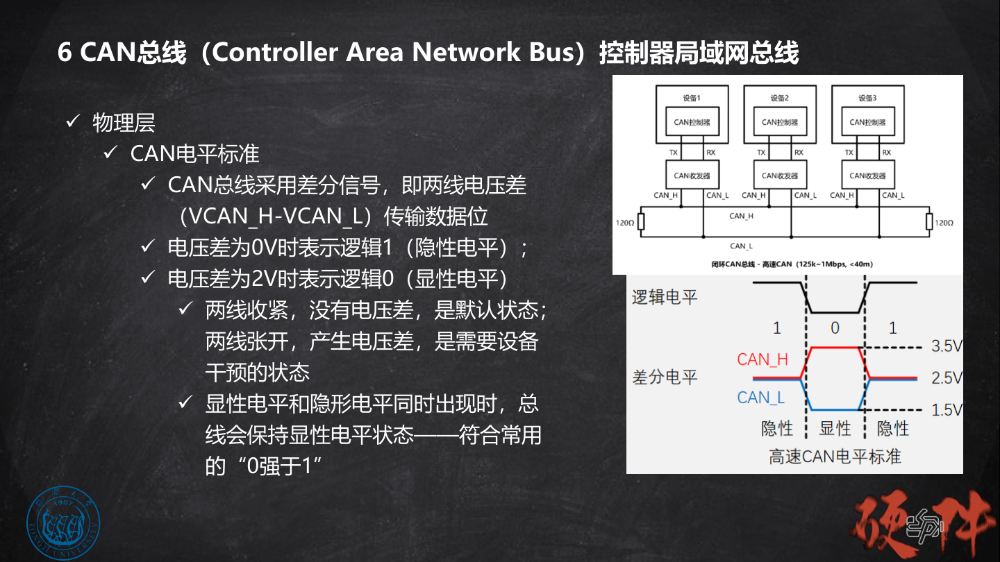

**数据链路层——五种帧**：CAN 协议规定数据帧、遥控帧、错误帧、过载帧、帧间隔五类。设备检测到连续 11 个隐性电平即认为总线空闲、可以发送。

**数据帧字段**（标准格式）：

| 字段 | 全称 | 作用 |
|---|---|---|
| SOF | Start of Frame | 帧起始，表示后面波形为数据位 |
| ID | Identify | 标识符，区分功能、决定优先级 |
| RTR | Remote Transmission Request | 远程请求位，区分数据帧/遥控帧 |
| IDE | Identifier Extension | 扩展标志位，区分标准/扩展格式 |
| SRR | Substitute Remote Request | 替代 RTR，协议升级留下的无意义位 |
| r0/r1 | Reserve | 保留位，为后续升级留空间 |
| DLC | Data Length Code | 数据长度，指示数据段字节数 |
| Data | — | 1~8 字节有效数据 |
| CRC | Cyclic Redundancy Check | 循环冗余校验 |
| ACK | Acknowledgement | 应答位，判断是否被接收 |
| EOF | End of Frame | 帧结束 |

- **遥控帧**：请求式传输——接收方先发遥控帧，某设备有该 ID 就用数据帧广播出来；遥控帧无数据段，RTR 为隐性电平 1，其余同数据帧；
- **错误帧**：所有设备监督总线，发现位错误/填充错误/CRC 错误/格式错误/应答错误时发出错误帧破坏数据、终止当前发送；
- **过载帧**：接收方收不过来时发出，延缓发送以平衡总线负载；
- **帧间隔**：把数据帧/遥控帧与前面帧分开；主动错误状态 3 位，被动错误状态 3 位+8 位延时传输（不可靠）。

**位填充**：数据帧和遥控帧发送到总线前都要位填充——发送方每发 5 个相同电平后自动追加一个相反电平填充位，接收方检测到后自动移除。作用：防止数据长时间不变、增加定时信息利于再同步、区分正常数据流与错误帧/过载帧、保持总线活跃防止被误认为空闲。

**仲裁（资源分配）**：CAN 只有一对差分线，同一时间只能一个设备操作总线。规则 1 **先占先得**：已有设备发送时其他设备不能再发（可以发错误帧/过载帧破坏）。规则 2 **非破坏性仲裁**：多个发送需求同时到来时按 ID 号仲裁，**ID 小（优先级高）取得总线控制权，ID 大（优先级低）仲裁失利后转入接收状态，等下次总线空闲再试**——仲裁失利不会破坏已发数据。

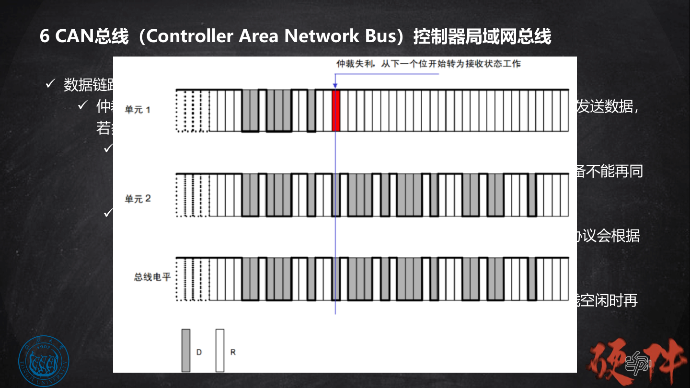

### 3.6 保留节目：为什么一个 CAN 总线上不可能同时控制 8 个大疆 3508 电机？

大疆 3508 电调的控制报文占用两个标识符：`0x200` 控制 ID 1~4，`0x1FF` 控制 ID 5~8，每个标识符对应 4 个 ID 的电调，控制电流值范围 −16384~16384，对应转矩电流 −20~20A；反馈报文为 `0x200+电调ID`（如 ID 1 为 0x201），DLC 8 字节，包含转子机械角度高低位、转子转速高低位、实际转矩/电流、电机温度，默认发送频率 **1kHz**。

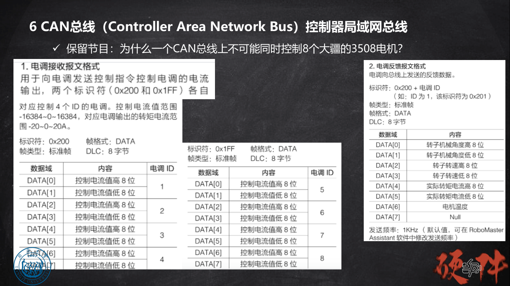

思考题结论方向：两个控制 ID 刚好覆盖 8 个电调，但每个电调都以 1kHz 周期收发反馈，叠加总线负载、仲裁延迟与带宽限制，实际工程中无法在一条总线上无冲突地同时带动 8 个——这也是整车通常按云台/底盘分多条 CAN 的原因。

## 第4讲 成为"焊武帝"

焊接是硬件组的基本功，本讲讲清焊接原理、操作要点和常用线材接头。

### 4.1 焊接基本原理

焊接是利用熔化的金属焊料（多指锡基合金）连接两个或多个金属表面，分四步：

1. **热传导**：提前给烙铁头挂锡，利用烙铁头与焊锡的接触，把焊锡和被焊器件一起加热；
2. **润湿**：焊接双方充分加热后，焊锡在张力作用下自发覆盖工件表面，向焊点持续添加焊锡；
3. **扩散**：浸润完成后持续保持一段时间加热，直到焊锡完全包裹焊点、不再自发流动；
4. **凝固**：快速移开烙铁头同时保持工件稳定，直到充分冷却，焊锡凝固。

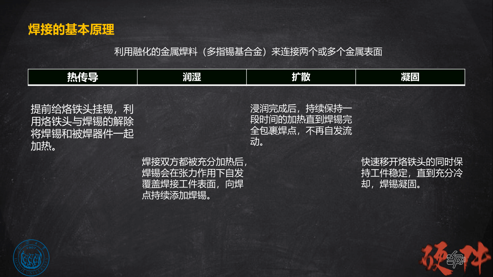

### 4.2 焊接七要点

1. **控制温度**：常见烙铁温度 250°C 左右，焊线（粗线/大焊点）300~350°C 左右；
2. **挂锡**：锡的热传导速率很快，利用流动焊锡包裹焊点；
3. **防氧化**：不要把烙铁温度调过高，高温加速氧化，氧化膜阻碍热传导；
4. **耐心**：充分加热焊点，散热性能好的焊点更要充分加热才能使焊锡湿润；
5. **助焊剂**：除去氧化膜、增强焊锡流动性、防止拉丝；
6. **上锡面积**：保证焊锡包裹焊点但不要过多，兼顾电气性能与物理强度；
7. **稳**：冷却过程中不能乱动，否则会出现空腔虚焊。

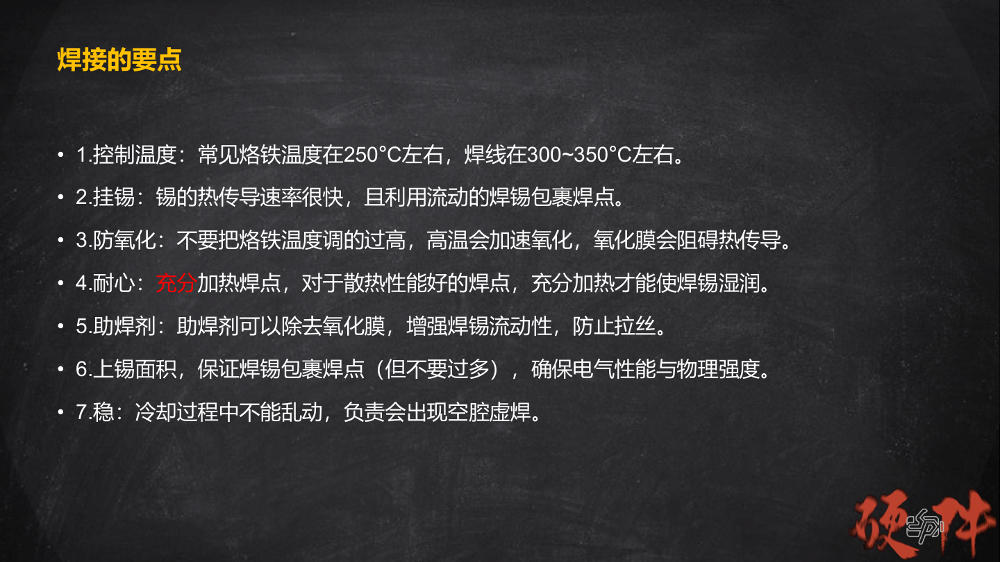

### 4.3 线材与接头

- 焊接常用电源线：**14AWG、16AWG**（AWG 美国线规，数字越粗线越细、载流越小）；
- 常用接头：艾迈斯（AMASS）XT30、XT60；
- 规格对照（三代接头）：XT30 额定电流上限 20A、配 16AWG；XT60 额定 35A、配 12AWG。

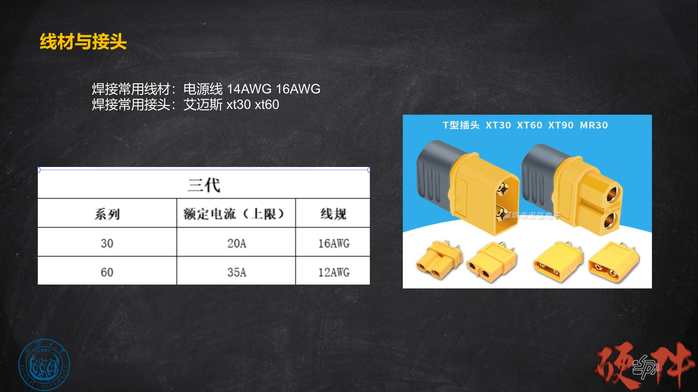

## 第5讲 必备的硬件知识

本讲是画电源板的核心知识：GPIO 输出结构、上下拉电阻、三种电源保护电路、BUCK/BOOST 开关电源与电流检测。

### 5.1 GPIO 输出：推挽、开漏与高阻

先看 GPIO 内部输出图：输出端由上管 Q1（接 VCC）和下管 Q2（接地）两个 MOS 管组成，关注两个管子的开关状态。

- **推挽输出**：Q1 开 Q2 关 → 输出高电平；Q1 关 Q2 开 → 输出低电平；两个管子一推一拉，描述 IO 口电流输出的动态，所以叫"推挽"，驱动能力强。

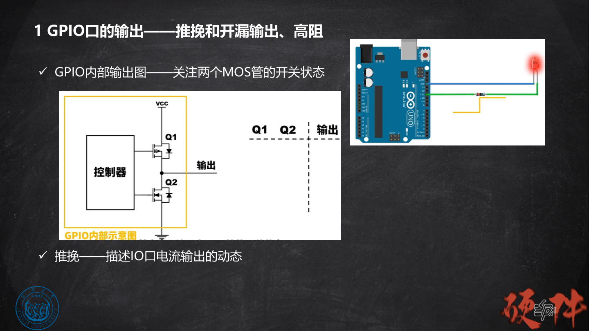

- **开漏模式**：只保留下管 Q2（上管去掉），输出端靠外部上拉电阻接到想要的电压。两个用途：**改变上拉电压**（实现电平转换）、**实现多个 GPIO 控制同一个输出**（多个开漏并联线与，任一拉低即为低）；
- **高阻态**：Q1、Q2 都关闭，输出端既不接上也不接下，相当于悬空。

### 5.2 上拉电阻与下拉电阻

- **上拉电阻**：什么时候需要？刚讲的开漏输出、单片机的上拉输入模式。默认状态把 IO 口钳位在高电平（3.3V）。
- **上拉电阻取值权衡**：上拉电阻小 → 驱动能力强但漏电流大；上拉电阻大 → 漏电流小但驱动能力弱，需折中。

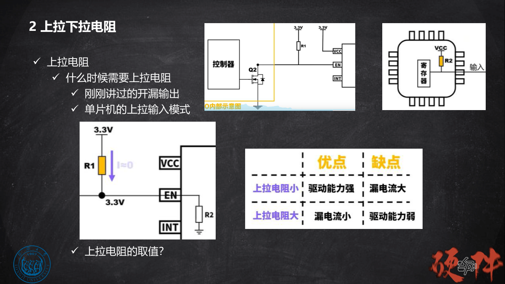

- **下拉电阻**：默认状态把单片机输入口钳位在 0V；外部输入 5V 时能很好地钳位在高电平。

### 5.3 防反接、过压保护、缓启动电路

**上电缓启动（soft start）**：软开启指电源缓慢开启，限制启动瞬间的浪涌电流。不做软开启时电源电压上升很陡峭，浪涌电流远高于稳态电流，可能损坏设备或触发断路器。设计上只要增加一个电容 C1、一个电阻 R2 即可实现软开启（RC 延缓 MOS 栅极电压建立）；其他位置抑制浪涌常用串联电阻。

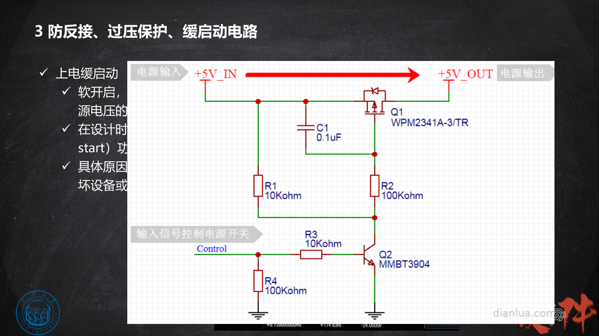

**过压保护（OVP）**：使用 TVS（瞬态抑制二极管）做可靠高效的钳位保护。

**防反接**有三种做法：

1. **二极管防反接**：串联一颗二极管（如 SS34），反接时截止不通；注意参数**最大整流电流**。单片机系统里无论 12~24V 电源入口还是 5V 入口，即便是电池场合（低功耗产品电流小、二极管压降小），这个电路基本都适用；
2. **保险丝 + 二极管防反接**：反接时电流经二极管流过保险丝，因保险丝电阻极小、电流很大而烧断；缺点是接反一次保险丝就烧坏，实际可选用**自恢复保险丝**；
3. **MOS 管防反接**：损耗小、无压降，实际产品常用。

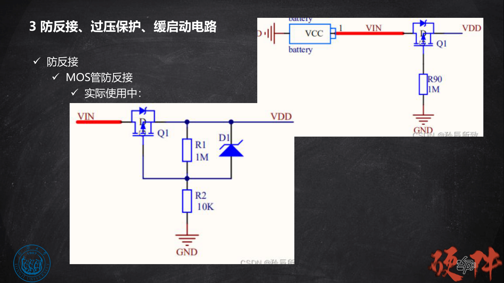

MOS 防反接两个电阻细节：

- **GS 并联电阻**：起防 ESD 静电作用、提供固定偏置，阻值一般取 5k 至数十 k；
- **GS 串联电阻**：与输入电容 $C_{iss}=C_{gd}+C_{gs}$ 形成 RC 充放电电路，减小瞬间电流，不至于损毁 MOS 管的驱动芯片。

注意：使用 NMOS 做防反接会破坏地回路，高边防反接要选对管型。课件最后把三种保护综合到 C 板实际电路上：**C 板 = 防反接 + 上电缓启动 + 过压保护**三合一。

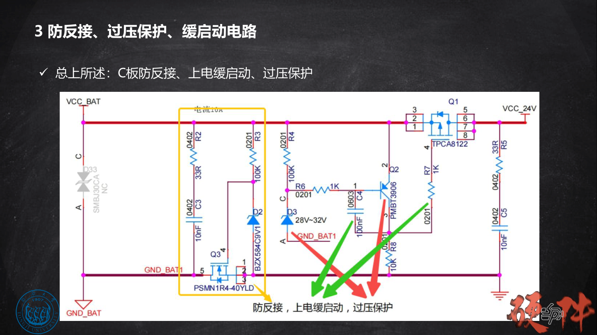

### 5.4 BUCK、BOOST 与 BUCK-BOOST

**DC-DC 电源**（直流-直流变换器，又称直流斩波器）：把一个固定直流电压变换为另一个直流电压，三大基本拓扑：BUCK（降压）、BOOST（升压）、BUCK-BOOST（升降压）。

**BUCK（降压）**：12V 如何获得 5V？直接高速开关通断，让占空比约 $5/12\approx42\%$，平均电压即下降；再加入电感平滑电流、续流二极管给电感提供回路，输出就稳定成 5V。

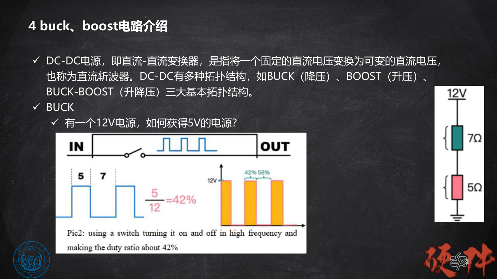

加入电感后，MOS 导通时电感电流上升、MOS 关断瞬间电感经续流二极管维持电流，电流变成带小纹波的锯齿波，更平稳。

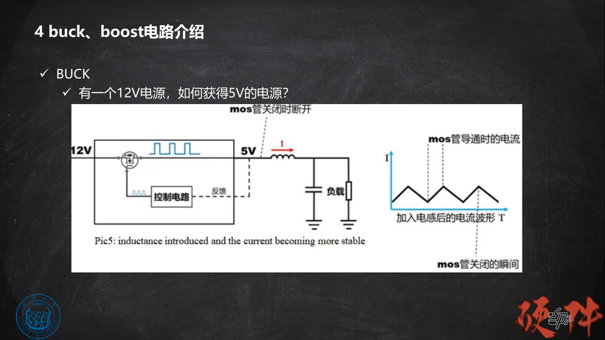

**BOOST（升压）**：5V 如何输出 12V？利用"电感电流不能突变"——开关闭合时电感储能、电流线性上升，开关断开时电感感应电动势叠加电源，经二极管给负载/电容充电，把电压"抬"上去。

**注意点：升压不是万能的**——功率守恒 $V_{in}I_{in}=V_{out}I_{out}$，电压升高的代价是电流减小。例：1.5V×2A = 12V×输出电流 → 输出电流只有 0.25A，带不动大负载。

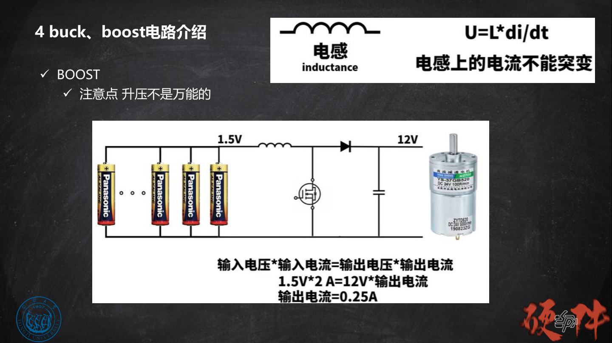

**BUCK-BOOST**：分两开关（反相型）与四开关（升降压一体，可正可反）两种拓扑。

**理论计算——伏秒积平衡原理**：开关电源稳定状态下，电感充放电进入稳态，开关管导通期间流入电感的电流增量，等于关断期间流过电感的电流减量（一个周期内伏秒积平衡），由此可推导出各拓扑的输入输出电压关系。

### 5.5 电流检测电路

测负载电流需要一颗小阻值**采样电阻**串入回路，再用运放放大其上的压降。分两种位置：

- **低端运放电流检测**：采样电阻放在回路低端（靠近地），运放 LMV321 放大，$I=V_{OUT}\cdot R_6/((R_3+R_6)\cdot R_8)$；
- **高端运放电流检测**：采样电阻放在电源侧（高端），适合不能破坏地回路的场合，$I=V_{OUT}\cdot R_2/(R_1\cdot R_4)$，且 $R_1=R_7$、$R_2=R_5$ 做电阻匹配。

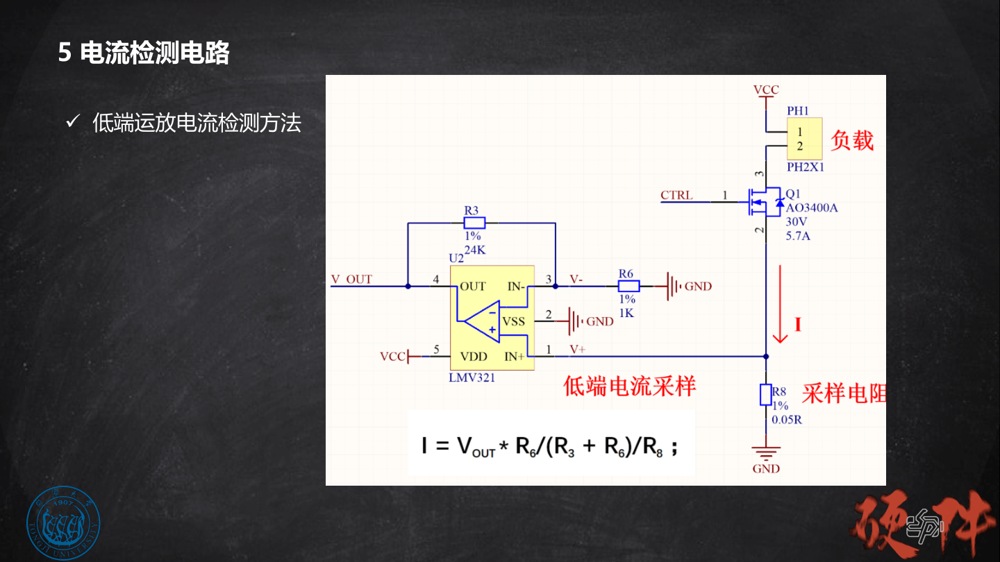

> 小作业：阅读一颗降压芯片的 datasheet，分析其原理与手册中得到的知识，为第6讲画 buck 电源做准备。

## 第6讲 最小系统板绘制（大作业）

### 6.1 大作业与控制核心

**【大作业】绘制以 STM32F103C8T6 为主控的系统板**（资料包：25-26SP 硬件组招新大作业）。实现功率控制、电机控制等功能需要一个控制核心，并把写好的程序烧录进去——这个核心就是 MCU。单单一颗芯片不够，还需要外围配套电路。

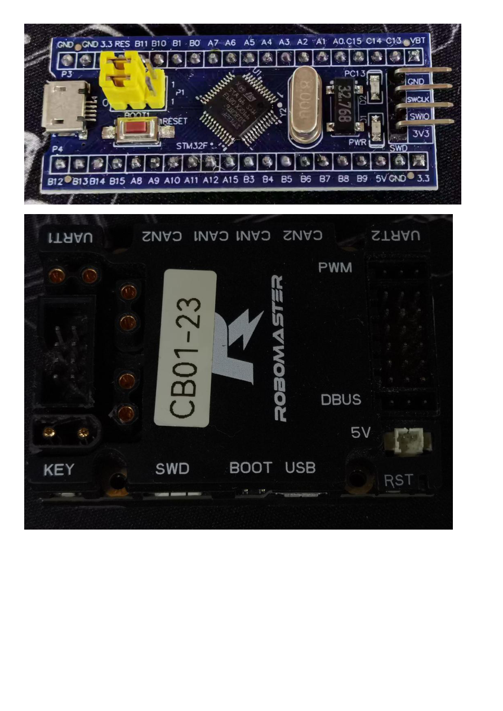

本板核心芯片：**STM32F103C8T6**（Cortex-M3，LQFP48 封装，队里最常用的入门主控）。开画前先学嘉立创 EDA 专业版基本操作（课件附软件教学合集）。

### 6.2 外围电路模块清单

绘图流程：**确定外围电路模块 → 确定主要元器件（芯片）→ 确定引脚定义 → 连线**。

| 外围模块 | 设计需求 | 主要芯片/器件 |
|---|---|---|
| 电源电路（最小系统板部分） | 提供 5V、3.3V 供电，24V 入电 XT30 公头 | TPS5430DDA（buck 到 5V）、AMS1117（LDO 到 3.3V） |
| 时钟电路——晶振 | 外壳接地，剩余脚接主控时钟引脚，同时经 22pF 接地 | 常见 8MHz，如 TAXM8M4RDBCCT2T |
| 复位电路——NRST | 正常运行高电平，低电平触发复位 | 复位按键 + 电容电阻 |
| 启动模式选择 | 最常用 BOOT0：主闪存存储器启动 | BOOT 跳线 |

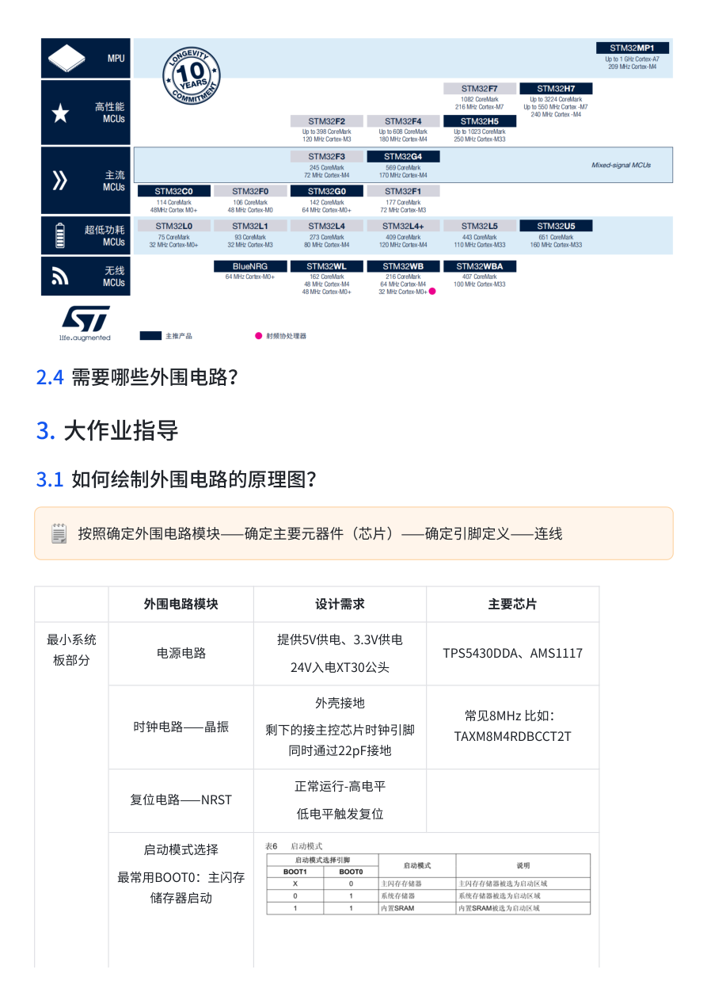

启动模式（BOOT1/BOOT0 组合）：00 主闪存存储器启动（最常用）、01 系统存储器启动（串口下载）、10 内置 SRAM 启动。

### 6.3 其余外围与接口

- **指示灯 LED**：指示工作状态（PC13）与供电状态；
- **程序调试电路 SWD（Serial Wire Debug）**：PA13-DIO（串行数据输入输出）、PA14-CLK（串行时钟），使用 MX1.25 4PIN 插口；
- **CAN 通讯**：PA11-CAN_RX、PA12-CAN_TX，供电引脚加去耦电容；CAN 收发器 **TJA1050M/TR**，匹配终端电阻 120Ω，GH1.25 2PIN 接口；
- **USB 接口 16pin**；
- **USB 转串口**：GH1.25 4P 立贴，专用芯片 **CH340**；
- **电流采样**：专用芯片 **INA226**（替代第5讲的运放分立方案）。

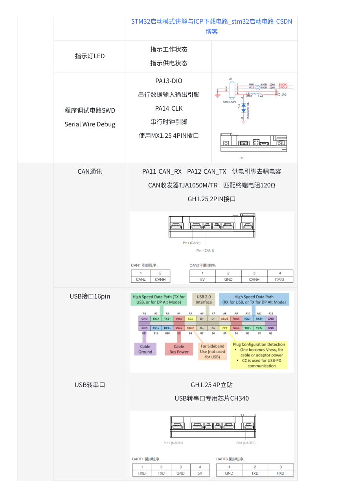

### 6.4 布局知识点与布线要点

**布线重点**：

- 核心：所有东西都有**寄生电阻、寄生电容、寄生电感**，布线就是在控制它们；
- 电源线适当加粗（经验值 **20mil 走 1A**，大电流可铺铜甚至开窗）；
- 要有完整地平面（回流路径）；
- 信号线注意阻抗（少过孔、差分要求等长），避免反射与信号延时；
- 敏感线路和高干扰线路都应减小回路面积、降低干扰（回路即天线）；
- 不许走锐角，少走直角；
- 走线不宜太密（降低耦合）。

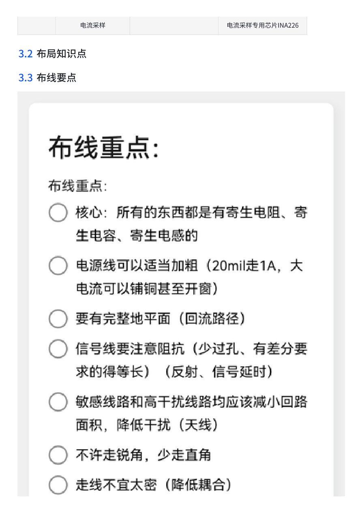

**PCB 设计要点**：

- 记得检查封装对不对；
- 要留有人看得懂的丝印（字体和大小很重要）；
- 优秀布局节省大量时间，所以**先布局再布线**；
- 布局最好让大电流或信号单向流通（如左进右出）；
- 留意回流路径，降低信号间串扰（信号回流与开关电源之间不能交叉）；
- 功率地、数字地、模拟地有需要时分开、隔离或单点接地（考虑压降）；
- 电容位置很重要（滤波/解耦/旁路），小的更近、大的更远；
- 要便于生产（焊接、贴片、风焊）。

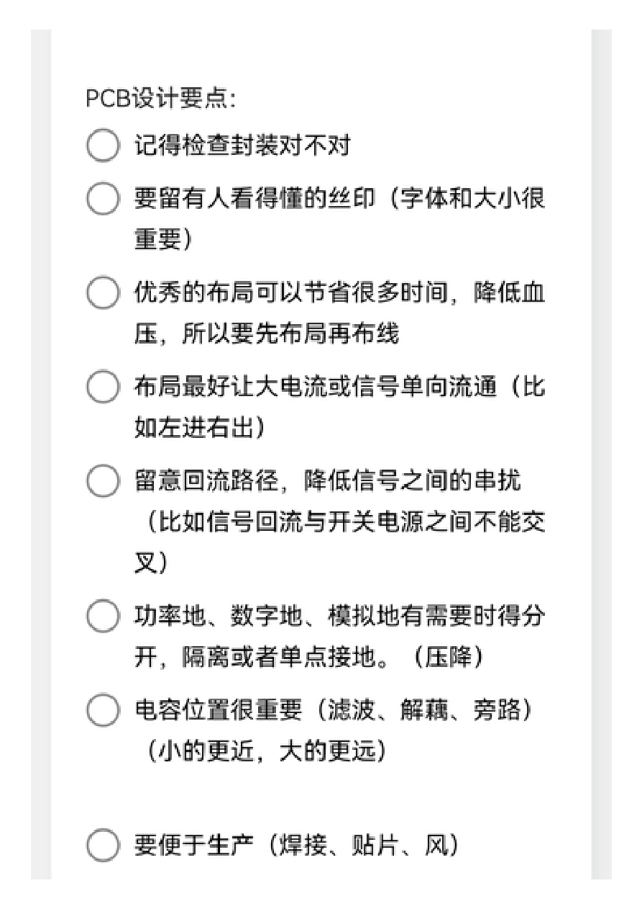

> 选讲拓展：铺铜与填充、焊盘与过孔。大作业完成后按资料包要求提交原理图与 PCB 文件，线下在实验室打样焊接调试。
