
# 同济大学 RoboMaster 招新培训笔记 · 机械组
> 来源：同济大学（SuperPower）RoboMaster 战队招新培训课件视频笔记，视频见 B 站空间：https://space.bilibili.com/651837546
> 整理：东南大学成贤学院 Solaris（天钺）战队 ｜ 2026-10-17 ｜ 配图均截取自原课件
> 用途：入队新生复习笔记，供战队学习交流使用

## 培训大纲

| 讲次 | 课件 | 核心主题 |
|---|---|---|
| 第1讲 SW零件绘制 | 1-SP26机械培训 SW零件绘制.pptx | SolidWorks 界面与快捷键、草图绘制与完全定义、拉伸凸台等特征建模、板件/机加工件/打印件画法 |
| 第2.1讲 标准件及标准件库使用 | 2.1-SP26机械培训 标准件及标准件库使用.pptx | 螺栓/螺母/垫片/铆钉等紧固件、扳手钳子等工具、防松与螺栓长度选择、麦迪标准件库 |
| 第2.2讲 装配与出图 | 2.2-SP26机械培训 装配与出图.pptx | 自下而上/自上而下设计、标准与机械配合、6 自由度完全定义、干涉检查、工程图视图与公差标注 |
| 第3讲 材料与工艺 | 3-SP26机械培训 材料与工艺.pptx | 应力与应力集中、玻纤板/碳板/亚克力、PLA/尼龙/TPU/树脂打印件、机加工件与车铣、铝方管/碳管/POM |
| 第4讲 轴系招新 | 4-SP26机械培训 轴系招新.pptx | 轴向/径向与欧拉角、三类轴承、刚性/挠性联轴器、涨紧套、导电滑环、轴系设计原则与铰链/云台/轮系案例 |
| 第5讲 传动系统及电机使用 | 5-SP26机械培训 传动系统及电机使用.pptx | 齿轮/带/链/丝杠传动、导向机构、联轴器选型、3508/2006/6020/关节/轮毂电机、电机安装设计 |
| 附：轴系作业 | 轴系作业.rar | 配合第4讲轴系设计的课后练习（压缩包，不展开） |

> 学习主线：机械组在整车流程中处于较高优先级，核心能力是**画图（建模）**；流程为「建模 → 装配 → 联调 → 迭代」，零件来源分机加工、标准件、商品件、3D 打印件等。

---

## 第1讲 SolidWorks 零件绘制

本讲是机械组的入门工具课：先认识 SolidWorks（SW）界面与提速技巧，再从「草图」到「特征」完成单个零件建模，最后区分板件、机加工件、打印件三类常见零件的画法差异。

### 1.1 机械组工作概述与 SW 界面

整车开发中机械与电控、视觉协同，机械优先级较高，核心是画图能力。一个零件从无到有的链条是：**建模 → 装配 → 联调 → 迭代**；零件按来源分为机加工件、标准件、商品件、打印件等。

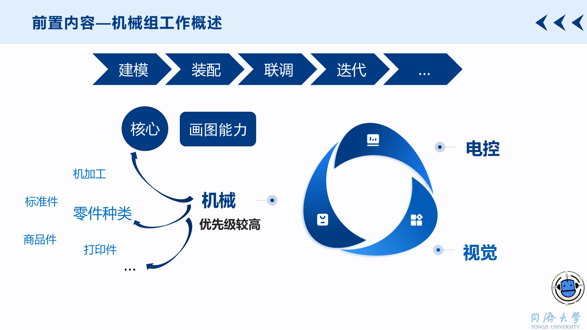

SW 界面三大块：

- **菜单栏**：新建、打开、保存、重建模型、选项；撤销 `Ctrl+Z`，恢复 `Ctrl+Y`。
- **功能选项卡**：切换「草图/特征/装配体/工程图」等选项卡，每个选项卡对应不同命令与快捷键。
- **绘图区**：常用**剖面视图**——选择不同平面作为剖面，用绘图区箭头和两个半圆环调整位置、角度，用来查看外部看不到的内部特征。

### 1.2 用快捷键与鼠标笔势提高画图速度

建议不要一直点选项卡图标，而是为常用命令绑定快捷键、配合鼠标笔势，形成肌肉记忆。自定义方法：搜索需要的命令 → 点击「快捷特性」→ 直接按下想绑定的键。

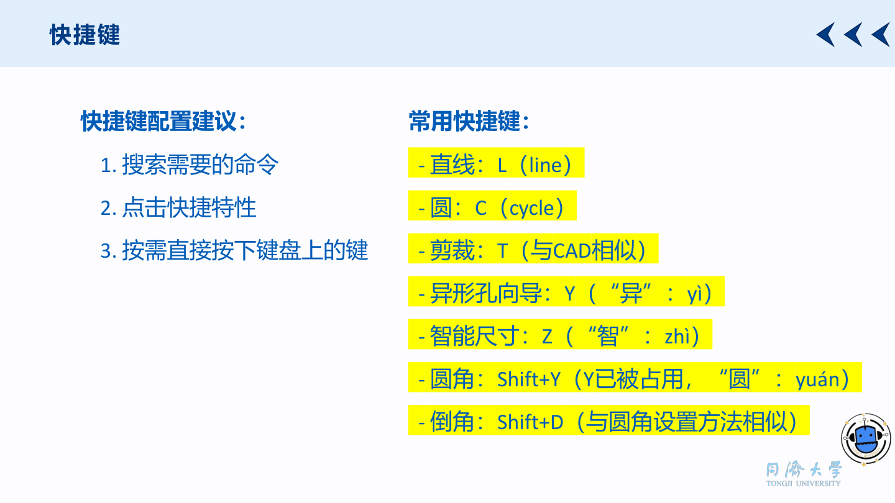

课件给出的常用快捷键：

| 命令 | 快捷键 | 记忆点 |
|---|---|---|
| 直线 | `L` | line |
| 圆 | `C` | cycle |
| 剪裁 | `T` | 与 CAD 相似 |
| 异形孔向导 | `Y` | 「异」yì |
| 智能尺寸 | `Z` | 「智」zhì |
| 圆角 | `Shift+Y` | Y 已被占用，「圆」yuán |
| 倒角 | `Shift+D` | 与圆角设置方法相似 |

**鼠标笔势**：在绘图区按住鼠标右键划出方向触发命令，同样可自定义；快捷键与笔势二选一或结合使用，目标都是减少鼠标移动点击。

### 1.3 建模的根本：草图绘制

建模思路：先画一张二维草图，对草图形状施加「拉伸/旋转」等运动得到三维实体，再通过多个实体的交集、并集拼成复杂模型。所以**草图是一切建模的根本**。

新建草图的常用方法：

1. 右击平面 → 新建草图（自动正视于该平面）；
2. 直接用快捷键/鼠标笔势唤起「直线、圆」，再选取绘制平面；
3. 在选项卡点「绘制草图」，按提示选择基准面。

小技巧：右击平面点「正视于」可把平面转正；通过绘图区左上角小设计树（小三角）也能选择基准面。

### 1.4 草图必须「完全定义」

- **完全定义**：草图必须完全定义。约束不完全时曲线呈**蓝色**、草图名称后带 `(-)`；完全定义后曲线变**黑色**。不知道哪里没定义时，拖动蓝色线条看哪个方向还能动。
- **属性选项卡**：绘图区左侧始终有属性栏，可调整当前图形的参数、类型；整个 SW（零件、装配体、工程图）里创建的特征都能在这里改参数。

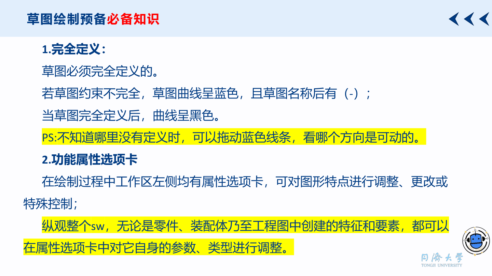

**草图约束的目的就是让草图完全定义**，约束分两类：

1. **尺寸约束**：标注长度、直径、角度等数值；
2. **几何约束**：水平、竖直、重合、同心、相切、相等、中点等关系。

### 1.5 草图各元素的绘制

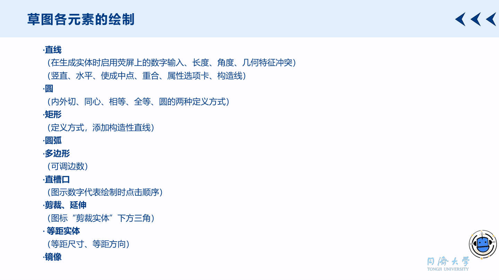

各元素要点：

- **直线**：可启用荧屏数字输入长度/角度；注意竖直、水平、中点、重合等几何关系，可转构造线。
- **圆**：内外切、同心、相等、全等，掌握圆的两种定义方式（圆心半径/三点）。
- **矩形**：注意定义方式，可添加构造性直线。
- **圆弧、多边形（可调边数）、直槽口**：图示数字代表绘制时的点击顺序。
- **剪裁、延伸**：在「剪裁实体」图标下方三角里切换。
- **等距实体**：设置等距尺寸与方向；**镜像**用于对称图形。

进阶设置：`选项 → 系统选项 → 草图 → 勾选「在生成实体时启用荧屏上的数字输入」`；画图形前勾选左侧属性栏「添加尺寸」。草图元素转构造线用 `Alt+C`；退出草图可在绘图区右上角或右键菜单操作。

**课堂练习要点**：先找准基准点；先标定形尺寸、后标定位尺寸；优先用辅助线；尽量少标尺寸；避免黄色/红色的过定义尺寸。

### 1.6 从草图到实体：特征建模

**拉伸凸台**是最常用的特征。开环草图并非不能拉伸——按住 `Alt` 点击拉伸区域，点旁弹出的拉伸图标即可。拉伸可选择不同终止模式（给定深度、成形到顶点、成形到面、到离指定面指定距离、成形到实体、两侧对称），也可选「从」哪个基准面开始拉伸。

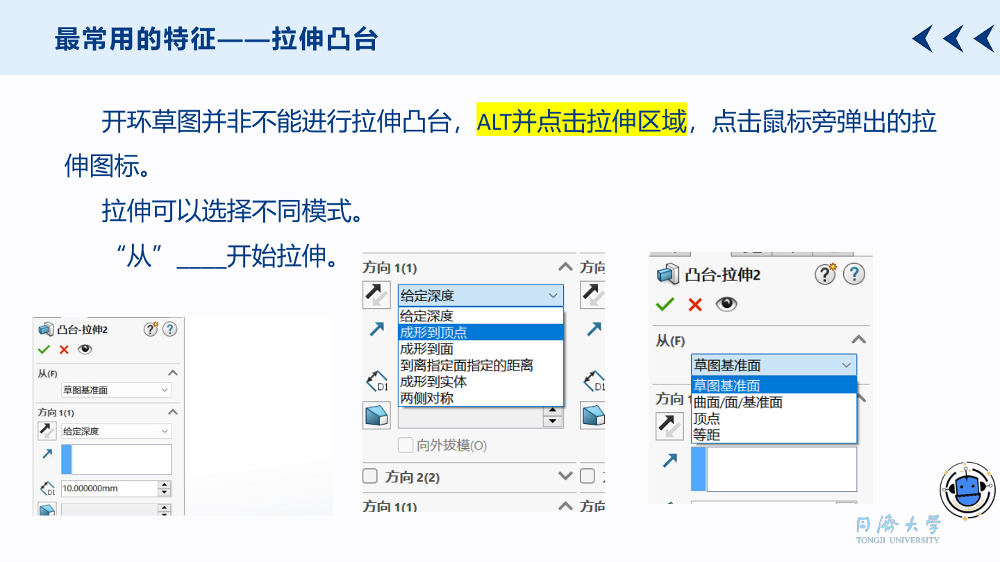

其他常用特征清单：

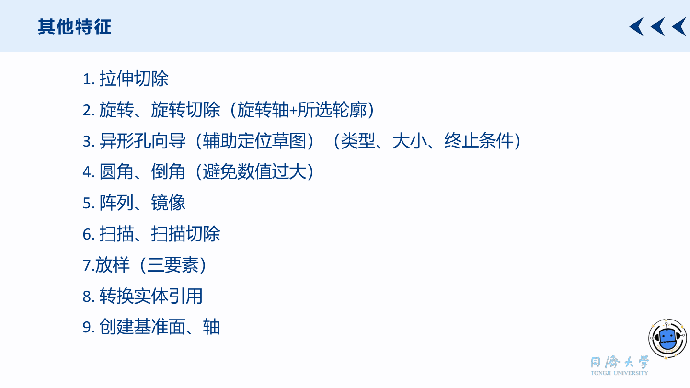

1. **拉伸切除**：在实体上切出槽/孔；
2. **旋转、旋转切除**：需要旋转轴 + 所选轮廓，适合做回转体（如轴、套）；
3. **异形孔向导**：配合辅助定位草图，选类型、大小、终止条件；
4. **圆角、倒角**：避免数值过大；
5. **阵列、镜像**：批量复制重复特征；
6. **扫描、扫描切除**：沿路径走轮廓；
7. **放样**：三要素（多个截面轮廓）；
8. **转换实体引用**：把已有边线投影到当前草图；
9. **创建基准面、轴**：为非默认平面上的特征提供参考。

### 1.7 三类零件的画法差异

**板件**：只涉及一个方向的特征生成，可近似看作二维绘图——在一定厚度的拉伸实体上做切除和形状调整。注意多用辅助线便于改图；孔大小多用「相等」几何约束减少标注；可适当做有限元轻量化。

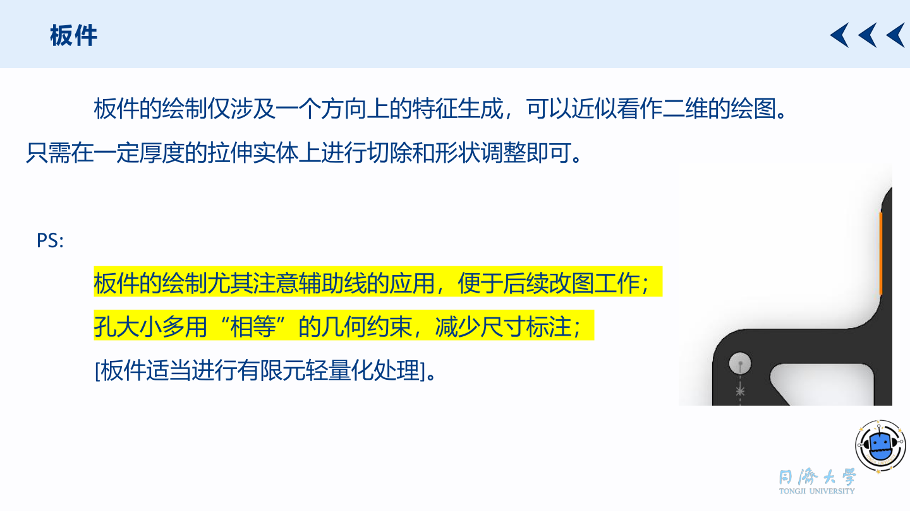

**机加工件**：常规三维画法。但机加工价格昂贵、CNC 加工方式局限大，设计时要重点关注合理性，**不要设计太复杂的机加工件**。

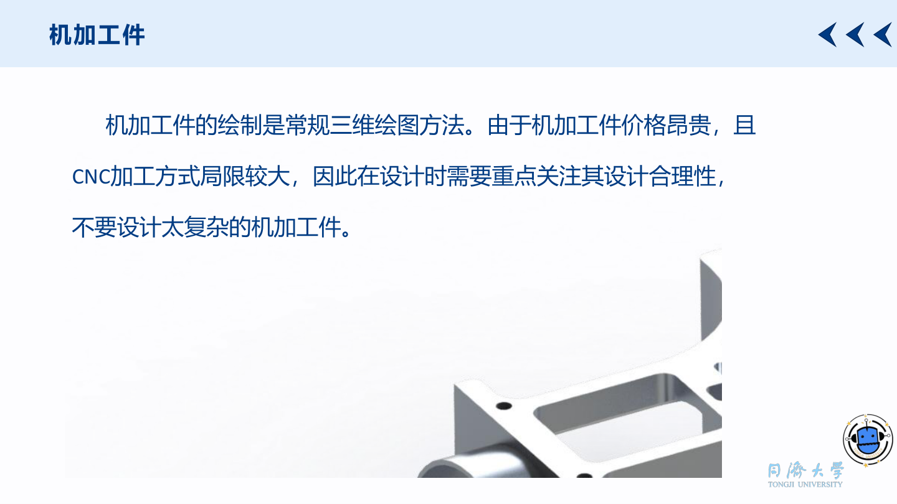

**打印件**：同样是常规三维画法，但 3D 打印是增材制造，可以制造较复杂零件，绘图角度相对自由。

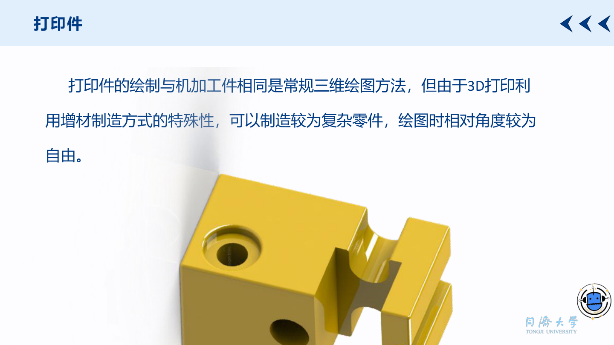

> 通用意识：无论画哪种零件都要**留余量**，任何加工方式都有误差，不存在完全无误差的加工与装配。本讲作业为二选一的零件建模练习。

## 第2.1讲 标准件及标准件库使用

本讲认识整车大量使用的现成标准件（紧固件为主）、常用装配工具，以及如何用 SW 标准件库插件直接调用标准件，而不必自己画。

### 2.1.1 零件从哪来：电气件 / 定制件 / 标准件 / 商品件

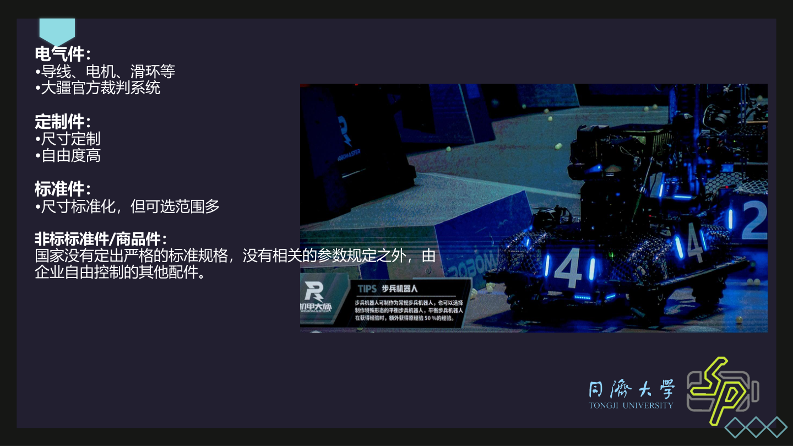

- **电气件**：导线、电机、滑环、大疆官方裁判系统等；
- **定制件**：尺寸自己定、自由度高（即自己建模的零件）；
- **标准件**：尺寸已标准化，但可选规格多（螺栓、螺母、轴承等）；
- **非标标准件/商品件**：国家没有严格标准规格、由企业自由控制参数的配件。

### 2.1.2 紧固件：螺栓

**螺栓头型**（最常用的是杯头内六角）：

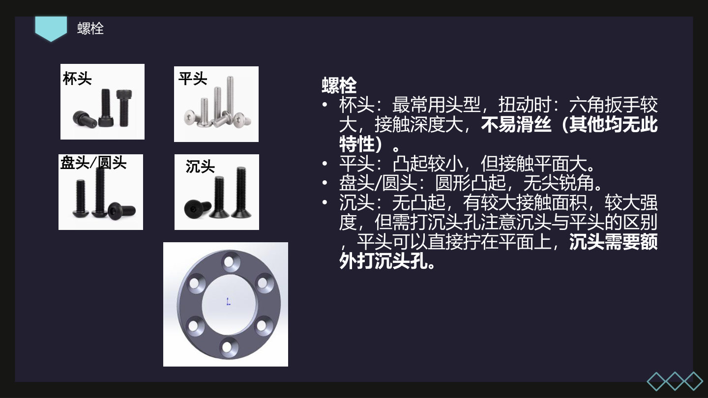

- **杯头**：最常用头型，六角扳手接触深度大、**不易滑丝**（其他头型无此特性）；
- **平头**：凸起较小，但接触平面大；
- **盘头/圆头**：圆形凸起、无尖锐角，转动件附近、容易勾线的地方多用；
- **沉头**：无凸起、接触面积大、强度较高，但需额外打**沉头孔**（注意与平头区别：平头可直接拧在平面上，沉头必须打沉头孔）。

**常用型号与性能等级**：最常用杯头内六角 **M3**；需要强度的用 M4、M5；与现成模组连接少量用 M2、M2.5。性能等级分 3.6 / 4.6 / 4.8 / 5.6 / 6.8 / 8.8 / 9.8 / 10.9 / 12.9 等十余级，**等级越高抗拉强度越高**；12.9 级表面有氧化层、有基本防锈效果。空间受限时用头部较矮的盘头/沉头（花型仍为内六角）。

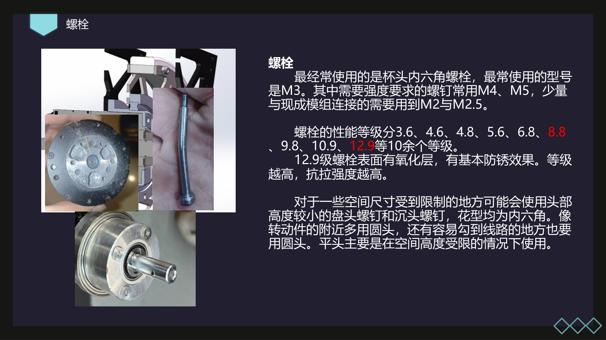

**两种常用固定方式**：

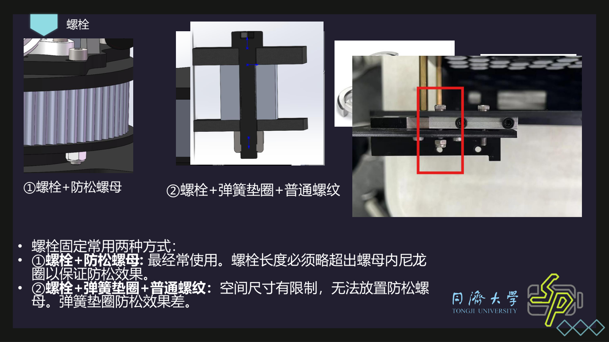

1. **螺栓 + 防松螺母**：最常用。螺栓长度必须略超出螺母内尼龙圈，才能保证防松效果；
2. **螺栓 + 弹簧垫圈 + 普通螺纹**：空间放不下防松螺母时用，弹簧垫圈防松效果较差。

**螺栓长度怎么选**：长度须比「被连接两表面距离 + 螺母厚度（可能再加垫片厚度）」略长。例：M3 防松螺母厚 4mm，两表面距离 24mm，则 $24+4=28\text{ mm}$，向上选市售标准长度 **30mm** 螺栓。先用 SW 测量功能测出两表面距离，再加螺母厚度定型号。

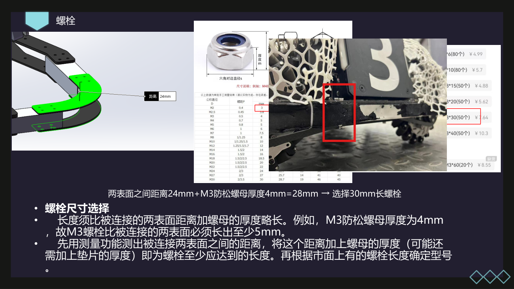

- **螺纹盲孔连接**：另一端是螺纹盲孔时，图纸要确认螺纹孔深度，螺栓长度不可超过孔深；
- **贯穿螺纹孔**：若伸出不与其他结构干涉，可适当伸出 1~2mm。

### 2.1.3 螺母、垫片与其他紧固件

**螺母**：

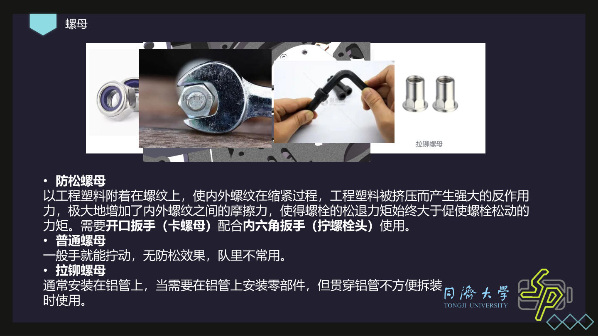

- **防松螺母**：工程塑料（尼龙圈）附着在螺纹上，拧紧时塑料被挤压产生反作用力、增大摩擦力，使松退力矩始终大于松动力矩；需**开口扳手（卡螺母）配合内六角扳手（拧螺栓头）**使用；
- **普通螺母**：手就能拧动、无防松效果，队里不常用；
- **拉铆螺母**：通常装在铝管上，需要在铝管上装零件但贯穿铝管不便拆装时使用。

**垫片**：

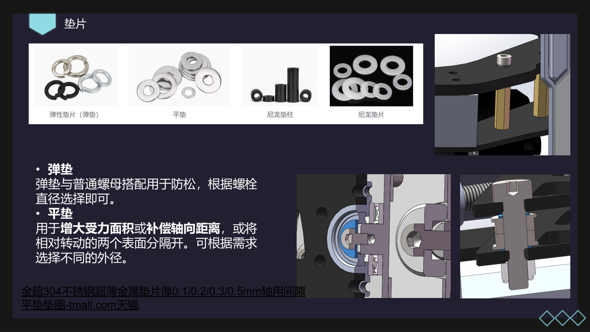

- **弹垫**：与普通螺母搭配防松，按螺栓直径选；
- **平垫**：增大受力面积、补偿轴向距离，或隔开两个相对转动的表面，可选不同外径；
- **尼龙垫**：补偿轴向距离，可买成品或 3D 打印（注意金属轴套抗压缩更好，打印材料易被压坏）。

**其他紧固件**：铆钉（铆钉枪铆接，车架保险杠常用，方便轻量但装上基本不可拆，钢强于铝）、垂直连接件（六面螺母、四孔转接件、合页，淘宝查尺寸自绘）、铝柱/不锈钢柱（铝柱用于垫高，受力选不锈钢柱、同样加弹垫）、铜嵌件（焊台加热嵌入打印件，不在受力大处用）、销（圆柱销定位/短轴传动，螺纹销导向，开口销+销轴轴向限位，弹簧销作不拆定位件）。

### 2.1.4 工具与「什么时候不能用电扳」

常用工具：扳手（六角/电动扳手、棘轮扳手、开口扳手）、钳子、拉马、拉铆枪、角磨机、电钻、台虎钳。

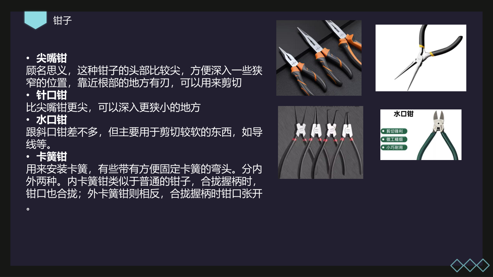

- **尖嘴钳**：头尖，伸入狭窄位置，根部有刃可剪切；**针口钳**更尖更深；**水口钳**剪较软物如导线；**卡簧钳**装卡簧，分内卡簧钳（握柄合拢钳口合拢）与外卡簧钳（握柄合拢钳口张开）。
- **拉马**：轴承与轴承座配合很紧时用螺纹压力把轴承拔出，注意垫合适物品分散压强防压坏。

**某些情况不能使用电扳**（否则容易出事）：

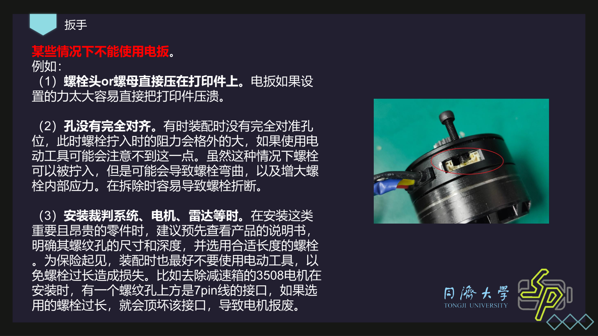

1. 螺栓头/螺母直接压在**打印件**上：电扳力太大易把打印件压溃；
2. **孔没完全对齐**：阻力异常大，电动工具察觉不到，会导致螺栓弯曲、内应力增大，拆除时易断；
3. 安装**裁判系统、电机、雷达**等昂贵件：先查说明书明确螺纹孔尺寸深度、选合适长度螺栓，最好不用电动工具。例：去掉减速箱的 3508 电机有个螺纹孔上方是 7pin 线接口，螺栓过长会顶坏接口导致电机报废。

**防松措施**：所有紧固连接都必须防松；除防松螺母、弹垫外还可用点胶螺丝、螺纹胶。防松强度：**红胶 > 蓝胶 > 弹垫**，选胶强度要谨慎。

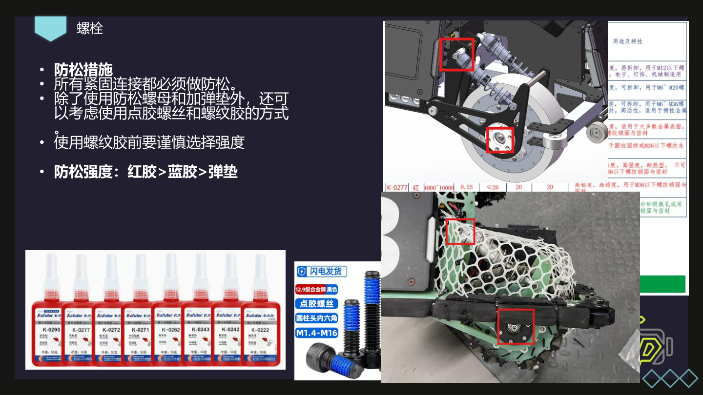

### 2.1.5 标准件库（麦迪插件 / 通用零件库）

不必亲手画标准件：SW 可装**麦迪工具集（标准件库）插件**，在目录树选标准（如 GB/T 内六角圆柱头螺钉）、规格列表选 M3/M4…、右侧属性填长度/代号/材料/类别，双击图片即生成零件，可直接拖入装配。

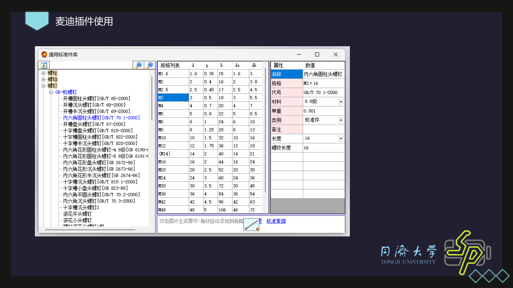

## 第2.2讲 装配与出图

单个零件画完后要在 SW 里拼成装配体，并最终出一张加工厂看得懂的工程图。

### 2.2.1 建立装配体：插入零部件

界面三要素：功能栏、设计树、装配体视窗。新建文件选「装配体」，通过「插入零部件 → 现有零件/装配体」浏览打开零件（零件必须先保存才显示）。**第一个添加的零件/子装配体默认为固定**；选第一个零件时直接在属性管理器点确定，让其坐标系与装配体重合。添加相同零件可按住 `Ctrl` 左键拖动复制。

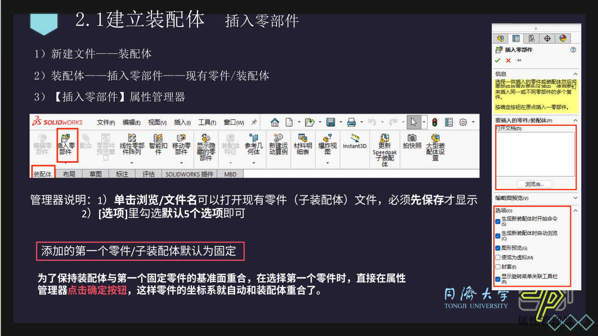

### 2.2.2 两种设计方法

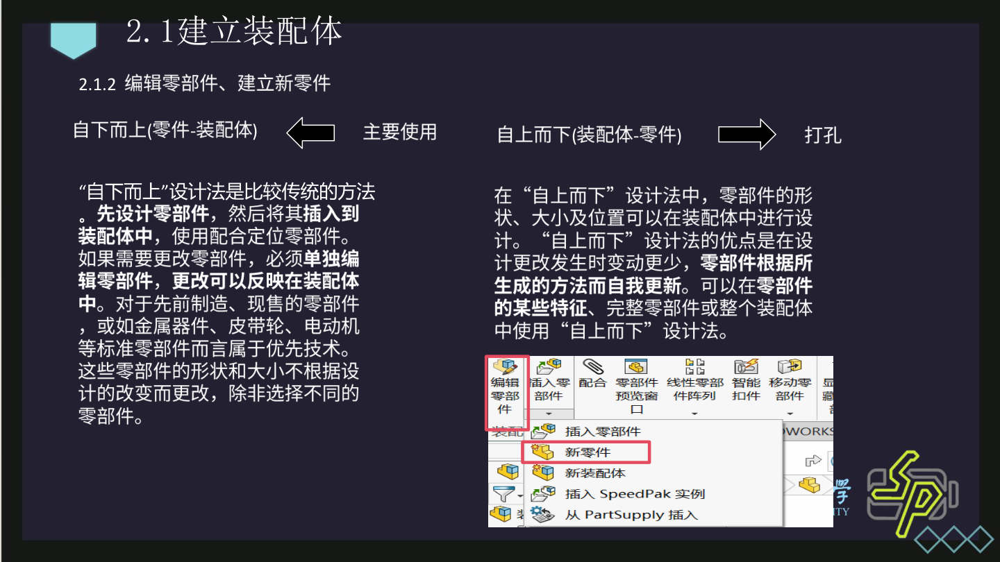

- **自下而上（零件→装配体）**：传统方法，先设计好零件再插入装配体用配合定位；改零件需单独编辑但改动会反映到装配体。金属器件、皮带轮、电机等**标准件/现售件优先用此法**（形状大小不随设计改）。
- **自上而下（装配体→零件）**：在装配体里直接定义零件的形状、大小、位置，设计更改时变动更少、零件自我更新；本队主要用于**打孔**等关联特征。

### 2.2.3 配合：标准配合与机械/高级配合

配合前把两个零件拖到接近最终位置（左键拖动、右键旋转，更精确用三重轴移动），配合更容易解算、不易报错。

**标准配合**：选要配合的实体（基准面、配合面、边线），可用多配合模式一次把多个零件与同一参考配合。常用：**重合**（同一基准面）、**同轴心**（同一中心线，用于孔/圆柱面）、**距离**（按指定距离放置）。

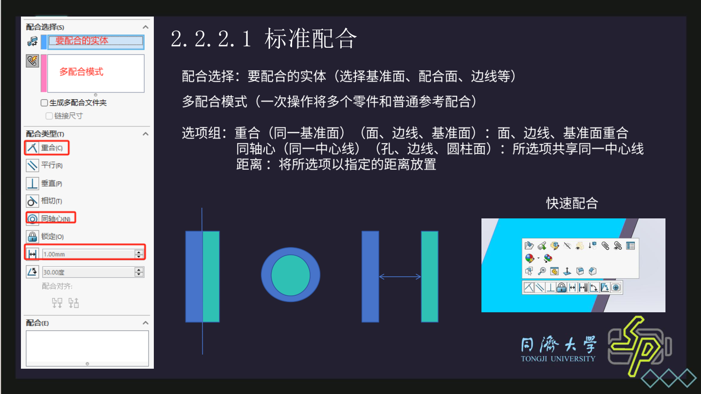

**机械配合 / 高级配合**：**齿轮**配合使两零件绕所选轴相对旋转——选分度圆传动比自动解算，选其他需手动输入传动比；**对称**（两实体绕基准面对称）；**宽度**（实现居中对齐）。

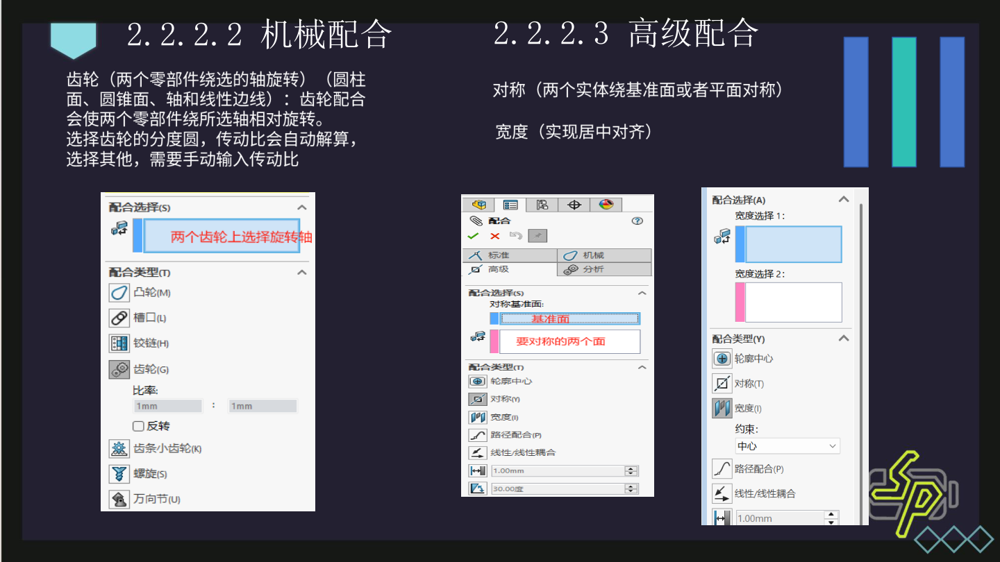

### 2.2.4 完全定义，避免过定义

除第一个固定件外，其余零件初始都是「浮动（欠定义）」，可移动并绕 3 轴转动，共 **6 个自由度**；配合的作用就是逐个消除自由度，**6 个自由度全部消除即完全约束**。SW 虽允许冗余约束，但解算慢、易报错，**不能出现过定义**。装完一个零件可拖动检查是否还有多余自由度（只看右下角状态提示可能不准）。

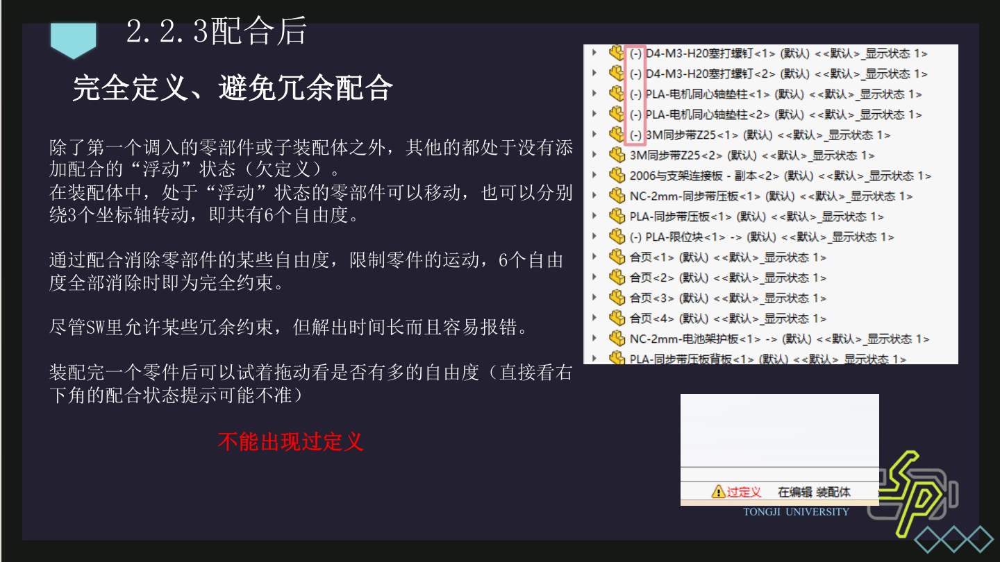

**配合报错处理**：配合导致自由度小于 0 会弹窗无法创建；改零件后再打开装配体也可能报错。有错误先修复再往下装，不要拖着；报错非常多时不要一个个查，直接全部删除重来。

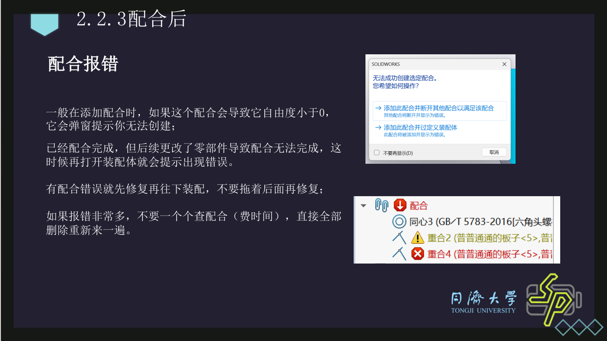

其他操作：**随配合复制**（同时复制零件和配合）；线性/圆周/阵列驱动零部件阵列；镜像（第 5 种镜像方式慎用，会生成镜像零部件）。

### 2.2.5 干涉检查与打包

- **目视检查**先看；
- **干涉检查**（评估 → 干涉检查）：选整个子装配体自动查干涉，再逐个按结果排查；
- **间隙检查**（评估 → 间隙验证）：检查给螺栓头尾留的空间和安装空间，建议把每个螺栓都装上（同类只装一个也行）。

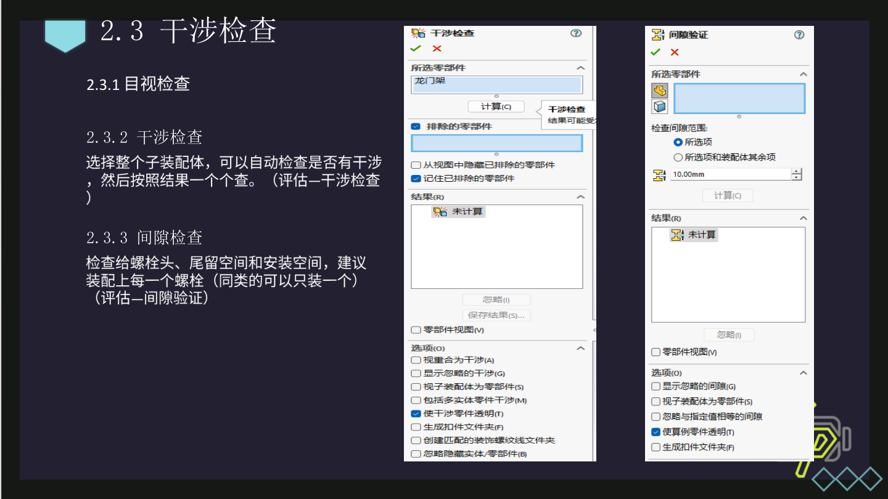

**压缩打包**：提前建好树状配合文件夹，零件存对应文件夹，压缩总文件夹后自己先解压确认装配体能正常打开，再上传。

### 2.2.6 工程图出图

核心原则：**加工商看得懂你出的图、能做出你要的东西**。

1. 新建「工程图」，或从零件 `文件 → 从零件制作工程图`；
2. 选择合理视图，一般标准三视图够用；
3. 显示样式选**第二种**才有虚线（隐藏轮廓）。

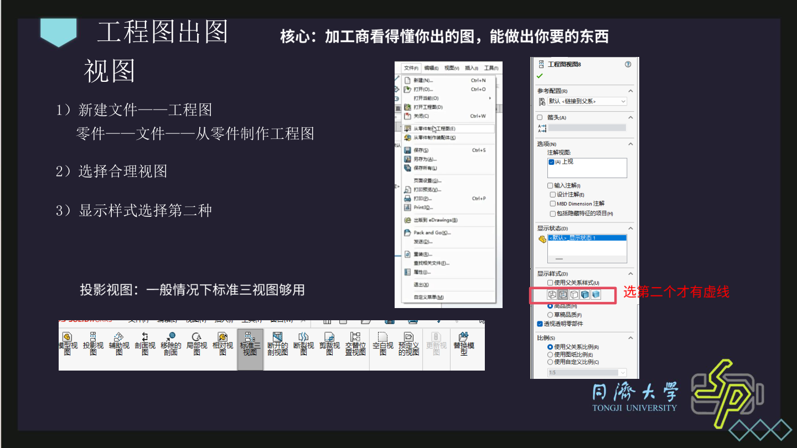

**尺寸标注：标全，宁可多标也不要少。** 公差标注三类：尺寸公差、形位公差、表面粗糙度；标注对象是除减重孔外的所有特征，尤其安装孔和安装面。尺寸公差常用 **IT7、IT8** 精度等级，公差大小由「精度等级 + 参考长度」查机械设计手册/大工程师。

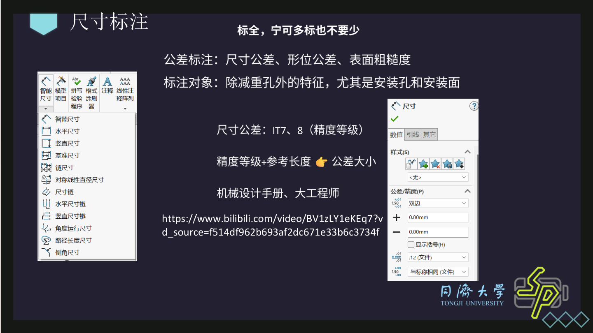

- **形位公差**：同轴度（轴、轴承）、位置度（安装孔）、跳动（轴）；
- **表面粗糙度**：常用 **3.2**；
- 补画中心线、中心符号线（遗漏需手动插入），对复杂异形孔做孔标注。

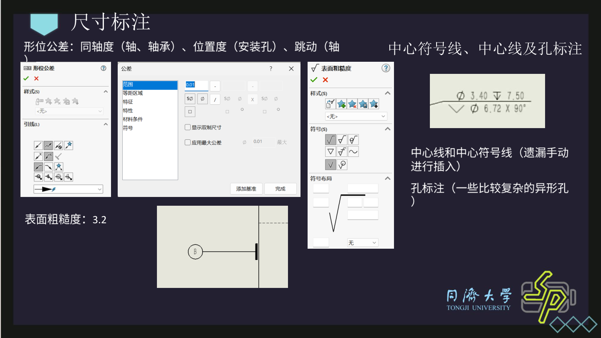

## 第3讲 材料与工艺

同一功能可用不同材料实现，本讲先补一点材料力学概念，再讲板件（玻纤/碳板/亚克力）、3D 打印件（PLA/尼龙/TPU/树脂）、机加工件和铝方管等结构材料的性能、工况与设计工艺约束。

### 3.1 材料力学简介：受力、应力与应力集中

常见受力：**拉、压、剪、扭、弯**；研究内容是强度、刚度、稳定性。**应力**是截面上一点处内力的聚集程度，反映一点内力强弱；有限元应力图颜色越深代表应力越集中，零件容易在该处破损。

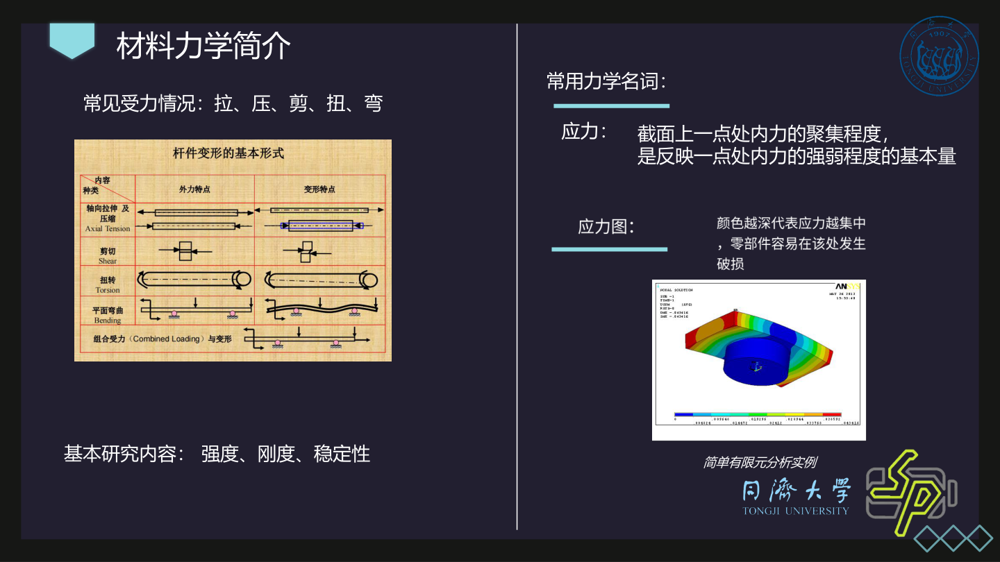

**应力集中**常发生在几何形状急剧变化处：孔、槽、缺口、焊点等，局部应力变大、失效风险升高。减小措施：①避免尖角，棱角改圆角、增大过渡圆弧半径；②改善外形用流线型/双曲率；③增加倒角或渐变过渡（最通用）。倒圆角本质是减小几何形状变化的急剧程度。

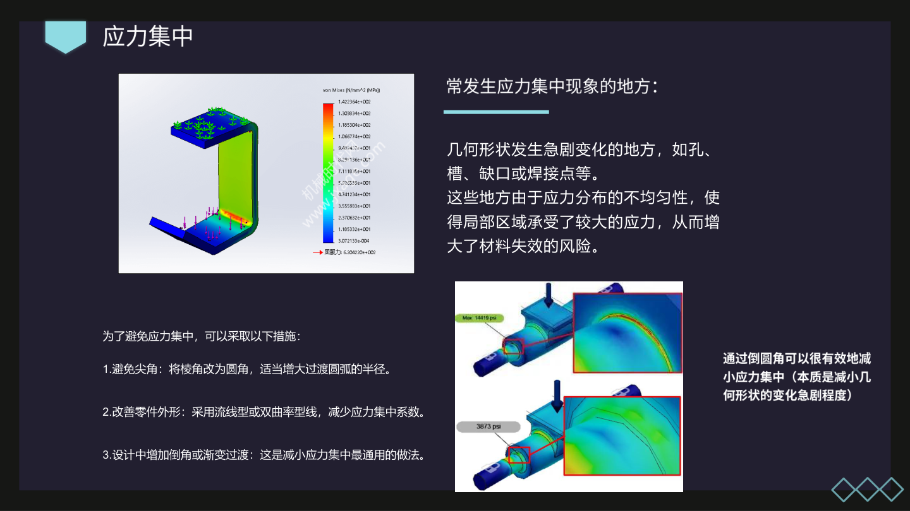

### 3.2 板件：FR-4 玻纤板

队内常用黑色 **FR-4 玻纤板**，刚度重量比高、韧性强、耐燃不导电，常用厚度 2/3/4/5mm。适合工况：抗弯（云台底板）、抗冲击（车壳）、沿板方向拉压、挠性零件（摩擦轮电机「蚊香盘」固定）、其他小受力场合（弹链）。RM 车各种受力基本都能用玻纤板，只是厚薄区别。加工方式上玻纤板**只能加工平面特征，不能加工出螺纹孔**（外发可打沉头孔）。

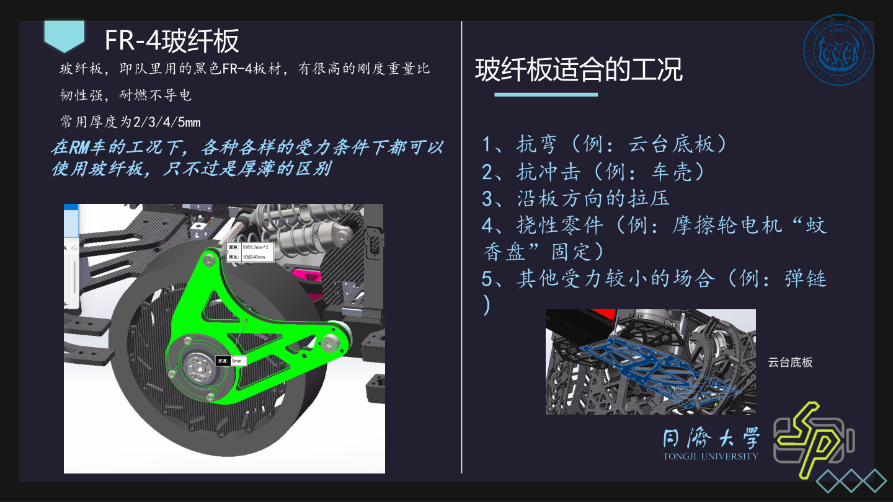

### 3.3 碳纤维板与亚克力

**碳纤维板**力学性能更优、强度高重量轻，但价格高；缺点：加工产生针状粉尘伤肺、**导电且会燃烧**（电路绝缘失效可能起火），一般作玻纤板上位替代，注意导电影响。碳板层向受力略弱，尽量不打柱形沉头孔，受冲击可能分层。不论玻纤还是碳板，与线路可能接触的边缘都要缠电工胶保护。车壳宜用 1mm 不镂空碳板，或 2mm 镂空玻纤板。

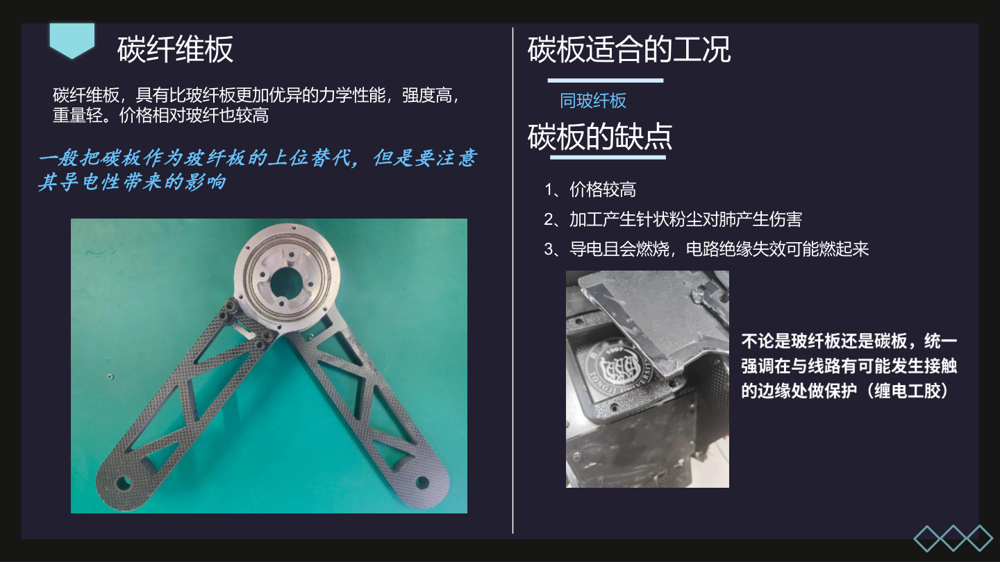

**亚克力**：利用透光性用于相机镜头保护、需要观察内部的保护壳；只能外发加工，另有吹塑工艺可做半球壳/弧形定制。

### 3.4 如何设计一块板件（按需设计）

1. **明确目的**：结构件/连接件/保护壳？与哪些部件连接？哪里受力、多大？刚度强度要求？避免冗余；
2. **选厚度**：常备 2/3/4/5mm，绝大多数 2/3mm 足够，校内赛小车推荐不超过 3mm（个别如拨叉需 10mm 保强度）；
3. **选连接方式**：两片不在同一平面的玻纤件需六面螺母等标准件/打印件/机加件辅助，也可拼插（注意释放孔）；
4. **工艺设计**：孔位留余量、避免角度过小的内部特征、避免直径小于 2mm 的特征。

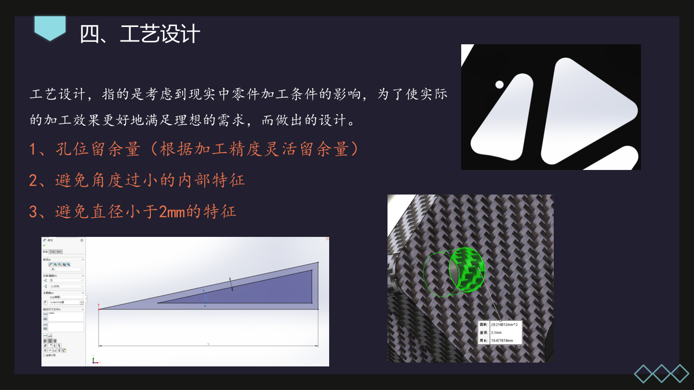

**玻纤板镂空**的原因：必要结构（避干涉/装零件）、减重轻量化、方便走线、便于装配（镂空让扳手伸入不拆外结构即可修内部）、便于观察内部元件。

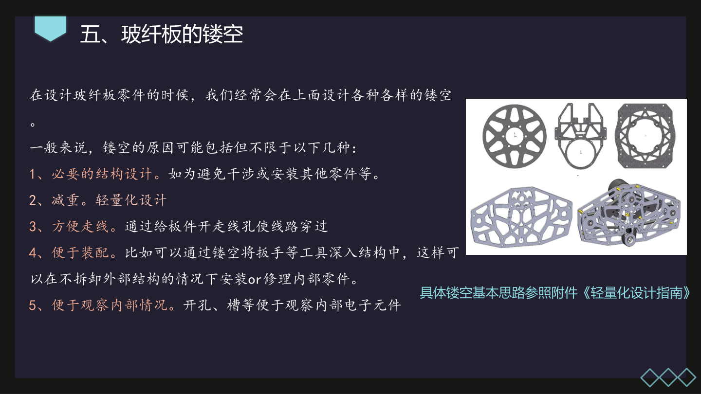

### 3.5 3D 打印件材料

**PLA（聚乳酸）**：最常见、队内最常用，拓竹打印机可高精度打印；综合力学中规中矩、承压强、抗拉抗剪较弱、冲击强度较高、受热易熔化，可嵌铜螺母。**所有打印件都不能画出车上能用的螺纹**。

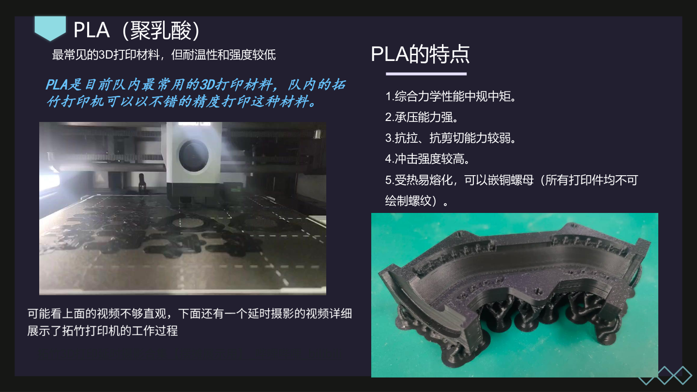

**嵌螺母做法**：在打印件上开一个未贯穿的六角深孔，塞入长度 ≤ 孔深的六角铜柱，即可从另一侧拧螺栓；防松螺母也可类似放置，解决空间不够放螺母的问题。

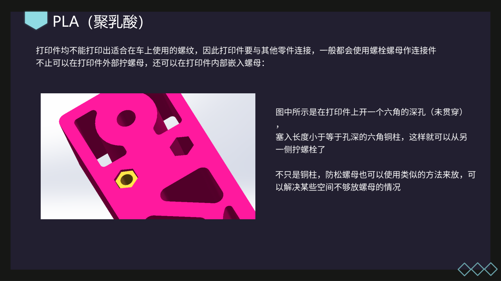

其他材料：**尼龙**力学性能较好、可作受力件但表面较粗糙，队内可打；**TPU** 柔性材料做可变形零件；**光固化树脂**精度高表面光滑美观，但力学弱且软、壁厚不宜薄，日光久照软化、成型后会变形，铜螺母只能加工商嵌（较贵），需外发。

**打印件设计注意**：

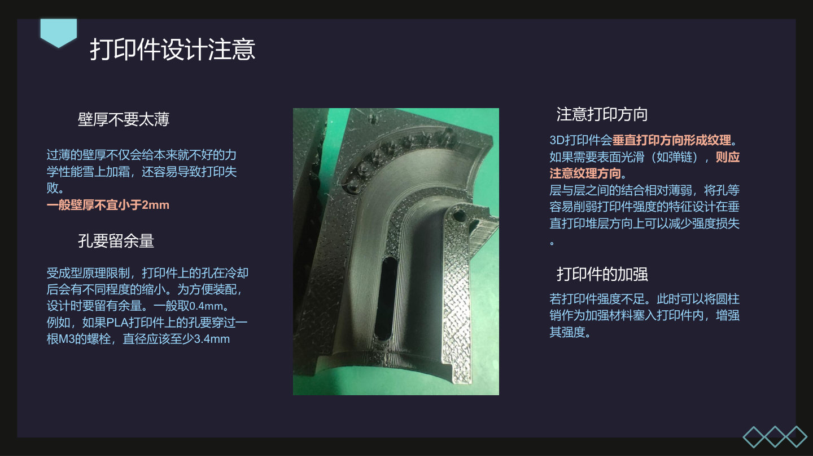

- **壁厚不要太薄**：一般不宜小于 2mm，否则力学更差且易打印失败；
- **孔留余量**：冷却后孔会缩小，一般留 0.4mm，如穿 M3 螺栓的孔直径至少 3.4mm；
- **注意打印方向**：垂直打印方向形成纹理，需光滑表面（弹链）注意纹理方向；层间结合弱，把孔等削弱特征放在垂直堆层方向可减少强度损失；
- 强度不足可把**圆柱销**塞入打印件加强；层间强度低于垂直层向，受大沿层剪力会破，最好让打印件受垂直层向压力（故常用打印件做垫块），并考虑支撑易拆除。

### 3.6 机加工件与其他结构材料

**机加工件**：车、铣等去除材料得到，考虑重量一般选 **6061 铝合金**；只能外发、价格昂贵需少用，但精度最高、表面质量与力学性能最好，适合高精度/高表面质量/高强度件，可直接加工螺纹孔（善用此点简化结构），**外发图纸一定要标明公差**，孔位不留余量但要注公差。

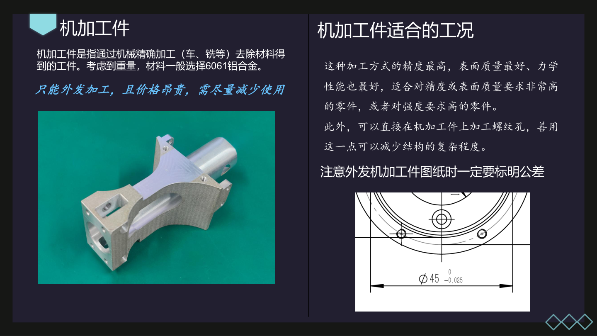

加工工艺：**车削**（工件旋转作主切削运动，加工回转表面）；**铣削**（刀具旋转作主切削，加工平面/槽面，成形铣刀可加工曲面）。设计前先想加工工序，避免无法切削的特征（如圆柱桶内壁封闭槽），避免过深薄壁（提高难度、降良品、增成本）。

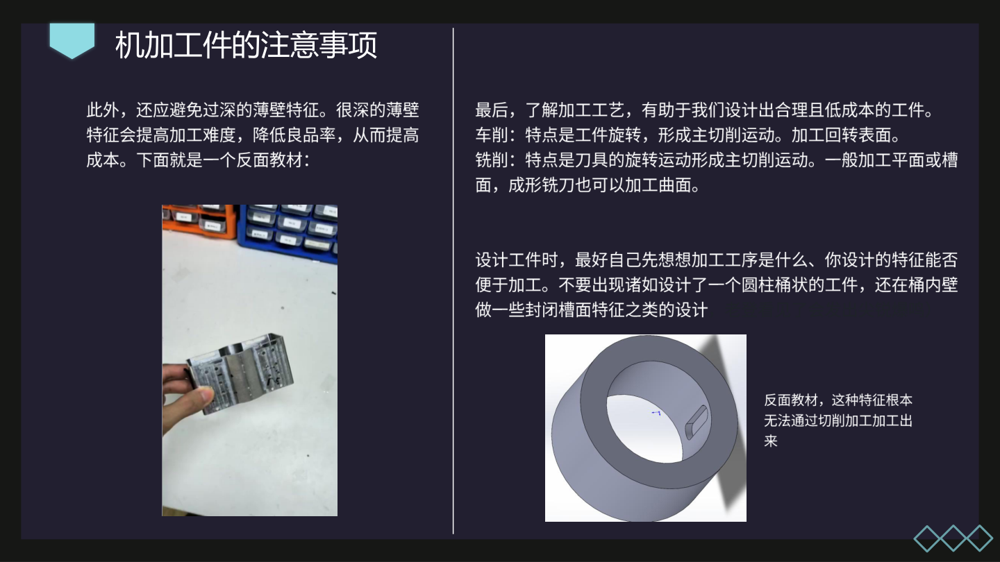

其他材料：**铝方管**力学不错、常用于车架，可定制长度/截面/壁厚，壁薄易被螺栓压溃或撕裂（可塞打印件/垫板），连接方式为打孔螺栓、焊接（受热易变形有误差）、拉铆螺母（不穿整管、缩短螺栓、便拆装）；**型铝**（挤压铝型材配 T 型螺母，多做场地模型支架）；**碳管**（建议只用碳圆管不用碳方管，极轻高强但贵、不好打孔、靠夹紧连接，地面车极少用）；**POM 聚甲醛/赛钢**高强度高刚度自润滑，可做弹链结构件润滑弹链；**聚氨酯**用于摩擦轮/麦轮/全向轮辊子/舵轮包胶。

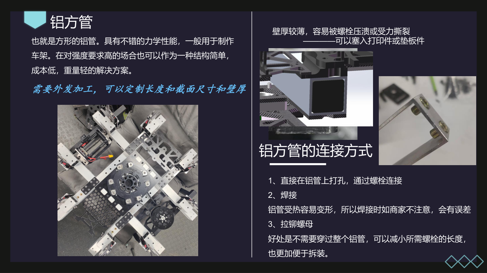

> 本讲作业：为 265g、会发热的 mid-360 激光雷达设计一个多零件保护壳装配体（兼作基座与保护，蓝色圆柱接头范围不可干涉，底部 4 螺纹孔固定，注意散热），零件规范命名。

## 第4讲 轴系招新（轴系基础）

学习路径：认识轴系零件 → 理解设计原则 → 读懂一个轴系 → 设计合理轴系，目标是设计合理的传动结构。

### 4.1 基础概念：轴向、径向、欧拉角、法兰

- **轴向**：圆柱体旋转中心轴的方向（沿轴）；
- **径向**：沿轴截面、理论上过轴心的方向（类似半径/直径）；
- **欧拉角**：Pitch 绕 x 轴（俯仰角，点头）、Yaw 绕 y 轴（偏航角，摇头）、Roll 绕 z 轴（翻滚角，前进方向旋转）。

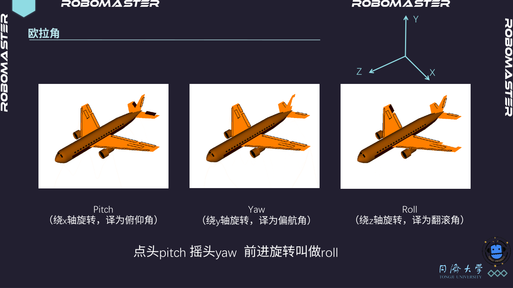

- **法兰（Flange）**：盘状金属连接件，靠周边螺栓孔 + 密封垫实现可拆卸连接，结构稳定可密封。

### 4.2 轴承：结构与分类

**轴承即承载转轴的零件**，垫在旋转轴与支撑部分之间减轻摩擦。结构拆解为：**内圈**（与轴配合固定，提供一半轨道传载）、**外圈**（与轴承座配合固定，提供另一半轨道传载）、**滚动体**（承受载荷保持转动）、**保持架**（把滚动体连成一体使受力均匀）。

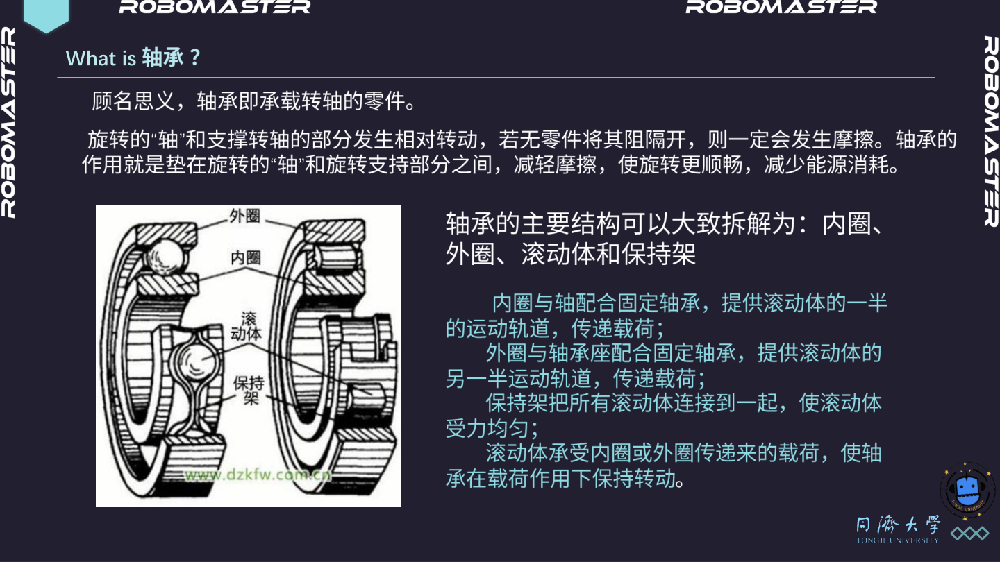

按可承受力的方向分三类：**向心轴承**（主要承径向）、**推力轴承**（主要承轴向）、**向心推力轴承**（径向+轴向都承）。

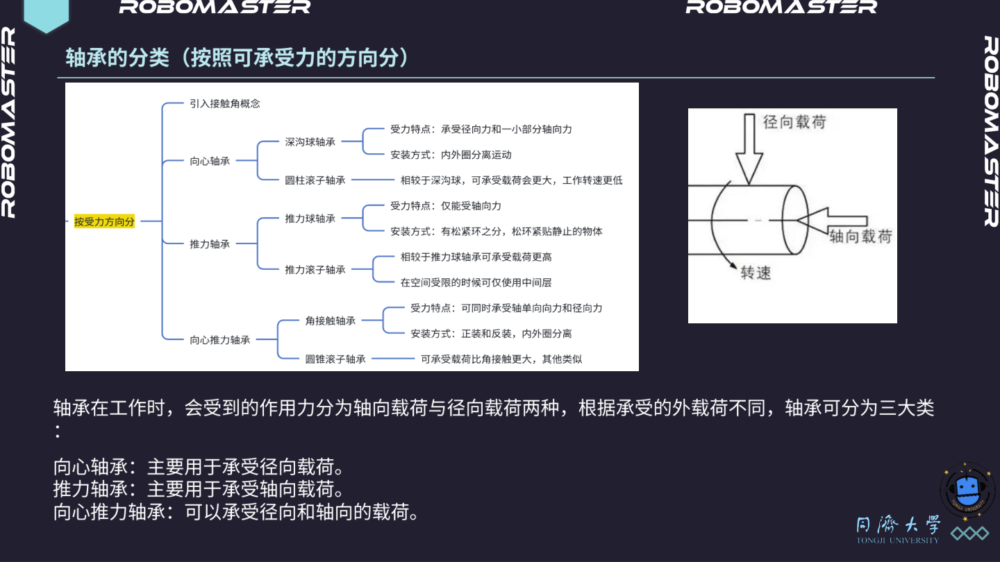

**向心轴承**：深沟球轴承、圆柱滚子轴承（后者承载更大、转速更低）。固定外圈的挡板/挡盖只能盖住外圈，避免接触内圈和密封圈；固定内圈的卡簧/挡圈也不接触密封圈、外圈——这就是常用**套筒**实现内外圈分离、留出间隙的原因。

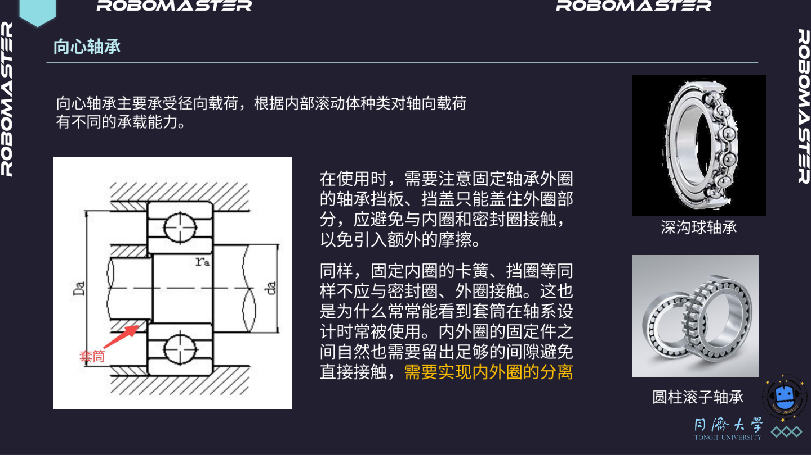

**推力轴承**：专承轴向、**不能承径向力**，由内圈、外圈、滚珠、保持架组成。安装注意：分清紧环松环（孔径差 0.1~0.3mm，松环内径大、紧环外径小）；时刻被压住；松环始终靠静止件端面；推力滚子轴向空间极限时可只用中间滚动体层。

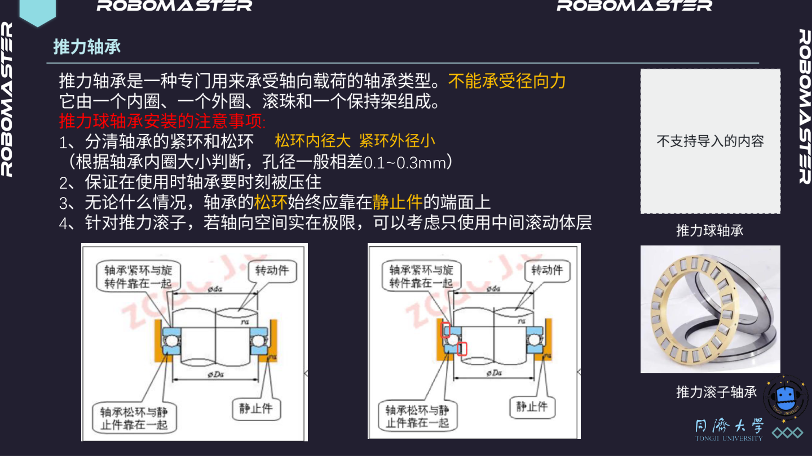

**向心推力轴承**：比赛常用角接触轴承、圆锥滚子轴承（另有交叉滚子轴承），为分离式、外圈可自由取下；只能承一个方向轴向力，通常**成对使用**，步兵/英雄/哨兵云台用得多。另有挡边轴承（一侧外缘便于轴向定位）、薄壁轴承（内外径差小，解决径向空间极限）。

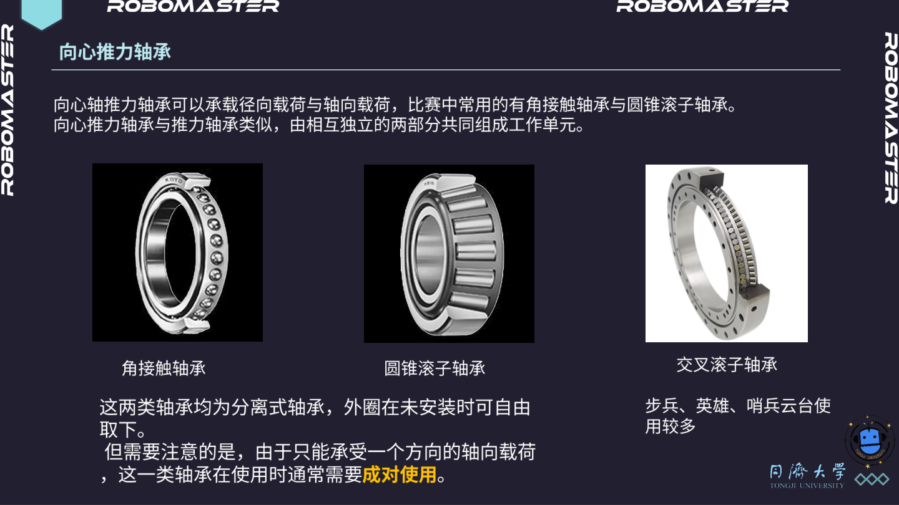

**关于轴承还要知道**：画图只用中空圆柱代替占位即可，不画细节；打印件轴承座留 **0.5mm** 盈余量（与内圈配合小 0.5、与外圈配合大 0.5）方便塞入；孔塞不进不要硬敲（转动不畅、寿命短、易爆珠），用台虎钳压入、拉马拔出。

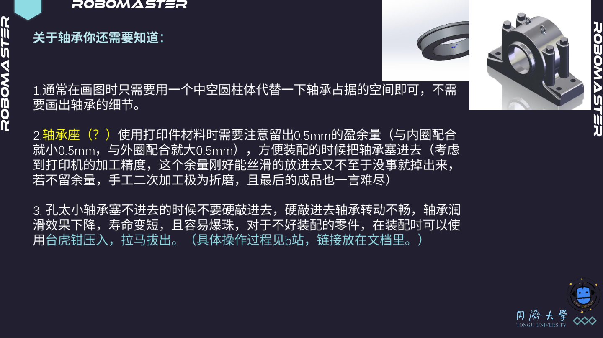

### 4.3 联轴器与导电滑环

联轴器用于把一根轴的扭矩、转速传给另一根轴（如电机输出轴连轮组）。按是否补偿相对位移分**刚性**与**挠性**两大类。

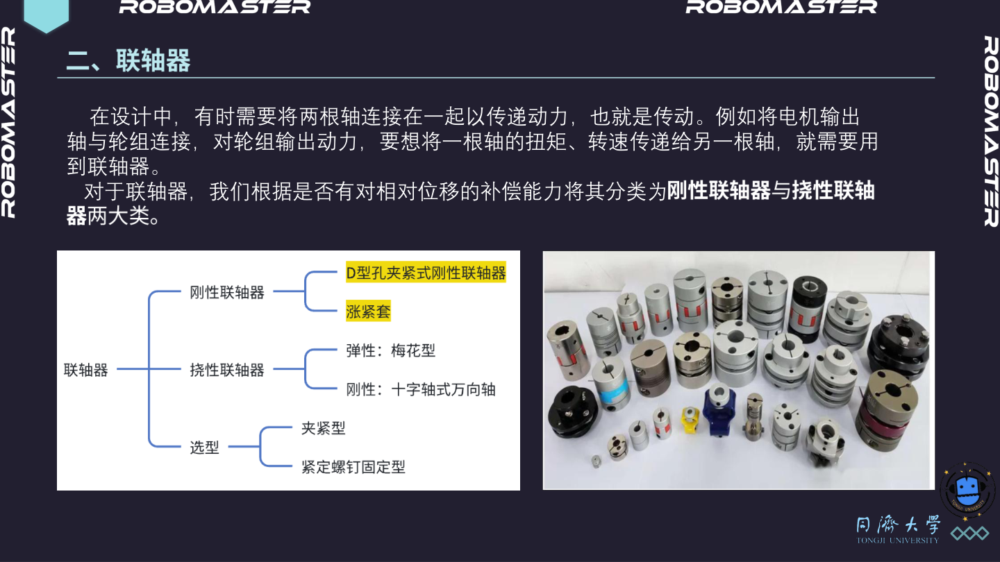

**刚性联轴器**：无位移补偿能力，要求两轴严格对中；优点结构简单、成本低、拆卸方便、耐造，缺点无缓冲，用于传大扭矩、两轴转速严格相等、控制精度高的场合。

- **涨紧套**：无键联结装置，靠高强度拉力螺栓在内环与轴、外环与轮毂间产生巨大抱紧力，最常用于带轮与轴联接。装配按对角交叉均匀拧紧（先手拧后扳手），拆卸逐级对角松开不全拧出、利用拆卸螺孔顶/拉取出；注意部分商家内径偏大无法涨紧，被固定的机加工件要给适宜公差。



- **D 型孔夹紧式**：内孔呈「D」型靠夹紧轴固定，注意分清光孔与螺纹孔，从光孔拧到螺纹孔。

**挠性联轴器**：**梅花弹性联轴器**红色塑料块补偿两轴相对位移（现已不太用、易坏，飞镖在用）；**十字轴式万向联轴器**。



**导电滑环**：在有相对转动的两部分之间传递电力/信号/流体又不影响自由旋转，一般装在旋转中心，由旋转部分（连旋转结构）和静止部分（连固定结构中心点）组成。滑环越大线数越多、允许电流越大、越贵；选线数先与电控确定，线数多又不想大体积重量需定制。



其他小零件：**卡簧（挡圈/扣环）**装在轴槽/孔槽中防止零件轴向位移。

### 4.4 轴系设计基本原则

1. 选用合适轴系零件，在有限空间内保障结构强度；
2. **径向和轴向完全定位，不发生窜动**；
3. **分清相对运动的物体，不发生干磨**；
4. 考虑可装配性和可加工性。

### 4.5 案例分析

**案例一：铰链结构（双法兰）**。套筒补偿轴向距离把零件固定在所需位置，打印件 PLA 套筒强度低需保证厚度；塞打螺钉的螺栓头不能接触轴承外圈（否则干磨），有接触可加垫片；注意塞打螺栓长度。



对比两种方案：**双法兰**与**单法兰+推力轴承**。单法兰推力轴系中间螺钉不能拧太紧，否则法兰轴承易轴向爆掉；双法兰铰链若不考虑打印套筒形变，拧紧不会出问题。



**案例二：步兵云台**。同时承受径向力 + 轴向力，需要完成定位与运动两件事。



定位：用螺钉/轴承把云台环在径向与轴向固定，不窜动。



**案例三：轮系设计**：深沟球 + 法兰轴承，配合滚子连接板、轮组支撑板实现轮组支撑与转动。



## 第5讲 传动系统及电机使用

本讲两部分：机械传动（把动力传到执行件并转换运动形式）与电机使用（原动机选型与安装设计）。

### 5.1 机械系统的组成

机械系统分四部分：**动力系统（原动机）**即驱动部分；**传动系统（传动装置）**把原动机与工作机有机联系，实现能量传递和运动形式转换；**执行系统（工作机）**位于末端，改变作业对象的性质/状态/形状/位置；另有控制操作系统与辅助零部件（结构支撑件）。



### 5.2 齿轮传动

**齿轮**是轮缘有齿、能连续啮合传递运动和动力的机械元件；齿廓为渐开线。基本参数：

- **模数 $m$**：决定齿大小的基本参数；
- **齿数 $z$**：齿的个数（大于 17）；
- **齿厚 $b$**：齿轮厚度；
- **压力角 $\alpha$**：一般为 $20^\circ$；
- **分度圆**：保证一对齿轮正常啮合的重要尺寸。

核心公式：

$$d = m \cdot z \quad\text{（分度圆直径）}$$

$$d_0 = m \cdot (z+2) \quad\text{（齿顶圆直径）}$$

$$D = \frac{d_1+d_2}{2} \quad\text{（中心距）}$$



**圆柱齿轮**对比：

| 类型 | 优点 | 缺点 |
|---|---|---|
| 直齿轮 | 成本低、无螺旋角加工方便（2 模以上可用雕铣机加工）；传动效率高、传动比大（传动力 1~8） | 噪音大、重合度低 |
| 斜齿轮 | 重合度高、啮合平稳、噪音小、更适合高速传动（啮合长度长） | 会产生轴向力（有螺旋角） |



**圆锥齿轮**：圆锥直齿轮可实现交错轴传动（传动比 1~8），但安装精度要求高、轴承承载轴向+径向、轴系复杂；圆锥螺旋齿轮为商品件，重合度高但需很高刚度与安装精度。

### 5.3 直线传动

- **齿轮齿条**：齿轮齿条啮合实现直线运动，传动精度高、承载力大、速度快、结构紧凑平稳耐用，适合连续、大负载直线场合。
- **啮合型同步带**：带与带轮啮合传动力，主动轮带从动轮转或用压板实现直线；传动比准确、结构紧凑，但对中心距和尺寸稳定性要求高、可能跳齿；**必须张紧**，张紧方式为改变中心距（设计时加张紧轮）。



- **链传动**：链条链轮啮合，适合高载荷、高可靠场景；可承高负载、可长距离，但效率低、需定期张紧（改链长或链轮中心距，加涨紧轮/楔形块）。
- **螺旋（梯形丝杠）**：螺纹副螺旋运动实现直线，高精度大负载；有自锁、可固定位置、承受大轴向力，但摩擦阻力大、效率低。**自锁条件**：螺纹升角小于静摩擦角。设静摩擦系数为 $f$，则 $\tan\alpha=f$，$\alpha=\arctan(f)$ 即静摩擦角，梯形丝杠因此自带自锁。



- **滚珠丝杠**：滚珠与螺纹配合，高速高精度大负载，平稳噪音低、效率高，但成本高、需保养、**不能自锁**。

**导向机构**四种对比（配合直线传动使用）：



| 种类 | 使用环境 | 优点 | 缺点 | 注意事项 |
|---|---|---|---|---|
| 滑轨滑块 | 活动空间在滑轨内，组合可伸出 | 阻力均匀、精度高 | 需定制、价格高、重 | 搭配滑块；不受反向力、受较小侧向力 |
| 抽屉滑轨 | 需要水平伸出的机构 | 便宜、载荷大 | 较重、阻力不均、有虚位 | 注意预留孔位、侧向安装 |
| 光轴 | 精度要求高、高速运动 | 便宜、精度高、阻力均匀 | 重、不易安装固定 | 配导向座+直线轴承，至少两组光轴 |
| 型铝滑车 | 设计空间大、行程长 | 便宜、精度高 | 占空间大、商品件需测绘难定位 | 一侧滑轮用偏心螺母调松紧 |

### 5.4 转动连接：联轴器选型（轴与轴 / 轴与回转件）



两个关键「为什么」：

- **为什么用弹性联轴器而不用刚性**：弹性联轴器可补偿轴向、径向、角向偏差，吸收震动冲击保护电机，便于安装；
- **为什么用夹紧式而不用顶丝固定**：顶丝孔易滑、顶丝拧不出；顶丝不如夹紧牢固；夹紧式更便于装拆。

转动环节其他注意：齿轮设计时分度圆相切；同步带加张紧轮张紧；链条加涨紧轮/楔形块张紧；连杆尽量设计平行四边形、设计前多计算。

**如何选择传动方式**，综合权衡 7 项：空间布置、载荷、减速比、重量、传动间距、成本、其他特殊需求（如自锁）。

### 5.5 电机种类与队内常用电机

常见电机：有刷/无刷电机、伺服电机、步进电机、舵机。

**大疆 3508** 是 RM 中使用最多的电机，尤其麦轮轮组等重要结构。控制流程：主控板发指令，**电调**把指令落实成输出给电机的电流；电机出动力线+数据线接电调，电调再出电源线+信号线接主控板。



**达妙 J4310** 应用也广（麦轮步兵 yaw 轴、工程机器人小臂末端），黑色为定子、银色为转子。按电机尺寸绘图时，最好的方法不是量实物、也不是在 SW 里直接量模型（孔有时不准），而是**查对应电机使用手册**。



**舵机**：程序控制下在一定角度内连续改变输出轴角度并保持，只支持固定角度范围转动、不能按圈转，用于机器人关节、转向；控制精度一般、扭矩小，过载会烧坏，注意标注的转角范围。

队内三款常用对比：



| 名称 | 类别 | 使用场景 | 注意事项 |
|---|---|---|---|
| 2006 | 减速电机（无刷+减速器集成，高扭矩、精确调速） | 17mm 拨弹盘、小机械臂末端、空间小不需大扭矩处 | 配 C610 电调，36 减速比 |
| 3508 | 减速电机 | 42mm 拨弹盘、工程 Z 轴、空间大需大扭矩；拆减速箱作摩擦轮电机 | 配 C620 电调，3591/187 减速比；不能固定在打印件上 |
| 6020（GM6020） | 云台电机（多方向精确运动控制） | 舵轮底盘舵向、云台 yaw/pitch 轴 | 内置电调、无减速箱，额定扭矩与 2006 相差无几 |

**关节电机**：高精度、高扭矩密度、法兰输出，做精确位置控制与重复运动。队内三款：CyberGear（额定 4N·m/最大 12N·m、240rpm，英雄云台 pitch）、DM-J8009-2EC（额定 20/最大 40N·m、120rpm，轮腿平衡步兵）、DM-J4310-2EC（额定 3/最大 7N·m、120rpm，17mm 云台 pitch 及工程小臂）。



另有**轮毂电机**（转子直接连车轮，如 MF9025V2 驱动板凳平衡步兵）、**无人机动力电机**（高效紧凑高转速，如 DJI E2000、好盈 X6plus）。

### 5.6 电机安装设计

最重要的是先确定**什么是活动部件、什么是固定部件**：利用定子、转子安装孔位，把定子连固定件（电机座）、转子连活动件，并检查活动范围是否干涉；同时考虑接线是否容易、走线是否方便。



实例：麦轮内部活动部件为麦轮、固定部件为轮组电机支架；麦轮步兵 pitch 连杆活动部件为连杆、固定部件为云台侧板。



舵机设计较简单：连到舵机支架再接结构，或直接用舵机上四个孔与结构相连。

**电机基本知识**：



- 所有无刷电机都需电子调速器（电调）驱动，没接电调的是内置电调；
- 闭环控制电机与电调间一般一组三相线 + 一组排线，开环只有一组三相线；
- 接电调的是一组电源线 + 一组信号线，信号线一般是细红黑 CAN 线，少数是三线（红黄棕 S/+/-）或两线（白黑 S/-）PWM 线；
- 选电机看额定扭矩、转速，以及位置是否需要归 0；设计时预留电调安装位置与走线孔位。

## 附：轴系作业

`轴系作业.rar` 为第4讲轴系设计配套的课后练习（含运动参考视频），按文档要求完成一个轴系结构的建模与装配即可，本笔记不展开。
