
# 同济大学 RoboMaster 招新培训笔记 · 视觉组
> 来源：同济大学（SuperPower）RoboMaster 战队招新培训课件视频笔记，视频见 B 站空间：https://space.bilibili.com/651837546
> 整理：东南大学成贤学院 Solaris（天钺）战队 ｜ 2026-10-17 ｜ 配图均截取自原课件
> 用途：入队新生复习笔记，供战队学习交流使用

## 培训大纲

| 讲次 | 课件 | 核心主题 |
|---|---|---|
| 第0讲 环境准备 | Lecture0 环境准备.pdf | VMware + Ubuntu 22.04 安装、网络代理、GitHub SSH 公钥、数学预习 |
| 第1讲 Hello Ubuntu&git | Lecture1 Hello Ubuntu&git.pptx | Ubuntu 终端、常用命令、apt 包管理、Git 版本控制、VS Code |
| 第2讲 Hello Ubuntu&Git | Lecture2 Hello Ubuntu&Git.pptx | C/C++ 编译（g++）、多文件与包含保护、CMake、OpenCV 图像基础、传统灯条法装甲板识别 |
| 第3讲 Hello OOP | Lecture3 Hello OOP.pptx | 类与对象、封装 public/private、相机类（曝光/增益）、识别器（传统 vs YOLO） |
| 第4讲 Hello Armor | Lectrue4 Hello Armor.pptx | solvePnP 位姿解算、姿态表示（rvec/矩阵/欧拉角/四元数）、坐标系变换流、手眼标定 |
| 第5讲 Hello Kalman | Lecture5 Hello Kalman.pdf | 卡尔曼滤波预测—修正、P/Q/R 调参、卡方检验（NIS/NEES）、扩展卡尔曼滤波 EKF |
| 附：招新大作业 | 26赛季视觉组招新大作业.pdf | 赛前自瞄自检（30 分）、击打静止靶（30 分）、击打小陀螺目标（40 分） |
| 附：雷达大作业 | 雷达大作业.pdf | FAST-LIO 2 建图（ROS 2 Humble、Livox Mid360） |

> 课后作业：第2讲（fmt + OpenCV 等比缩放）、第3讲（myCamera 封装 + 关键点可视化）、第4讲（能量机关解算）作业要求已分别并入对应讲次末尾。

---



## 第0讲 环境准备

本讲在正式开课之前完成两件地基工作：在 Windows 上用 VMware 装好 Ubuntu 22.04 虚拟机，并注册 GitHub、配置好 SSH 公钥；同时给出数学预习清单和作业提交方式。

### Part 1 VMware 与 Ubuntu 安装

课程提供一个同济网盘压缩包，解压后得到 `RM` 文件夹，里面包含 VMware Workstation Pro 安装包、`ubuntu-22.04.5.iso` 镜像、Clash Verge 和 VS Code 的 deb 安装包。若网盘异常，可从 Broadcom 官网下载 VMware、从阿里云镜像站下载 Ubuntu 22.04。

> 注意：由于相机 SDK 及依赖库的版本要求，后续课程与大作业**只能使用 Ubuntu 22.04**，不要装更高或更低版本。Mac 用户另参考课件给出的 B 站安装视频。

安装要点（典型虚拟机配置向导）：

1. 双击 `VMware-workstation.exe` 安装 VMware，全部选默认。
2. 新建虚拟机选「自定义」，光盘映像文件选择 `ubuntu-22.04.5.iso`；用户名随意、密码建议简单。
3. 虚拟机位置建议放在非 C 盘。
4. **分配 CPU**：处理器数量 × 每个处理器的内核数量 = 分配给虚拟机的内核总数，只要这个总数小于物理机的逻辑处理器数即可（任务管理器 `Ctrl+Shift+Esc` 可查看逻辑处理器数），建议分配一半；两个参数怎么凑都行，总数一致则整机性能一致。
5. **分配内存**：根据物理机内存选，建议分配一半；网络模式、磁盘类型保持默认，创建新虚拟磁盘，最大磁盘按需填写。
6. 进入 Ubuntu 安装界面后选 `Minimal installation`，磁盘选 `Erase disk and install Ubuntu`，设置用户名密码，等待进度条完成后重启。

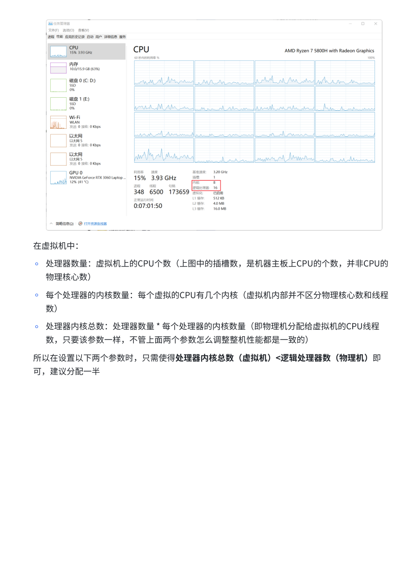

装好后 VMware 通常自带 VMware Tools，支持物理机与虚拟机之间拖拽文件、复制粘贴；若不生效，可按课件给出的博客园教程修复。建议先自行熟悉一下 Ubuntu 的图形界面和基本操作。

### Part 2 网络代理与 GitHub 配置

已有翻墙能力可跳过代理步骤。否则把 `RM` 文件夹里的 Clash Verge deb 包拖进虚拟机，在其所在路径打开终端安装：

```bash
sudo apt install ./clash.deb
```

打开 Clash，导入自己的代理配置文件并启用系统代理，之后即可访问 GitHub。

GitHub 配置 SSH 公钥（免密 push 的标准做法）：

```bash
# 1. 生成 RSA 密钥，邮箱替换成自己的注册邮箱，一路回车即可
ssh-keygen -t rsa -C "xxx@xxx.com"

# 2. 查看并复制公钥（Ubuntu 复制快捷键 Ctrl+Shift+C）
cat ~/.ssh/id_rsa.pub
```

把输出的公钥粘贴到 GitHub：右上角头像 → `Settings` → `SSH and GPG keys` → `New SSH key`。回终端验证：

```bash
ssh -T git@github.com
```

返回 `Hi UserName! You've successfully authenticated, but GitHub does not provide shell access.` 即说明 SSH 密钥配置成功。

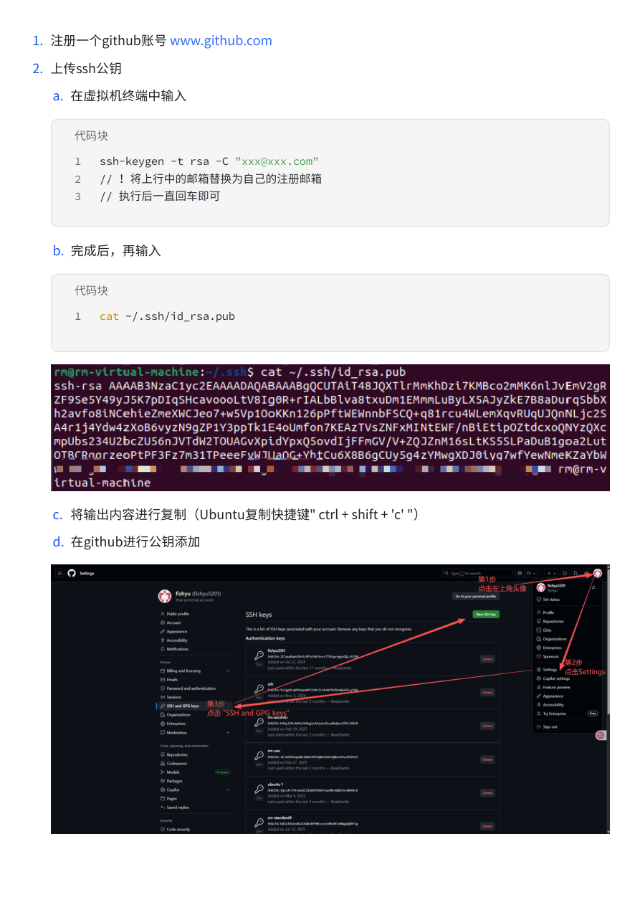

### Part 3 数学知识准备

后续坐标变换、卡尔曼滤波等内容会用到线性代数与概率论，建议开课前简单自学：微积分的泰勒展开与泰勒级数、线性代数的「什么是线性变换」、协方差矩阵（课件附 B 站讲解链接）。

### Part 4 资料来源与作业提交方式

- 2025 年 SuperPower 视觉组培训视频（B 站）；
- 同济大学 SuperPower 战队 25 赛季自瞄算法开源仓库 `sp_vision_25`；
- 后续课程配套代码仓库 `sp_vision_tutorial_26`。

作业线上提交流程：先把 `sp_vision_tutorial_26` **Fork** 成自己的私人仓库，在自己仓库里修改提交代码，再把 Fork 后的仓库链接私信发给招新负责人；线下需要调试、展示的部分在公布时间段到嘉定校区开物馆右侧集装箱完成。

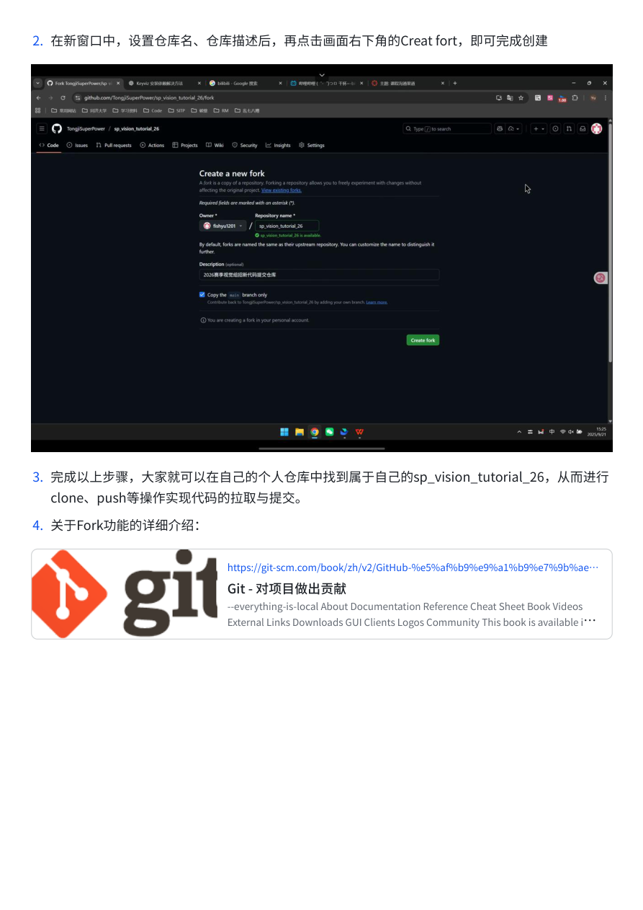

## 第1讲 Hello Ubuntu&git

本讲三块内容：视觉组简介、Ubuntu 上手（终端与 apt）、Git 版本控制与 VS Code 中的使用。

### Ubuntu 与终端 Terminal

Ubuntu 是一款操作系统，也是机器人开发界常用的系统。**Terminal（终端）**起源于早期计算机的字符界面，用来输入命令、直接与系统核心交互；相比图形界面逐个点选，终端命令灵活高效，还支持自动化脚本和远程操作。

例如要把当前目录所有 png 图片批量加上 `image_` 前缀，图形界面只能逐个改名，终端一行命令即可：

```bash
rename 's/^/image_/' *.png
```

路径写法例：`~/Desktop/sp_vision_25`（`~` 代表当前用户主目录）。

### 常用命令与使用技巧

课件给出的最基础目录与文件命令：

| 命令 | 全称 / 含义 | 作用 |
|---|---|---|
| `pwd` | print working directory | 查看当前工作目录的路径 |
| `cd <path>` | change directory | 切换工作目录 |
| `ls` | list | 列出当前目录内容 |
| `mkdir <folder>` | make directory | 创建文件夹 |
| `touch <file>` | — | 新建文件 |
| `rm <file>` | remove | 删除文件 |
| `rm -r <folder>` | recursive | 递归删除文件夹 |
| `sudo <cmd>` | super user do | 以管理员权限执行别的命令 |

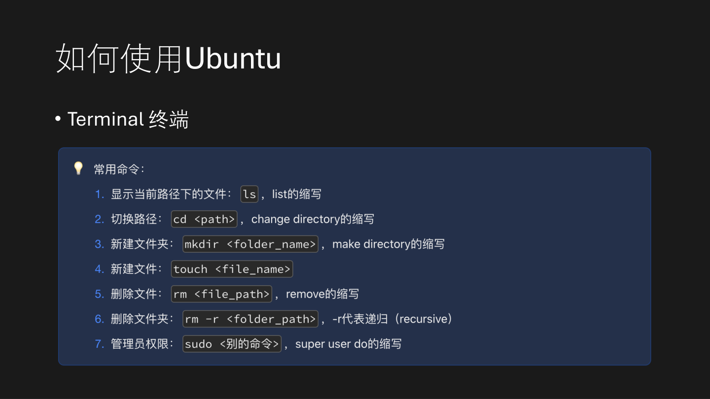

终端使用技巧：

- 复制 / 粘贴：`Ctrl+Shift+C` / `Ctrl+Shift+V`；
- `Tab`：自动补全命令或文件名；
- `↑` / `↓`：翻阅历史命令；
- `!!`：重复上一条命令，常配合 `sudo !!` 给上一条忘记加 sudo 的命令提权；
- `Ctrl+R`：搜索补全历史命令；
- `Ctrl+C`：终止当前程序；`Ctrl+Z`：暂停程序（`Ctrl+C` 无效时的替代方案）。

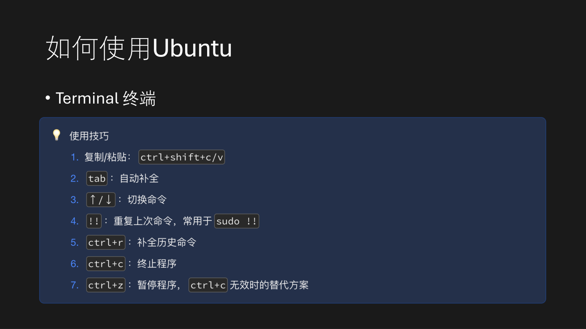

### apt 包管理

apt（Advanced Packaging Tool）是 Ubuntu 的软件包管理器，常见子命令：

```bash
sudo apt update          # 只检查可更新列表，不真正更新
sudo apt upgrade         # 检查并实际更新已装软件
sudo apt install <pkg>   # 下载并安装远程软件，也可装本地 deb
sudo apt purge <pkg>     # 删除软件并一并移除配置文件
```

### Git 版本控制

Git 是**分布式版本控制系统**，用来记录代码修改历史、协同开发。先安装并配置身份：

```bash
sudo apt install git
git config user.name "your name"
git config user.email "your_email@example.com"
```

核心操作围绕四个区域流转：**工作区 → 暂存区（add）→ 本地仓库（commit）→ 远程仓库（push）**，反向用 `pull` 拉取远程更新。

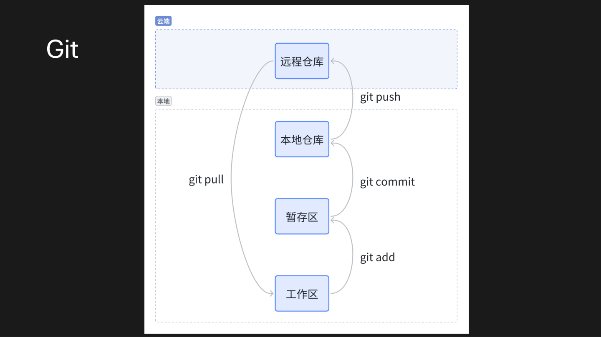

常用命令：

```bash
git init                  # 在当前目录初始化一个新仓库
git clone <url>           # 克隆远程仓库到本地
git add <file_name>       # 把改动加入暂存区
git commit -m "commit message"   # 把暂存区改动提交到本地仓库
git pull                  # 拉取远程仓库更新并合并
git push                  # 把本地提交推送到远程仓库
```

### VS Code 中使用 Git

VS Code 可本地安装：`sudo apt install ./vscode.deb`；终端里在项目目录执行 `code .` 即可用 VS Code 打开当前目录，并按需安装插件提升效率。VS Code 内置 Terminal，也提供图形化的「源代码管理」面板，鼠标点选即可完成 add、commit、clone、pull、push。

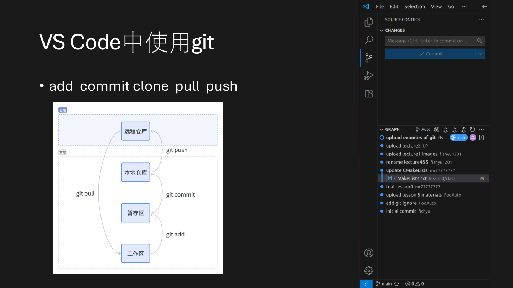

**课后练习**：熟悉 Terminal 与 git 常用指令；尝试创建自己的 GitHub 仓库并提交、修改文件；预习 C++ 基本语法（下一讲 Hello C++）。

## 第2讲 Hello Ubuntu&Git

本讲课件实际主题为 **Hello C++**，覆盖四部分：C/C++ 编译原理、CMake 安装与使用、OpenCV 安装与图像基础、传统方案装甲板识别（灯条法）。

### C/C++ 编译原理（g++）

**编译**就是把人写的源代码翻译成计算机能直接运行的形式（可执行文件）。C++ 的编译器是 `g++`。完整流程分四个阶段：

1. **预处理**：处理 `#include`、宏等，生成 `.i/.ii` 文件；
2. **编译**：翻译成汇编，生成 `.s` 文件；
3. **汇编**：翻译成机器码，生成 `.o` 目标文件；
4. **链接**：把多个 `.o` 与库合并成可执行文件。

```bash
# 分步执行（了解即可）
g++ -E main.cpp -o main.i      # 预处理
g++ -S main.i -o main.s       # 编译
g++ -c main.s -o main.o       # 汇编
g++ main.o -o main           # 链接

# 日常一键完成全部阶段
g++ main.cpp -o main
```

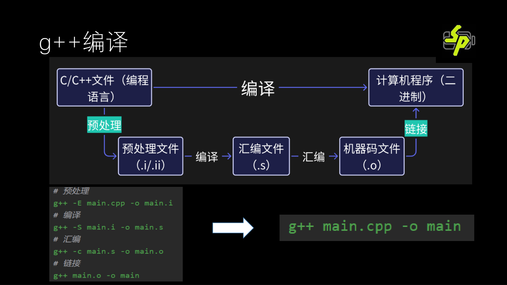

### 多文件结构与包含保护

工程变大后源码拆成多个文件：**头文件（`.hpp`）负责声明，源文件（`.cpp`）负责实现/定义**。每个 `.cpp` 单独编译成 `.o` 目标文件，最后由链接器把 `main.o` 和各目标文件链接成可执行文件 `main`。

当头文件之间互相包含、或被多个源文件重复包含时，会出现重复定义，因此需要**包含保护**（防止同一个头文件内容被重复展开），这是多文件工程的必备写法。

### CMake 安装与 CMakeLists.txt

`.cpp` 文件很多时手动敲 g++ 命令非常麻烦，于是用 **CMake + make**：CMake 像「项目经理」，只负责读一份项目概况说明书 `CMakeLists.txt`（注意大小写不能错）并生成构建脚本；make 像「执行者」，按脚本实际编译。

安装：

```bash
sudo apt install make cmake
```

并在 VS Code 安装 CMake 插件。`CMakeLists.txt` 最小示例（重点掌握）：

```cmake
cmake_minimum_required(VERSION 3.10)
project(lesson_2)

include_directories(part_1)
add_executable(cpp_basics part_1/cpp_basics.cpp part_1/tools.cpp)
```

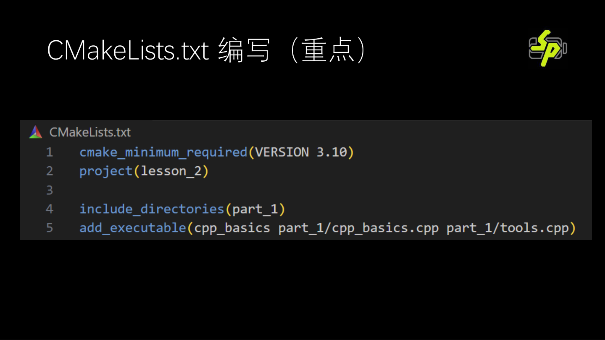

标准构建三步：

```bash
mkdir build          # 1. 让 CMake 运行 CMakeLists.txt，生成 build 文件夹
cmake -B build
make -C build       # 2. 让 make 进入 build 目录运行 makefile
./build/cpp_basics  # 3. 运行生成的可执行文件
```

### OpenCV 安装与图像基础

OpenCV 是本节起使用的计算机视觉库。安装方式：浏览器进入 OpenCV 官网，按所选配置复制安装命令，先 `sudo apt update` 再在终端粘贴执行，等待安装完成。

**理解图像**：计算机世界里所有图像都可以简化为一个数值矩阵，外加描述矩阵本身的其他信息（通道数、尺寸等）——这正是 OpenCV 中 `Mat` 的本质。单通道灰度图中每个像素是 `0~255` 的整数，0 为纯黑、255 为纯白。

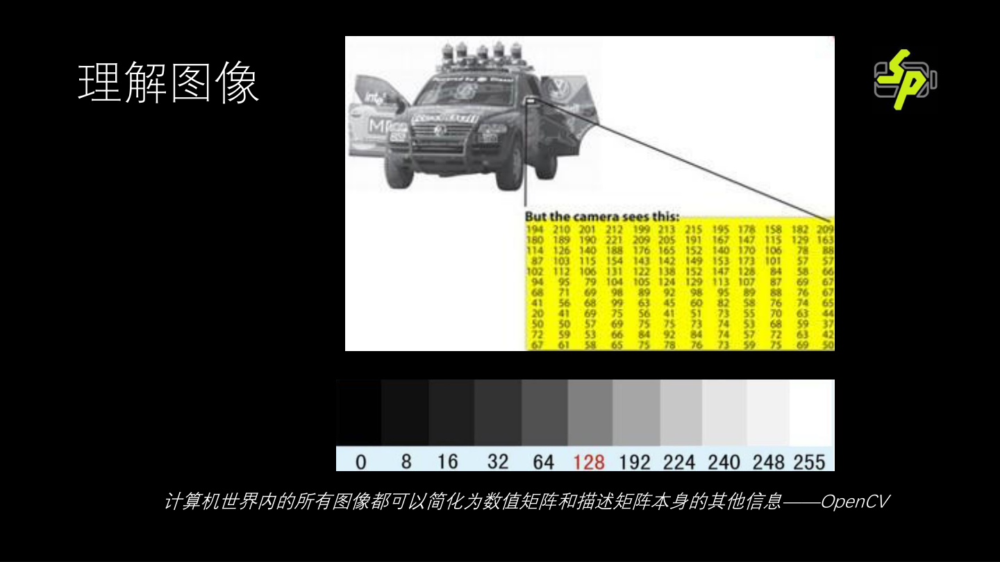

**理解 RGB**：色彩空间可以理解为用不同方式对颜色进行编码和表示。最常见的 RGB 色彩空间由 R（红）、G（绿）、B（蓝）三个通道叠加而成，三通道取值都为 255 时为白；图像也可以拆成 R、G、B 三幅独立灰度图分别处理。

实验环节：在 `split_channels.cpp` 中写代码读图，查阅 OpenCV 官网编写对应 `CMakeLists.txt`，安装 CMake tools 后按 F7 编译运行。OpenCV 安装后，CMake 配置文件在 `usr/lib/x86_64-linux-gnu/cmake`，库文件 `libopencv...` 在同目录，头文件在 `usr/include/opencv4/opencv2`；其中 `.a` 是静态库（如 `libopencv_core.a`），`.so` 是动态库（如 `libopencv_core.so`）。

### 传统方案装甲板识别（灯条法）

目标是「找到敌人的弱点」——识别对方机器人的装甲板。装甲板包含三类信息：

- **灯条颜色**：用于敌我判断（红 / 蓝）；
- **数字**：表示机器人类型，位于两根灯条包围的区域内；
- **灯条角点**：用于计算装甲板的位姿信息。

传统灯条法的识别流水线为：图片输入 → 转换为灰度图 → 图片二值化 → 寻找轮廓 → 获取旋转矩形 → 几何筛选，逐步把候选灯条从背景中筛出。

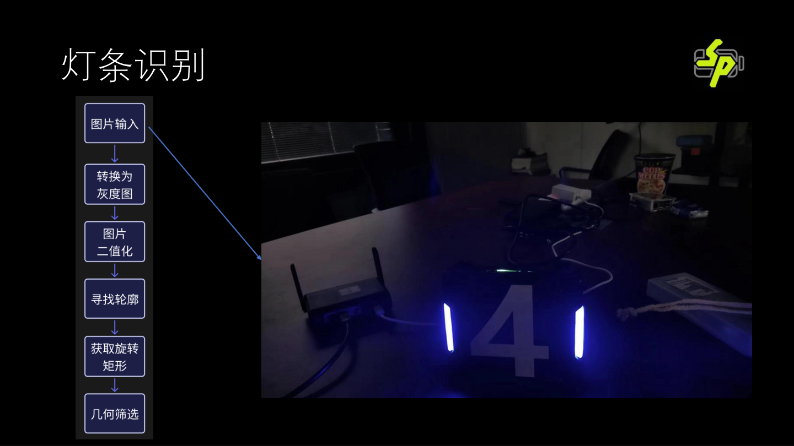

### 课后作业

作业分两部分：Part1 参照课上装 OpenCV 的流程安装 fmt（官网 fmt.dev），学会写 fmt 的 `CMakeLists.txt`（参考官网 Get Started），在 homework 下建 `fmt_test.cpp` 调用 `print` 和 `format` 函数；Part2 用 OpenCV 把任意尺寸图片等比缩放为 640×640 并居中放置、缺失区域填黑，用 `cv::imshow` 展示，缩放比例与偏移距离等参数用 fmt 输出，并把缩放函数从主程序分离，声明/定义分别放入 `tools.hpp` / `tools.cpp`，上传前记得删除 `build` 文件夹，截止时间 9.23。

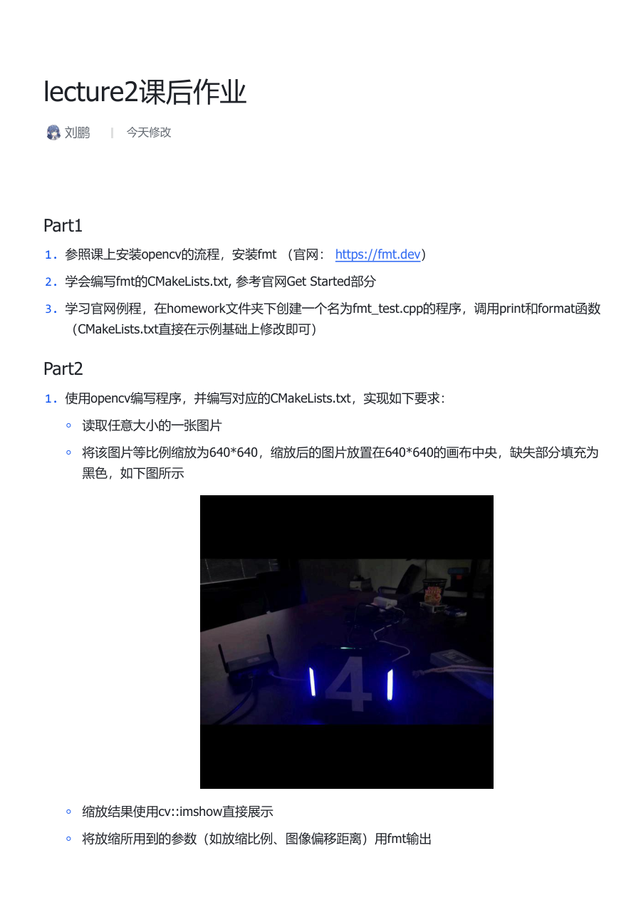

## 第3讲 Hello OOP

OOP（Object-Oriented Programming，面向对象编程）是本讲主题，分四部分：基本语法、核心思想封装、相机类、识别器类。

### 基本概念：类与对象

- **类（class）**：相当于一种「分类」/ 抽象模板，描述一类事物共有的特征和行为；
- **对象（实例 instance）**：按类模板造出来的具体个体；
- 类由**属性**（成员变量，描述特征）和**方法**（成员函数，描述行为）组成。

### 基本语法：声明、定义、调用、构造与析构

一个成员函数要经过三步：在类内**声明**、在类外 `类名::函数名` **定义**、在 main 中造出对象后**调用**。

两个特殊成员函数：

- **构造函数**：与类同名、无返回值，在创建对象时自动调用，负责初始化资源；
- **析构函数**：`~类名()`，在对象销毁时自动调用，负责释放资源。

对比两种写法：不用类时要手动 `new` 申请、`delete` 释放；用类之后，资源被捆绑进对象，构造时申请、析构时自动释放，避免忘记释放。

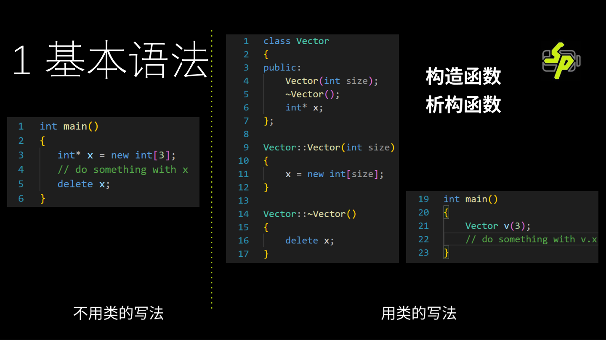

**动手环节 1**：写一个名为 `Material` 的类，无参构造函数输出 `Material Default Constructor!`，析构函数输出 `Material Destructor!`，成员函数 `print` 输出 `This is a Material object!`；主函数创建一个 `Material` 对象并调用 `print`。

### 封装：public / private

**封装**就是把数据和操作这些数据的函数捆绑在一起，对外只提供受控的接口。为什么要封装：

1. **数据安全与控制**：类比支付宝这个类，成员变量「余额」不能被使用者随意直接修改；
2. **隐藏实现细节**：类比一辆车，使用者不需要了解内部有多少零件，只要会用油门、方向盘等对外接口即可。

访问控制关键字：

- `public:` 对外暴露的接口，即使用这个类的人会用到的部分——需要「暴露」什么就放什么；
- `private:` 所有不想让别人看到的内容，包括不希望泄露的成员变量、仅供内部使用的成员函数。

以课件的 `Camera` 类为例：`public` 区只暴露构造函数 `Camera(config_path)` 和读图函数 `read(img, timestamp)`；`private` 区藏着 `std::unique_ptr<CameraBase> camera_`（本质是一个指向相机 SDK 句柄的指针），外部无需关心。

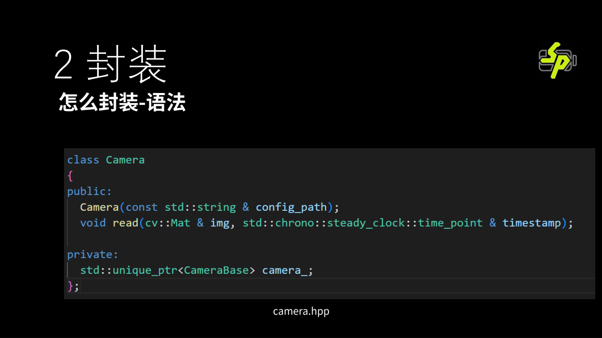

**动手环节 2**：修改 `Material` 类，添加一个私有整型变量 `count`，每次调用 `print` 时 `count` 加一；修改析构函数，输出 `Material destructor! It has been read {count} times`。

### 相机类：曝光与增益

相机参数写在配置文件 `configs/camera.yaml` 中（`camera_name`、`exposure_ms`、`gain`、`vid_pid`），主程序只需把配置路径传给 `io::Camera camera(config_path)` 即可，体现封装带来的简洁。

两个核心成像参数：

- **曝光（exposure_ms）**：传感器感光时间，单位毫秒。曝光时间长（如 20ms）进光多、画面亮，但运动物体会拖影模糊甚至过曝；曝光时间短（如 5ms）画面偏暗但轮廓清晰。
- **增益（gain）**：把传感器信号放大的倍数，单位 db。在曝光不足时提高增益可以提亮画面，但会同时放大噪点（如曝光 5ms、增益 20db 比 5ms、10db 颗粒更明显）；课件留了「TODO: 值域」让同学自行查资料。

可以拿出手机相机手动模式对照理解：快门速度（s）对应曝光，感光度（ISO）类似增益，只是单位不同。

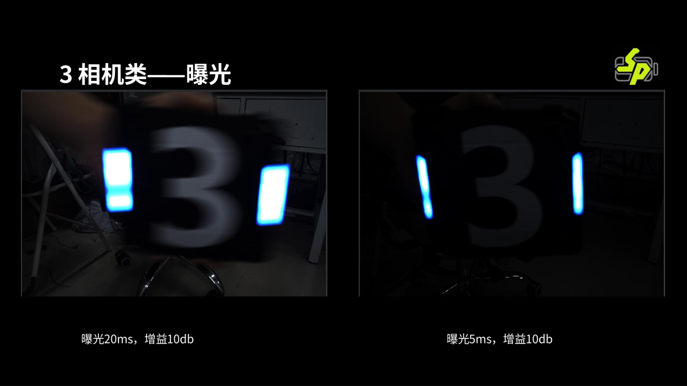

### 识别器：传统灯条法 vs YOLO

识别器的目标是识别装甲板并分类，关心位置、颜色、图案三类线索。课程给出两种思路：

| 思路 | 流程 | 输出 |
|---|---|---|
| 传统（灯条法） | 先识别灯条 → 判断是否构成装甲板 → 再识别数字 | 几何特征逐步拼接 |
| YOLO | 输入图片，神经网络直接输出装甲板 id 和 4 个关键点 | 一步到位（本课程版本为 YOLO-pose） |

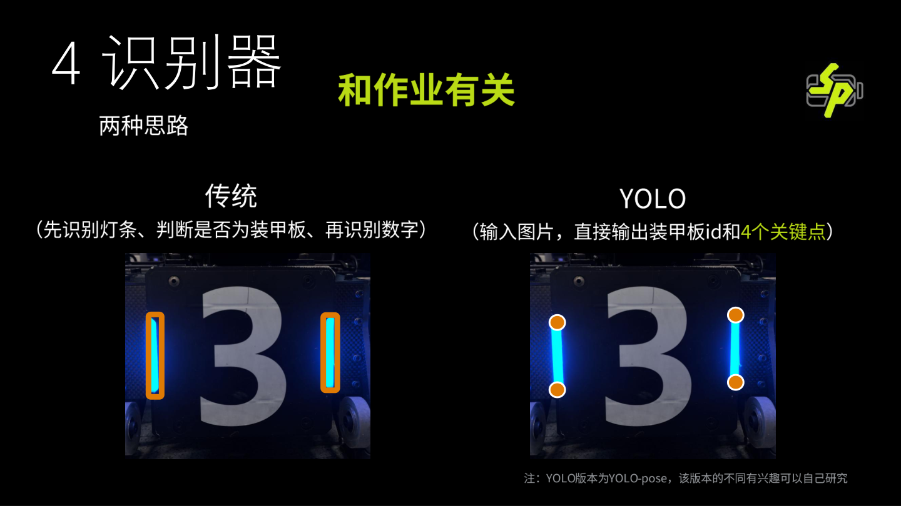

**鲁棒性**是两者优缺点的核心：在暗光、灯条残缺、被遮挡、过曝模糊等复杂场景下，传统灯条法容易因为找不到合格灯条而丢失目标，YOLO 依靠神经网络对整体图案的理解更稳定；代价是 YOLO 需要训练好的模型与算力。

### 课后作业

作业需先在 GitHub 页面点 `Sync fork` 同步原仓库、再 `git pull`，并安装 OpenVINO 2024.6、yaml-cpp、Eigen、spdlog 与海康 MVS 相机 SDK。作业一：阅读 `./io/example.cpp` 的开相机、读一帧、关相机示例，封装成 `myCamera` 类，public 仅保留构造函数、析构函数、`read` 函数，私有成员变量名必须以 `_` 结尾；作业二：编写 `main.cpp`，用 `myCamera` 读图、用 yolo 类识别装甲板，在图上把四个关键点首尾相连成闭合矩形（红色）并可视化，完成后到线下实机测试（虚拟机需把 USB 控制器兼容性改为 USB 3.1），10 月 4 号前提交，地点为开物馆大厅北侧灰色集装箱。

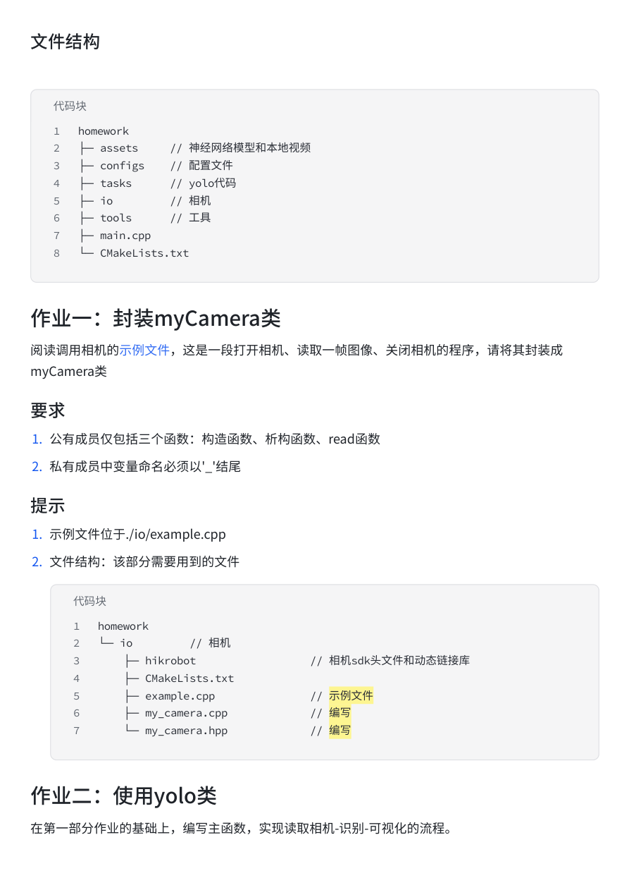


## 第4讲 Hello Armor

本讲解决一个核心问题：视觉程序已经在画面里框出了装甲板（Armor），但**装甲板在三维空间里到底离相机多远、朝哪个方向**，需要用 `solvePnP` 把二维像素反解成三维位姿；解出的姿态还要经过一系列坐标系变换，才能变成云台能执行的 yaw / pitch 控制量。

### 4.1 solvePnP：从四个灯条角点反解位姿

- **PnP（Perspective n Points，n 点透视）**：已知物体上若干个三维点在自身坐标系下的坐标（`objectPoints`），以及它们在图像上对应的二维像素坐标（`imagePoints`），再配合相机内参 `cameraMatrix` 和畸变系数 `distCoeffs`，就能解出物体相对相机的**旋转向量 `rvec`** 和**平移向量 `tvec`**。`tvec` 给出装甲板在相机坐标系下的位置，`rvec` 给出装甲板的姿态。

```cpp
bool solvePnP(InputArray objectPoints, InputArray imagePoints,
              InputArray cameraMatrix, InputArray distCoeffs,
              OutputArray rvec, OutputArray tvec,
              bool useExtrinsicGuess = false, int flags = SOLVEPNP_ITERATIVE);
```

- **动手试一试（建立 objectPoints）**：规定输入点集顺序为**左上角灯条为 1，顺时针依次为 2、3、4**；灯条尺寸为宽 0.135 m、长 0.056 m。先在装甲板自身坐标系里按这个尺寸和顺序写出四个角点的三维坐标，再填入检测到的四个像素角点，即可调用 `solvePnP`。

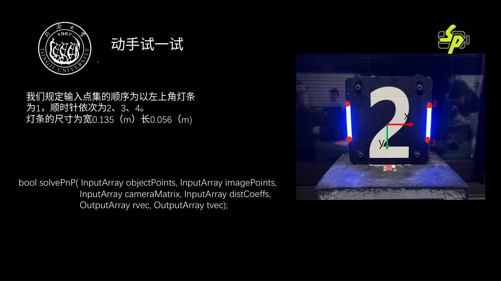

- 解算结果在画面上以调试文字输出：`tvec`（x/y/z 平移，单位米）与 `rvec`（旋转向量），后续再由 `rvec` 换算出欧拉角供云台使用。

### 4.2 姿态的几种表示方法与相互转换

为什么要折腾多种表示？因为 `solvePnP` 直接给的是旋转向量，而云台控制需要的是 yaw/pitch/roll，矩阵运算时又更习惯用旋转矩阵。

| 表示方法 | 特点 | 用途 |
| --- | --- | --- |
| 旋转向量 rvec | 绕空间中一个单位向量 $\mathbf{e}$ 一次性旋转；方向由右手定则决定，向量长度就是旋转弧度（$\theta=\theta\mathbf{e}$） | `solvePnP` 的直接输出，紧凑无奇异 |
| 旋转矩阵 rmat | 3×3 正交矩阵，方便直接做坐标变换乘法 | 计算、坐标系之间的旋转换算 |
| 欧拉角 | 把一次旋转拆成绕三个轴的三次旋转 | 云台控制（yaw/pitch/roll），但**表述不唯一，存在万向死锁** |
| 四元数 | 无奇异、计算高效 | 工程中常用的姿态存储与传输形式 |

- **欧拉角分解顺序（先 yaw、再 pitch、最后 roll）**：
  - **偏航角 yaw**：先绕"上下的轴"旋转，改变前进方向；
  - **俯仰角 pitch**：再绕"左右的轴"旋转，改变俯仰程度；
  - **横滚角 roll**：最后绕"前进/后退方向的轴"旋转，改变倾斜程度。

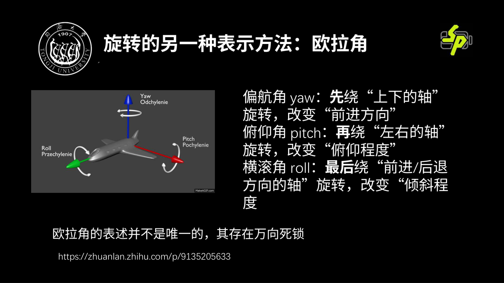

- **转换链**：旋转向量经罗德里格斯公式（OpenCV 中即 `cv::Rodrigues`）转成旋转矩阵，旋转矩阵再经反三角函数解出欧拉角；四元数是另一条并行的表示路线。

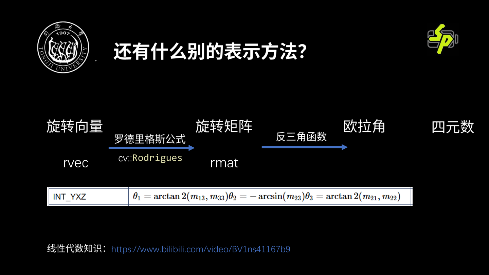

- **为什么需要装甲板姿态**：实际战车运动状态千奇百怪（平动、转向、小陀螺旋转），需要借助装甲板姿态推算出它的旋转中心，进而对运动进行拟合与预测。

### 4.3 常见坐标系与实际变换流

- **相机坐标系（camera）**：与相机刚性连接、随相机一起平移旋转的坐标系，原点在镜头光心。如果相机安装有倾斜、且位置不与枪管重合，像素方向就不能直接当作瞄准方向，必须做坐标变换。
- **手眼标定**：用来获取"机器人本体坐标系 → 相机坐标系"的变换关系，即求出相机原点在云台/本体坐标系中的位置与朝向。
- **实际坐标系变换流**：

```text
像素坐标系 ──solvePnP──▶ 相机坐标系 ──手眼标定──▶ 机器人本体坐标系(base_link) ──实际安装──▶ imu坐标系
```

机器人本体控制依赖 imu（陀螺仪），因此还需要知道 imu 到本体坐标系之间的变换。

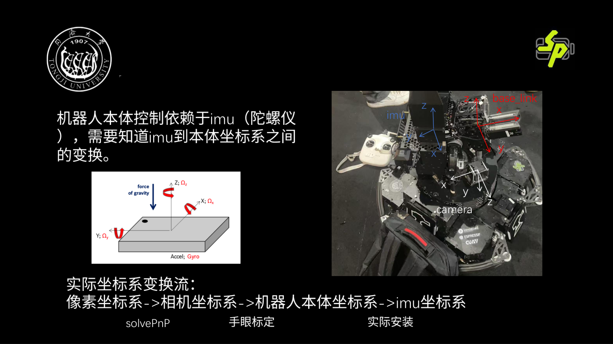

- **世界坐标系（world）**：惯性系，方向不变；当需要定位、导航、建图（如激光点云地图）时引入，与本讲后面的雷达大作业 FAST-LIO 建图相衔接。
- **地面投影**：打靶时需要把目标位置投影到地面/考虑弹道落点，是坐标变换的另一类应用。

### 4.4 小结

- `solvePnP` 使用：三维物体点 + 二维像素点 + 内参/畸变 → `rvec`、`tvec`；
- 姿态表示：旋转向量（紧凑）、旋转矩阵（方便计算）、欧拉角（不唯一表述，有万向死锁）、四元数；
- 坐标系转换流：像素 → 相机 → 本体 → imu，相机到本体靠手眼标定。

### 课后作业（Lectrue4 Homework.pdf）

本讲课后作业围绕**能量机关（符）识别与解算**展开：先用提供的 YOLO11 模型识别符并完成解算，稳定解算出符的中心位置（内环中心），用 PlotJuggler 输出位置曲线；再由旋转符的中心位置反推旋转中心（R 标位置），同样输出旋转中心曲线（保持相机静止时曲线波动应很小）。主要实现在 `tasks/buff_solver.cpp` / `buff_solver.hpp`；环境上需安装 PlotJuggler 并把 `tasks/CMakeLists` 中的 OpenVINO 路径改为本机安装路径，能量机关尺寸数据查阅官方比赛文件。

```bash
sudo apt install nlohmann-json3-dev && snap install plotjuggler
```

```cmake
cmake_minimum_required(VERSION 3.16)
set(OpenVINO_DIR "/your_dir")  # 修改为你的 OpenVINO 安装路径
find_package(OpenVINO REQUIRED)
```

PlotJuggler 调试流程：Streaming 选择 UDP Server，Start 后用默认 IP/端口接收程序发布的数据，在 Timeseries List 中把数据项拖入右侧曲线区即可查看。

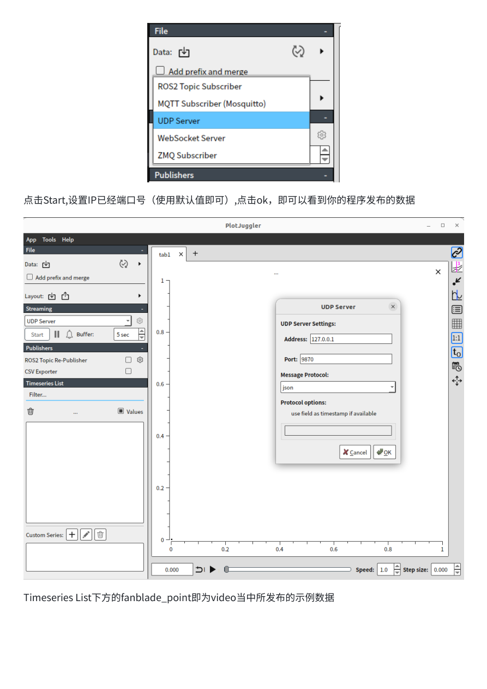

提交分线上（更新仓库并附代码与 PlotJuggler 曲线图，私信通知群主）与线下（到地下车库用提供的能量机关道具测试，由视觉组成员确认）两部分。

## 第5讲 Hello Kalman

### 5.1 为什么需要卡尔曼滤波

- 识别过程始终存在噪声干扰：最直观的均值滤波会明显**滞后**；直接用 $v=ds/dt$ 求速度噪声又太大；而目标运动状态一直在变（转向平动、小陀螺），需要**对运动状态建模并预测**。
- **卡尔曼滤波（Kalman Filter）目标**：从带噪声的观测数据中，最优地估计系统的真实状态。核心思想是把目标运动状态表示为一个状态向量，先基于运动模型**预测**下一时刻状态，再用观测结果**修正**状态向量。

### 5.2 状态向量与协方差

以简单一维匀速运动为例：

- 状态向量 $\hat{x}_k = [p_k,\ v_k]^T$（位置、速度）；
- 协方差 $P_k = \mathrm{Mat}(2,2)$，衡量对状态向量的**不确定度**；
- 初始假设：$\hat{x}_k=[0,5]^T$，$P_k=\mathrm{diagonal}(0.1,0.1)$。

### 5.3 预测过程

假设目标匀速运动，状态转移模型（线性假设 1）：

$$
\begin{cases} p_{k+1}=p_k+v_k\Delta t \\ v_{k+1}=v_k \end{cases}, \qquad F=\begin{bmatrix}1 & \Delta t\\ 0 & 1\end{bmatrix}
$$

$$
\hat{x}_{k+1}=F\hat{x}_k,\qquad P_{k+1}=FP_kF^T+Q
$$

其中 $Q$ 衡量**预测过程引入的噪声**。（完整形式中还有控制项 $\hat{x}_{k+1}=F\hat{x}_k+Bu_k$，本讲略去控制信号 $u_k$。）

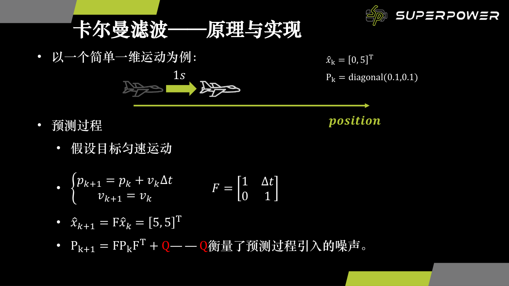

### 5.4 观测与修正过程

- 观测：假设只能观察到目标位置坐标 $z_{k+1}$。状态量往往需要经某种变换才能和观测量求差，**H 矩阵刻画这种变换**（线性假设 2）；只观测位置时 $H=[1,0]$。
- 修正四步：

$$
d_{k+1}=z_{k+1}-H\hat{x}_{k+1} \quad\text{（观测误差）}
$$

$$
S_{k+1}=HP_{k+1}H^T+R \quad\text{（误差协方差，$R$ 衡量观测过程噪声）}
$$

$$
K_{k+1}=P_{k+1}H^TS_{k+1}^{-1} \quad\text{（卡尔曼增益：每个状态需要修正的权重）}
$$

$$
\hat{x}_{k+1}=\hat{x}_{k+1}+K_{k+1}d_{k+1},\qquad P_{k+1}=(I-K_{k+1}H)P_{k+1}
$$

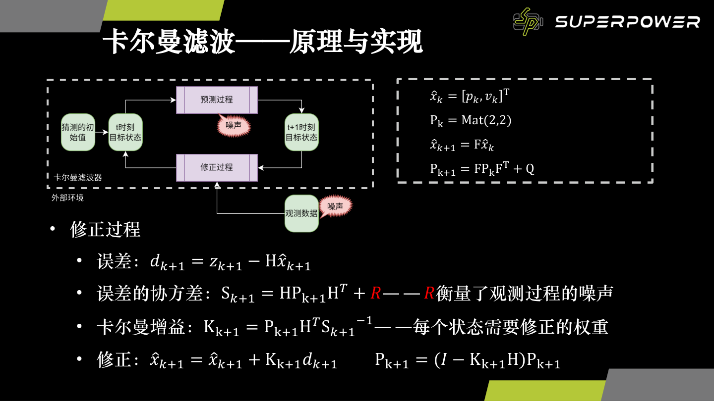

### 5.5 简单上手：滤波效果展示

- 一维往复运动场景：蓝色散点为带噪声的测量值，青色实线为真实轨迹，橙色实线为卡尔曼滤波估计——滤波在噪声测量中平滑地贴近真实轨迹。

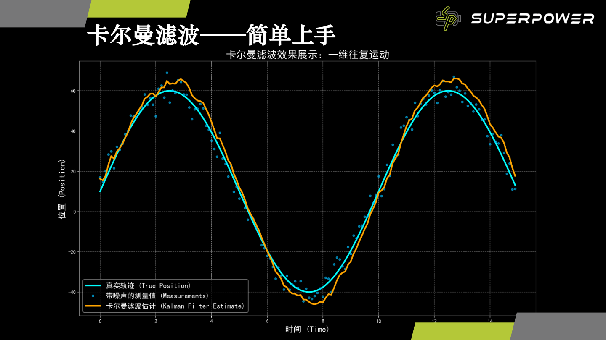

- 自瞄实践中分别拟合 x/y 轴坐标，以及小陀螺目标的真实角速度与真实转动角（拟合角速度围绕真实角速度分布，拟合转动角跟随真实转动角）。

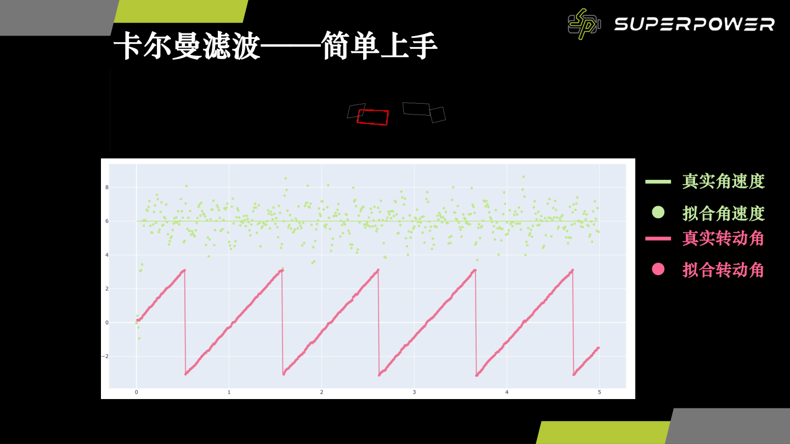

### 5.6 可调参数 P / Q / R

| 参数  | 含义（"我有多相信……"） | 越接近 0 的效果 |
| --- | ------------- | --------- |
| $P$ | 当前状态（初始不确定度）  | 越相信初始值    |
| $Q$ | 预测过程（运动模型）    | 越相信自己的预测  |
| $R$ | 观测（测量值）       | 越相信观测     |

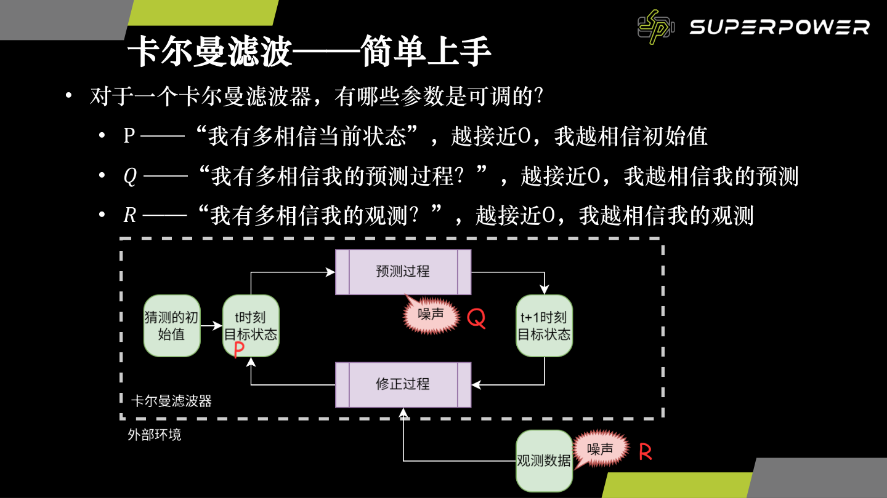

### 5.7 效果评估：卡方检验

如何知道滤波器现在估计得好不好？用卡方检验类指标：

$$
\mathrm{NIS}_{k+1}=d_{k+1}^T S_{k+1}^{-1}d_{k+1} \quad\text{（新息平方，基于观测）}
$$

$$
\mathrm{NEES}_{k+1}=(x_{k+1}-\hat{x}_{k+1})^T P_{k+1}^{-1}(x_{k+1}-\hat{x}_{k+1}) \quad\text{（基于真实状态）}
$$

### 5.8 缺陷与扩展卡尔曼滤波（EKF）

- **两条线性假设**：假设 1 状态转移 $F$ 为线性；假设 2 观测与状态之间为线性关系。
- **缺陷**：机器人运动状态与观测量之间往往非线性，状态转移 $F$ 也可能非线性，普通 KF 不再适用。
- **扩展卡尔曼滤波（EKF）**：非线性情况下 $\hat{x}_{k+1}=\mathcal{F}(\hat{x}_k)$、$\hat{z}_{k+1}=\mathcal{H}(\hat{x}_{k+1})$，通过**泰勒展开线性化近似**，把 $F$、$H$ 替换为 $\mathcal{F}$、$\mathcal{H}$ 的**雅可比矩阵（Jacobian Matrix）**，再沿用 KF 的预测—修正流程。

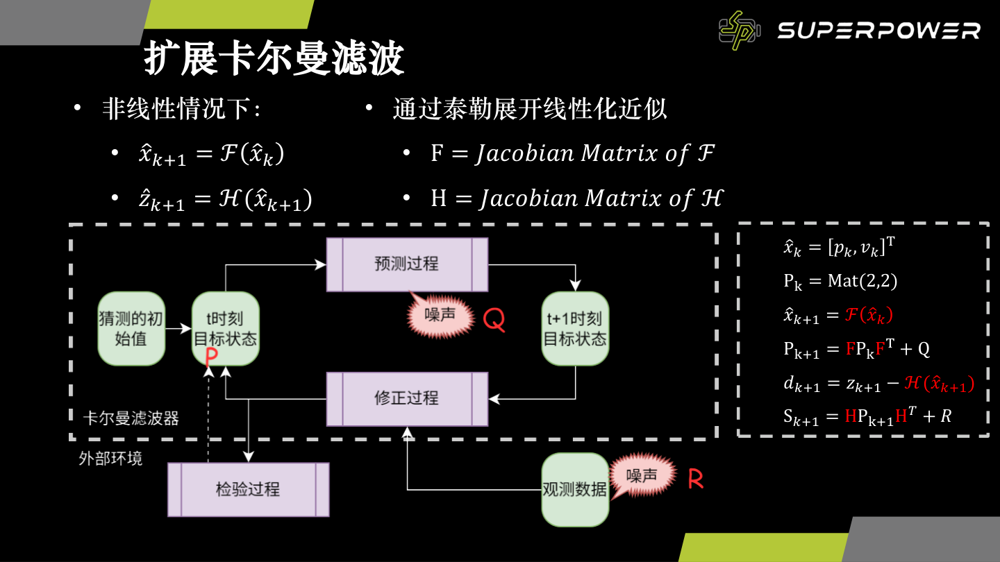

### 5.9 总结与拓展

- 为什么需要它：在噪声环境中估计目标状态；基本原理：建模目标状态，比较预测与观测来修正；调参看 P、Q、R；缺陷是线性假设；EKF 用线性化近似解决非线性。
- 后续还要面对：地面/电机响应/操作手微操扰动、自身运动 + 目标转动 + 目标平动、转动未必匀速等问题，以及在拟合基础上结合预测量制定开火策略。
- 拓展资料：《Kalman-and-Bayesian-Filters-in-Python》中文版 EKF 章节、"How a Kalman Filter Works, in Pictures"、同济 SuperPower `sp_vision_25` 仓库等。

## 附：26赛季视觉组招新大作业

### 任务总览与环境

- 代码位于 `sp_tutorial_26` 仓库的 `final_project` 分支，需用 GitHub 管理自己的代码（在自己 fork 的仓库上通过 New branch 选择上游 `final_project` 完成分支拉取）。
- 调试地点为嘉定校区开物馆地下室，场地提供靶机与机器人；代码 clone/复制到车载计算平台后以个人姓名首字母缩写命名文件夹；每个任务仅有一次正式提交机会，提交后立即记录命中情况与 Plotter 截图。须遵守实验室安全规则（不得擅自操作机器人、不得拆卸、不得更改计算平台系统环境、严禁抄袭他人代码等）。
- 系统交互架构：C 板提供四元数、工业相机提供图片，二者输入"你的程序"，程序回发运动与开火指令。

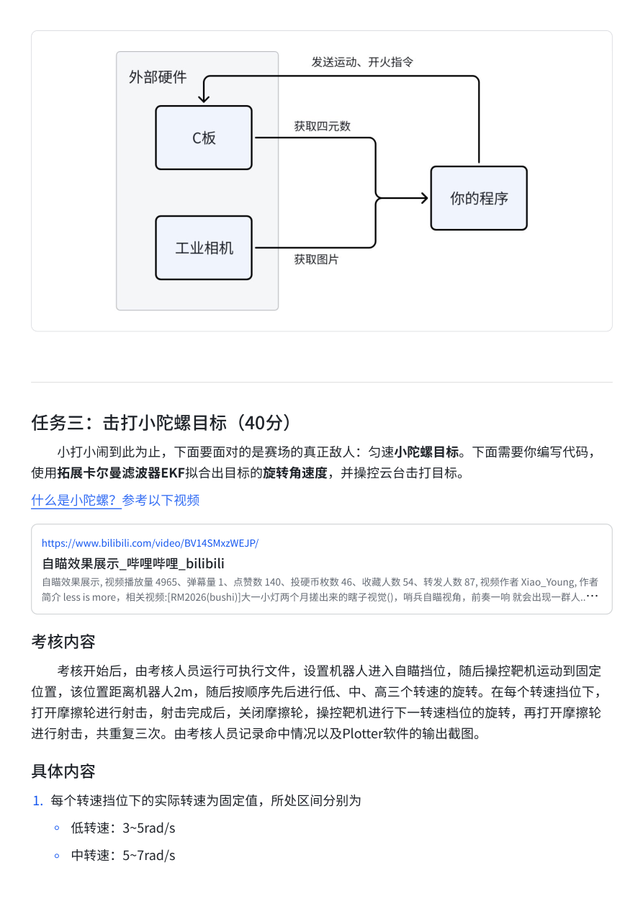

### 任务一：赛前自瞄自检（30 分）

- **目标**：实现简单的云台跟随手持装甲板功能，比赛开场前检查自瞄程序是否正常。
- **考核**：进入自瞄挡位后，考核人员手持装甲板在云台可动范围（yaw 360°，pitch 约 ±20°）内移动，云台持续指向装甲板且无异常运动即通过；由考核人员记录 Plotter 输出截图。
- **要求**：使用 Plotter 类输出发送给云台的控制命令；考核开始后不得改代码、操作机器人。本任务暂不需要卡尔曼滤波，云台基本跟上装甲板运动趋势即可。

### 任务二：击打静止靶（30 分）

- **目标**：操控云台击打三个不同位置的静止装甲板。
- **考核**：靶机在 5 m 范围内随机位置、装甲板正对机器人；单发模式（每发一次 fire 命令只发射一枚弹丸），每个位置限射 10 发，每发 1 分；由考核人员记录命中情况与 Plotter 截图。
- **提示**：较远距离需考虑重力加速度对弹道的影响（可不计空气阻力）；同样用 Plotter 类输出控制命令。

### 任务三：击打小陀螺目标（40 分）

- **目标**：使用**扩展卡尔曼滤波 EKF** 拟合目标旋转角速度，操控云台击打匀速小陀螺目标。
- **考核**：靶机固定在 2 m 处，依次按低、中、高三个转速旋转并各射击一次；每挡限 10 发。
  - 转速区间：低 3~5 rad/s、中 5~7 rad/s、高 8~10 rad/s；
  - 命中分：低/中转速每发 0.3 分、高转速每发 0.4 分，共 10 分；
  - 拟合分 30 分：Plotter 输出 EKF 拟合角速度，误差在容许值内每挡得 10 分——低 ±0.6 rad/s、中 ±1 rad/s、高 ±1.5 rad/s；
  - `tasks` 目录提供含 EKF 完整实现的 target 类，其中需自行设置、调参处以 TODO 注释标出。
- **提示**：可让云台瞄准靶机中心保持静止，判断开火时机实现高效命中。

### 相关类与坐标系

- `io::Gimbal`：与 C 板通信，`q(t)` 获取当前四元数，`send(control, fire, yaw, pitch)` 发送控制命令（yaw/pitch 为世界坐标系绝对值）；
- `io::Camera`：`read(img, timestamp)` 从相机获取图像及时间戳；
- `auto_aim::YOLOV5`：`detect(bgr_img, frame_count)` 识别图像，返回 `Armor` 列表；
- `tools` 目录提供绝大多数数学与调试工具。

**三套坐标系**（单位均为米）：

- **相机坐标系 camera**：与相机刚性连接，原点在镜头光心；实际使用时通过手眼标定获得其原点在云台坐标系中的坐标。

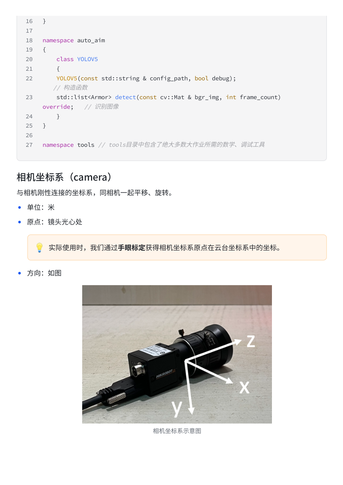

- **云台坐标系 gimbal**：与云台刚性连接，原点为 pitch 轴轴线与 yaw 轴轴线的交点；x 轴为子弹发射方向，y 轴指向操作手视角左侧，z 轴指向操作手视角上面（仅当枪管与底盘平行时 z 轴才与 yaw 轴轴线重合）。
- **世界坐标系 world**：惯性系（空间中静止或匀速、方向不变，满足牛顿第二定律，可用于目标预测）；原点为云台坐标系原点，x 轴为云台上电时初始 x 轴在水平面的投影，z 轴为重力加速度反方向，y 轴由右手直角系确定；可简单理解为"云台水平上电时的初始云台坐标系"。

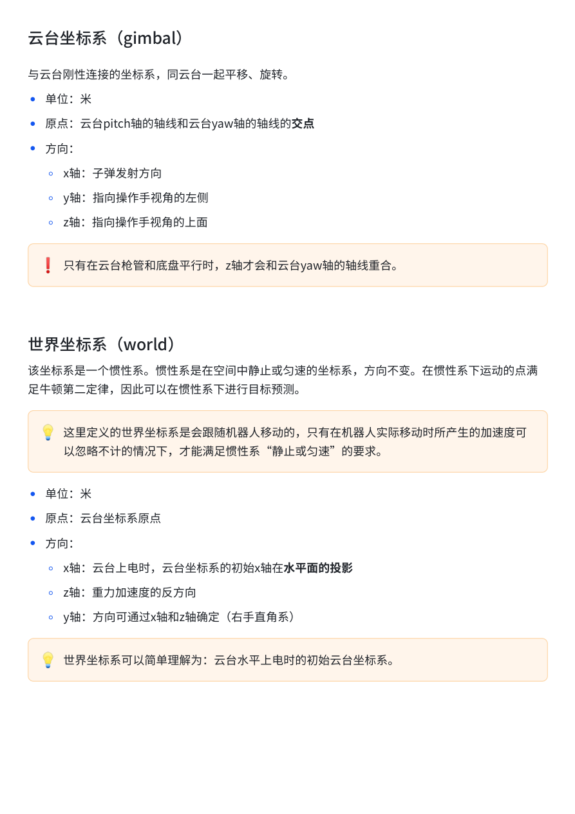

## 附：雷达大作业

### 任务目标与环境

- **概述**：使用提供的 rosbag 跑通 **FAST-LIO 2**（一种 LiDAR-惯性里程计，属 SLAM 算法范畴，以激光雷达和 IMU 数据为输入，同时完成定位与建图），最终提交程序运行时可视化界面截图与最终生成的 3D 点云图。
- **环境要求**：Ubuntu 22.04、ROS 2 Humble。
- 输入数据：国赛哨兵建图时录制的 rosbag（群文件 `rosbag_mapping.zip`），内含 Livox Mid360 三维激光雷达点云与 IMU 输出。
- 代码仓库：`https://github.com/hku-mars/FAST_LIO/`，克隆 ROS 2 版本，按文档完成环境配置与编译。

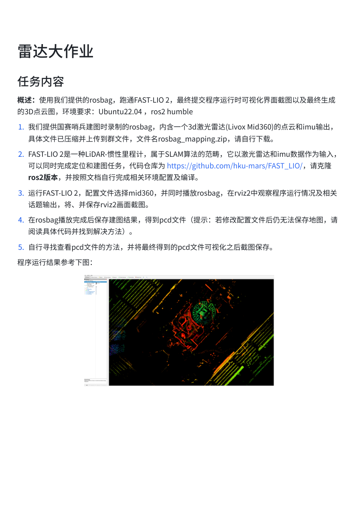

### 步骤与提交内容

1. 运行 FAST-LIO 2，配置文件选择 `mid360`，同时播放 rosbag，在 rviz2 中观察运行情况与话题输出，保存 rviz2 画面截图；
2. rosbag 播放完成后保存建图结果得到 pcd 文件（若改配置仍无法保存地图，需阅读代码自行解决）；
3. 自行寻找查看 pcd 的方法，将最终 pcd 可视化后截图保存。

**注意事项**：以学习态度了解算法全流程，即便未完成建图，提交学习笔记也可接受；考核重点是对 ROS 2 的了解（基本消息、节点间通信方式），面试着重考察对 ROS 2 与本作业算法的理解；使用别人建好的图视为抄袭，直接取消入队资格。

**提交内容**：建图完成的 pcd 文件、程序运行截图、写有完整建图流程（使用的命令、脚本，他人按 readme 可复现）的 `readme.md`，以及可选的学习笔记；与自瞄大作业压缩为一个包一起提交。
